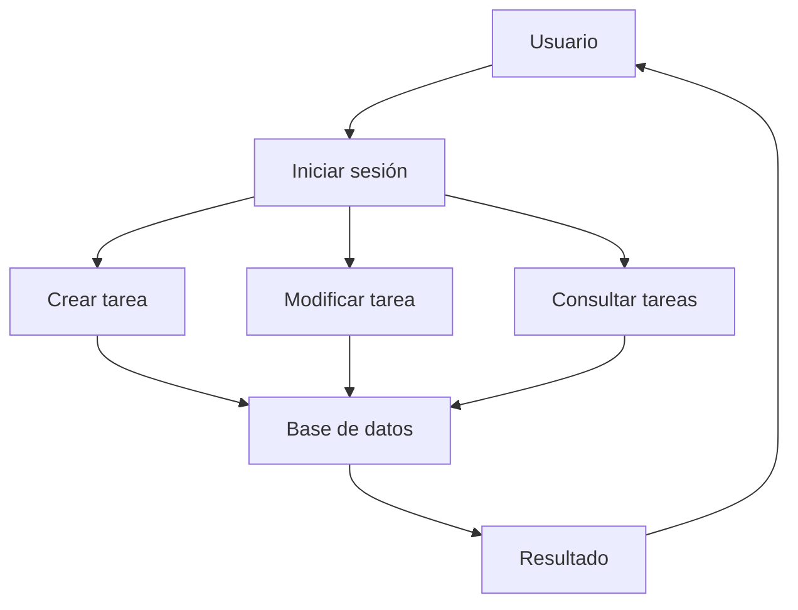

# GestorTareasUniversitarias

## Imagen del proyecto
[Ver imagen del proyecto](https://via.placeholder.com/800x250.png?text=SmartTaskManager)


## Descripción
Este proyecto ha sido desarrollado para practicar programación en Java y la elaboración de documentación técnica mediante Markdown.
La aplicación permite registrar tareas universitarias, organizarlas y consultar cuáles están pendientes.

---
# Índice

- [Características principales](#características-principales)
- [Instalación y configuración](#instalación-y-configuración)
- [Tecnologías utilizadas](#tecnologías-utilizadas)
- [Arquitectura o funcionamiento](#arquitectura-o-funcionamiento)
- [Ejemplos de uso](#ejemplos-de-uso)
- [Información adicional](#información-adicional)
- [Contacto](#contacto)

---
# Características principales

## Funcionalidades

- Crear tareas universitarias.
- Modificar tareas registradas.
- Eliminar tareas finalizadas.
- Organizar actividades por asignaturas.
- Consultar tareas pendientes.

### Detalles

- Gestión de tareas
  - Crear nuevas tareas.
  - Editar tareas existentes.
  - Eliminar tareas finalizadas.

- Gestión de proyectos
  - Asociar tareas a proyectos.
  - Controlar fechas límite.

### Estado de desarrollo

- [x] Gestión básica de tareas
- [x] Gestión de proyectos
- [x] Sistema de prioridades
- [ ] Exportación en PDF
- [ ] Sistema de notificaciones

---

# Instalación y configuración
Sigue los siguientes pasos:

1. Clona el repositorio.
2. Entra en la carpeta del proyecto.
3. Compila el programa.
4. Ejecuta la aplicación.

```bash
git clone https://github.com/ejemplo/SmartTaskManager.git

cd SmartTaskManager

javac Main.java

java Main
```
Configuración mediante la variable:

`DATABASE_URL`
Ejemplo:

```bash
export DATABASE_URL=jdbc:mysql://localhost:3306/tasks
```
---
# Tecnologías utilizadas

| Tecnología | Versión | Descripción | Uso en el proyecto |
|:----------|:-------:|:------------|:------------------|
| **Java** | 21 | Lenguaje principal | Desarrollo de la aplicación |
| **Maven** | 3.9 | Gestión de dependencias | Compilación |
| **MySQL** | 8.0 | Base de datos | Almacenamiento |
| **Git** | 2.x | Control de versiones | Seguimiento del proyecto |

---
# Arquitectura o funcionamiento

La aplicación está dividida en varias partes:

1. Interfaz de usuario.
2. Lógica de negocio.
3. Gestión de datos.
4. Base de datos.

## Diagrama Mermaid

# Ejemplos de uso

## Ejemplo 1: Crear una tarea
```java
Task tarea = new Task(
    "Actividad de Gestion de Proyectos",
    "Completar el README de la practica",
    "ALTA"
);

taskManager.addTask(tarea);
```
taskManager.addTask(tarea);

## Ejemplo 2: Mostrar tareas
```java
for(Task tarea : taskManager.getTasks()){
    System.out.println(tarea);
}
```
## Recursos relacionados
- https://docs.oracle.com/en/java/
- https://docs.github.com/es
- https://maven.apache.org/
---

# Información adicional
>  Se recomienda realizar copias de seguridad periódicas para evitar la pérdida de información.
<details>
<summary>Información técnica adicional</summary>
Durante el desarrollo he intentado organizar el proyecto de forma clara para que sea fácil añadir nuevas funciones en el futuro
</details>

# Contacto
📧 Correo: ruben.cuevas@alumnos.uneatlantico.es

🐙 GitHub: https://github.com/rubencuevas-bit/26-27-igps.git