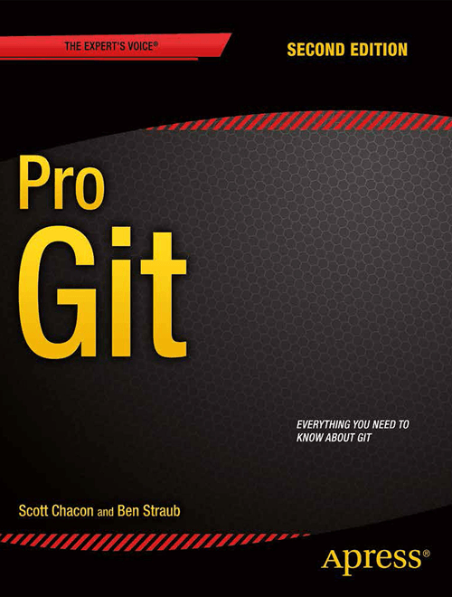
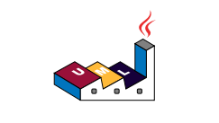

# Bibliografía

---

## 1. GIT

### Libros

#### ProGit by Scott Chacon and Ben Straub [PDF](./libros/progit.pdf) [EPUB](./libros/progit.epub) 

### Enlaces

### Vídeos

---
## 2. Markdown

### Libros

#### The Markdown Guide by Matt Cone [PDF](./libros/The_Markdown_Guide_by_Matt_Cone.pdf)

### Enlaces

### Vídeos

---
## 3. PlantUML

### Libros

#### Guía de Referencia del Lenguaje PlantUML [PDF](./libros/PlantUML_Language_Reference_Guide_es.pdf)

### Enlaces

### Vídeos
