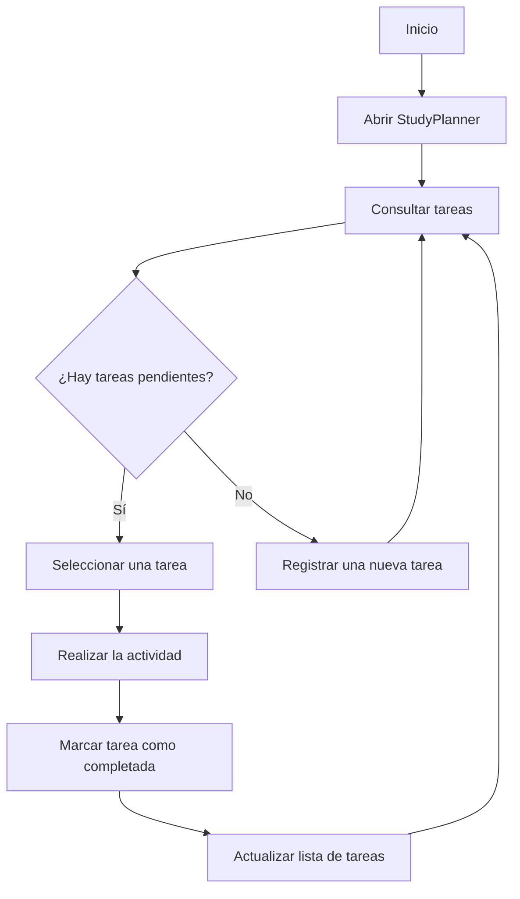

# StudyPlanner


StudyPlanner es un proyecto tecnológico que consiste en una aplicación diseñada para ayudar a los estudiantes a organizar sus actividades académicas de una manera sencilla.

---

## Índice de contenidos

1. [Presentación](#1-presentación)
2. [Características principales](#2-características-principales)
3. [Instalación y configuración](#3-instalación-y-configuración)
4. [Tecnologías utilizadas](#4-tecnologías-utilizadas)
5. [Arquitectura y funcionamiento](#5-arquitectura-y-funcionamiento)
6. [Ejemplos de uso](#6-ejemplos-de-uso)
7. [Información complementaria](#7-información-complementaria)
8. [Identidad del proyecto](#8-identidad-del-proyecto)
9. [Contacto](#9-contacto)

---

## 1. Presentación

### Descripción general

StudyPlanner permite a los estudiantes organizar sus actividades académicas, registrar tareas, consultar actividades pendientes y organizar sus horarios de estudio. Su propósito es ofrecer una herramienta sencilla para mantener la información académica organizada en un solo lugar.

### Objetivo

El objetivo principal de StudyPlanner es facilitar la organización del tiempo y las responsabilidades académicas de los estudiantes.

El proyecto busca resolver problemas habituales como la desorganización, el olvido de fechas de entrega, la acumulación de tareas pendientes y la dificultad para distribuir el tiempo de estudio. Mediante sus funcionalidades, los estudiantes podrán organizar sus actividades, cumplir con sus fechas de entrega y mejorar sus hábitos de estudio.

---

## 2. Características principales

StudyPlanner contará con diferentes funcionalidades que ayudarán a los estudiantes a organizar sus actividades académicas.

### Funcionalidades principales

1. **Registro de tareas:** permite añadir nuevas tareas y trabajos académicos indicando su nombre y descripción.

2. **Control de fechas de entrega:** permite establecer fechas límite para recordar cuándo se deben entregar las actividades.

3. **Organización del horario de estudio:** permite distribuir las horas de estudio y organizar las actividades durante la semana.

4. **Seguimiento de tareas pendientes:** permite consultar las actividades que todavía no se han completado y mantener un control del trabajo pendiente.

5. **Control de tareas completadas:** permite marcar las tareas como completadas y consultar el progreso académico.

### Estado de desarrollo

- [ ] Crear el registro de tareas.
- [ ] Añadir fechas de entrega.
- [ ] Diseñar el horario de estudio.
- [ ] Implementar el seguimiento de tareas pendientes.
- [ ] Permitir marcar las tareas como completadas.

---

## 3. Instalación y configuración

Para consultar y editar los archivos de StudyPlanner, es necesario acceder al repositorio del proyecto y abrirlo utilizando Visual Studio Code.

### Cómo acceder al proyecto

1. Abrir el repositorio del proyecto.
2. Localizar la carpeta de StudyPlanner.
3. Abrir Visual Studio Code.
4. Consultar el archivo `README.md` y la carpeta `images`.
5. Utilizar la vista previa de Markdown para visualizar el documento.
6. Guardar los cambios realizados con `Ctrl + S`.

### Abrir el proyecto desde la terminal

Desde la carpeta principal del repositorio, ejecutar los siguientes comandos:

```bash
cd entregas/alex.salinas/AEC-MD/StudyPlanner/
code .
```

---

## 4. Tecnologías utilizadas

StudyPlanner utiliza diferentes herramientas y tecnologías para desarrollar y documentar el proyecto.

| Tecnología | Versión | Descripción | Uso en el proyecto |
|---|---|---|---|
| Markdown | N/A | Lenguaje de marcado ligero. | Crear y organizar el contenido del archivo README.md mediante títulos, listas, tablas y enlaces. |
| HTML | N/A | Lenguaje de marcado para estructurar contenido. | Crear elementos desplegables mediante details y summary, además de comentarios HTML. |
| Mermaid | N/A | Herramienta para crear diagramas a partir de texto. | Representar visualmente los procesos y el funcionamiento de StudyPlanner. |
| Visual Studio Code | N/A | Editor de código y texto. | Escribir, editar y visualizar la documentación del proyecto. |
| Git | N/A | Sistema de control de versiones. | Registrar los cambios realizados en los archivos del proyecto. |
| GitHub | N/A | Plataforma para alojar repositorios. | Almacenar y compartir el proyecto, además de visualizar su documentación. |

---

## 5. Arquitectura y funcionamiento

StudyPlanner sigue un proceso sencillo para ayudar a los estudiantes a gestionar sus actividades académicas.

El estudiante puede registrar nuevas tareas, añadir sus fechas de entrega y consultar las actividades pendientes. Una vez realizada una actividad, puede marcarla como completada para mantener actualizado su progreso.

### Diagrama de funcionamiento



---

## 6. Ejemplos de uso

Los siguientes ejemplos muestran cómo se podrían representar las tareas dentro de StudyPlanner.

### Registrar una tarea

Este ejemplo representa el registro de un trabajo de programación que todavía está pendiente.

```json
{
  "tarea": "Trabajo de programación",
  "descripcion": "Realizar los ejercicios de clase",
  "fecha_entrega": "2026-11-15",
  "estado": "Pendiente"
}
```

### Marcar una tarea como completada

Después de realizar la actividad, su estado puede actualizarse a completada.

```json
{
  "tarea": "Trabajo de programación",
  "descripcion": "Realizar los ejercicios de clase",
  "fecha_entrega": "2026-11-15",
  "estado": "Completada"
}
```

### Recursos relacionados

Para consultar información sobre las herramientas utilizadas en la documentación:

- [Clase 7 - Introducción a Markdown](https://github.com/alexsalinas-cell/IGPS/blob/main/temario/4-markdown/clase-7-markdown-introduccion.md)
- [Clase 8 - Markdown avanzado](https://github.com/alexsalinas-cell/IGPS/blob/main/temario/4-markdown/clase-8-markdown-avanzado.md)

---

## 7. Información complementaria

> **Nota importante:** Es recomendable actualizar las tareas y sus fechas de entrega con frecuencia para mantener una buena organización y evitar olvidar actividades académicas.

### Posibles mejoras futuras

StudyPlanner busca facilitar la vida académica de los estudiantes.

Entre sus posibles mejoras futuras se encuentran:

<details>
<summary>Más información sobre StudyPlanner</summary>

- Añadir recordatorios de fechas de entrega.
- Incorporar un calendario académico.
- Permitir organizar las tareas por asignaturas.
- Mostrar el progreso de las actividades completadas.

</details>

<!-- Este comentario HTML no aparecerá en la visualización del documento. -->

---

## 8. Identidad del proyecto

### Estado y documentación


### Elementos visuales

📚 StudyPlanner: una herramienta para organizar las actividades académicas.

### Caracteres especiales en Markdown

Markdown permite mostrar caracteres especiales sin que se interpreten como formato.

- `\*Texto\*` permite mostrar los asteriscos literalmente.
- `\# Título` permite mostrar el símbolo numeral sin crear un encabezado.
- `\*StudyPlanner\*` permite mostrar el nombre del proyecto entre asteriscos.

---

## 9. Contacto


**Desarrollador:** Alex Sebastián Salinas Valarezo

**Correo electrónico:** alex.salinas@alumnos.uneatlantico.es

**Repositorio:** [GitHub](https://github.com/alexsalinas-cell/IGPS)

---

**StudyPlanner - Organiza tus tareas, mejora tu tiempo y alcanza tus objetivos académicos.** 📚