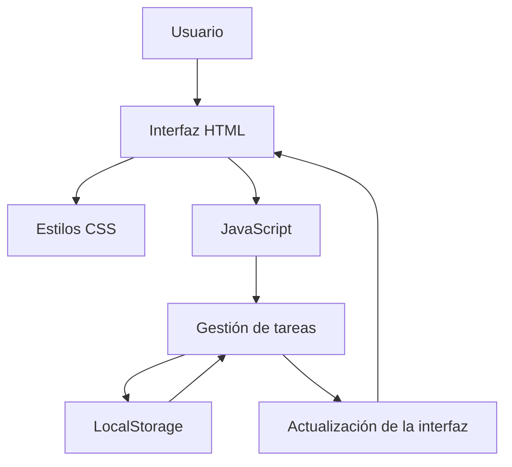
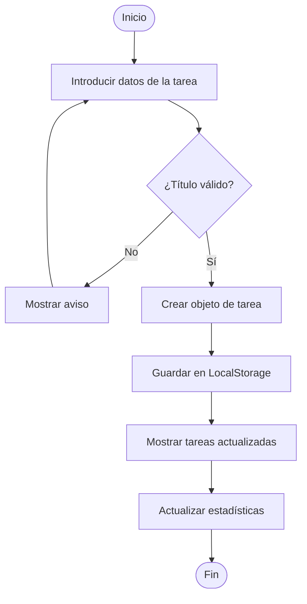
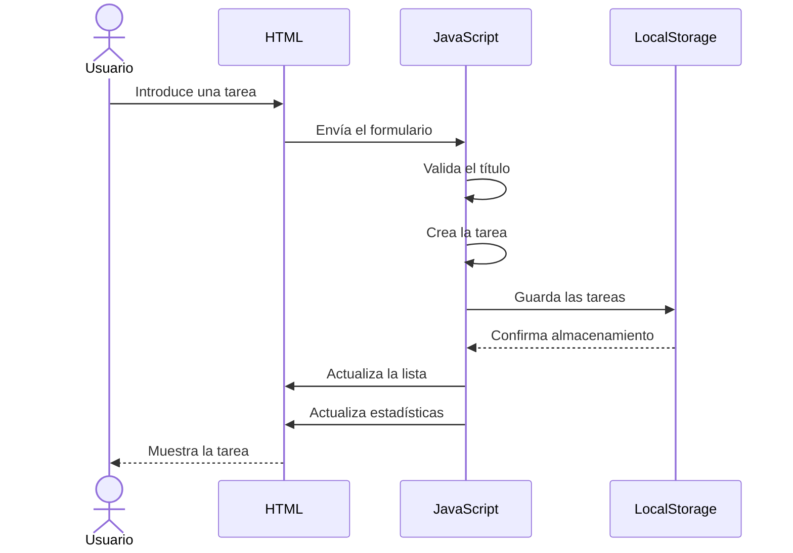

# 🚀 TaskFlow

### Aplicación web para la gestión y organización de tareas personales


---

<a id="presentacion"></a>
## 1. Presentación del proyecto

**TaskFlow** es una aplicación web de productividad desarrollada para facilitar la organización de tareas y actividades personales. Permite crear actividades, asignar prioridades, establecer fechas límite y controlar el progreso de cada tarea desde una interfaz sencilla e intuitiva.

### Objetivo principal

Proporcionar una herramienta digital que ayude a los usuarios a organizar sus responsabilidades, administrar mejor su tiempo y llevar un seguimiento de sus actividades.

### Problema que pretende resolver

La falta de organización puede provocar olvidos, retrasos y dificultades para gestionar las responsabilidades diarias. TaskFlow centraliza las tareas en una única interfaz, facilitando su administración y seguimiento.

### Imagen representativa


*Panel principal de la aplicación TaskFlow.*

---

<a id="indice"></a>
## 2. Índice de contenidos

| Apartado | Contenido |
|:---|:---|
| 1. | [Presentación del proyecto](#presentacion) |
| 2. | [Índice de contenidos](#indice) |
| 3. | [Características principales](#caracteristicas) |
| 4. | [Instalación y configuración](#instalacion) |
| 5. | [Tecnologías utilizadas](#tecnologias) |
| 6. | [Arquitectura y funcionamiento](#arquitectura) |
| 7. | [Ejemplos de uso](#ejemplos) |
| 8. | [Información adicional](#informacion) |
| 9. | [Elementos visuales y avanzados](#elementos) |

---

<a id="caracteristicas"></a>
## 3. Características principales

TaskFlow incorpora las siguientes funcionalidades:

1. **Creación de tareas:** permite registrar nuevas actividades mediante un formulario.
2. **Edición de tareas:** permite modificar el título y la descripción de una actividad existente.
3. **Eliminación de tareas:** permite eliminar actividades mediante una confirmación.
4. **Gestión de prioridades:** permite clasificar las tareas en tres niveles:
   - Alta.
   - Media.
   - Baja.
5. **Fechas límite:** permite establecer una fecha para cada actividad.
6. **Control de progreso:** permite marcar tareas como completadas o volver a abrirlas.
7. **Estadísticas:** muestra el número total de tareas, las pendientes y las completadas.
8. **Almacenamiento local:** conserva las tareas utilizando `LocalStorage` del navegador.

### Estado de las funcionalidades

| Funcionalidad | Estado |
|:---|:---:|
| Crear tareas | ✅ |
| Editar tareas | ✅ |
| Eliminar tareas | ✅ |
| Asignar prioridades | ✅ |
| Establecer fechas | ✅ |
| Completar y reabrir tareas | ✅ |
| Actualizar estadísticas | ✅ |
| Guardar información localmente | ✅ |

---

<a id="instalacion"></a>
## 4. Instalación y configuración

TaskFlow es una aplicación web desarrollada con tecnologías estándar. No necesita servidores externos, bases de datos ni instalaciones de dependencias para su funcionamiento básico.

### Requisitos previos

- Un ordenador con Windows, Linux o macOS.
- Un navegador web actualizado.
- Git para descargar el repositorio (opcional).
- Un editor de código, como Visual Studio Code (recomendado).

### Procedimiento de instalación

**1. Clonar el repositorio:**

```bash
git clone https://github.com/carlosproano-web/IGPS.git
```

**2. Acceder a la carpeta del proyecto:**

```bash
cd IGPS/entregas/carlos.proano/AEC-MD
```

**3. Abrir el archivo principal:**

Localizar el archivo `index.html` y abrirlo en el navegador web.

También se puede abrir la carpeta del proyecto con Visual Studio Code:

```bash
code .
```

**4. Utilizar la aplicación:**

Una vez abierta la página, se puede comenzar a crear, modificar y administrar tareas.

### Configuración

Los archivos principales se encuentran organizados de la siguiente manera:

```text
AEC-MD/
├── README.md
├── index.html
├── styles.css
├── app.js
└── imagenes/
    └── taskflow.png
```

No es necesario realizar una compilación ni instalar paquetes adicionales.

---

<a id="tecnologias"></a>
## 5. Tecnologías utilizadas

TaskFlow utiliza cuatro tecnologías principales:

| Tecnología | Versión | Descripción | Uso en el proyecto |
|:---|:---|:---|:---|
| HTML | HTML5 | Lenguaje de marcado web. | Estructura de la aplicación. |
| CSS | CSS3 | Lenguaje de estilos. | Diseño, colores y adaptación visual. |
| JavaScript | ECMAScript 2015+ | Lenguaje de programación. | Lógica e interacción. |
| Web Storage API | HTML Living Standard | API de almacenamiento del navegador. | Persistencia mediante LocalStorage. |

### Herramientas de desarrollo

- **Visual Studio Code:** editor utilizado para desarrollar los archivos.
- **Google Chrome:** navegador utilizado para probar la aplicación.
- **Git y GitHub:** herramientas utilizadas para el control de versiones y la entrega.

---

<a id="arquitectura"></a>
## 6. Arquitectura y funcionamiento

TaskFlow utiliza una arquitectura sencilla basada en el modelo cliente, donde el navegador ejecuta la aplicación y conserva los datos localmente.

### Componentes principales

| Componente | Responsabilidad |
|:---|:---|
| `index.html` | Organiza los elementos de la interfaz. |
| `styles.css` | Define la presentación visual. |
| `app.js` | Gestiona las operaciones y la lógica de las tareas. |
| `LocalStorage` | Guarda las tareas en el navegador. |

### Diagrama de arquitectura



### Diagrama de flujo: creación de una tarea



### Diagrama de secuencia



### Funcionamiento del almacenamiento

Las tareas se mantienen en un array de JavaScript. Cuando se produce un cambio, los datos se convierten a formato JSON y se guardan en el almacenamiento local del navegador.

---

<a id="ejemplos"></a>
## 7. Ejemplos de uso

### Ejemplo 1. Crear una tarea

El usuario introduce un título, una descripción, una prioridad y una fecha límite. Al enviar el formulario, JavaScript crea un objeto y lo incorpora a la lista.

```javascript
const newTask = {
    id: Date.now(),
    title: taskTitle.value.trim(),
    description: taskDescription.value.trim(),
    priority: taskPriority.value,
    date: taskDate.value,
    completed: false
};

tasks.push(newTask);

saveTasks();
renderTasks();
```

**Resultado:** la nueva actividad aparece en la lista y las estadísticas se actualizan.

### Ejemplo 2. Completar una tarea

El usuario pulsa el botón «Completar». La aplicación cambia el estado de la actividad y actualiza la información almacenada.

```javascript
function toggleTask(id) {
    tasks = tasks.map(function(task) {
        if (task.id === id) {
            return {
                ...task,
                completed: !task.completed
            };
        }

        return task;
    });

    saveTasks();
    renderTasks();
}
```

**Resultado:** la tarea pasa al estado completado. También puede volver a abrirse mediante el mismo botón.

### Ejemplo 3. Eliminar una tarea

El usuario selecciona el botón «Eliminar» y confirma la operación.

```javascript
tasks = tasks.filter(function(task) {
    return task.id !== id;
});

saveTasks();
renderTasks();
```

**Resultado:** la tarea desaparece de la lista y se actualizan los contadores.

### Documentación técnica relacionada

- [Documentación HTML - MDN](https://developer.mozilla.org/es/docs/Web/HTML)
- [Documentación CSS - MDN](https://developer.mozilla.org/es/docs/Web/CSS)
- [Documentación JavaScript - MDN](https://developer.mozilla.org/es/docs/Web/JavaScript)
- [Web Storage API - MDN](https://developer.mozilla.org/es/docs/Web/API/Web_Storage_API)

---

<a id="informacion"></a>
## 8. Información adicional

### Recomendación

> 💡 **Nota importante:** se recomienda utilizar TaskFlow en el mismo navegador y perfil de usuario donde se crearon las tareas, ya que la información se almacena localmente y no se sincroniza con otros dispositivos.

### Información desplegable

<details>
<summary>Detalles técnicos del almacenamiento</summary>

TaskFlow utiliza `LocalStorage` para guardar los datos de las tareas.

Los objetos se transforman en cadenas JSON mediante `JSON.stringify()` y se recuperan mediante `JSON.parse()`.

La información permanece almacenada en el navegador mientras no se borren los datos correspondientes del almacenamiento local.

</details>

### Limitaciones conocidas

- No dispone de cuentas de usuario.
- No sincroniza los datos entre dispositivos.
- La información depende del almacenamiento local del navegador.
- No requiere conexión a una base de datos externa.

### Contacto

Para consultas relacionadas con el proyecto:

- **Proyecto:** TaskFlow.
- **Desarrollador:** Carlos Proaño.
- **Repositorio:** [GitHub - IGPS](https://github.com/carlosproano-web/IGPS).
- **Correo de ejemplo:** [taskflow.demo@example.com](mailto:taskflow.demo@example.com).

---

<a id="elementos"></a>
## 9. Elementos visuales y avanzados

### Badges del proyecto


### Emoji

📋 TaskFlow facilita la organización diaria y ayuda a mantener un seguimiento de las actividades.

### Separación de secciones

La línea horizontal se utiliza para dividir los diferentes apartados del documento.

---

### Caracteres especiales escapados

Ejemplos de caracteres especiales en Markdown:

- Asteriscos: \*texto entre asteriscos\*
- Barra vertical: HTML \| CSS \| JavaScript
- Corchetes: \[ejemplo\]

Estos caracteres pueden mostrarse literalmente utilizando la barra invertida `\`.

---

## Conclusión

TaskFlow representa una solución sencilla y funcional para la gestión de actividades personales. Mediante HTML, CSS, JavaScript y LocalStorage, proporciona herramientas para organizar tareas, establecer prioridades, controlar su estado y conservar la información en el navegador.

El proyecto también permite aplicar conocimientos de desarrollo web y documentar su funcionamiento utilizando Markdown, diagramas Mermaid, tablas, enlaces, bloques de código y elementos HTML.

---

*Documentación elaborada como parte de la Actividad de Evaluación Continua de Markdown.*

<!-- Fin del documento README.md de TaskFlow. Este comentario no aparece en la visualización. -->
