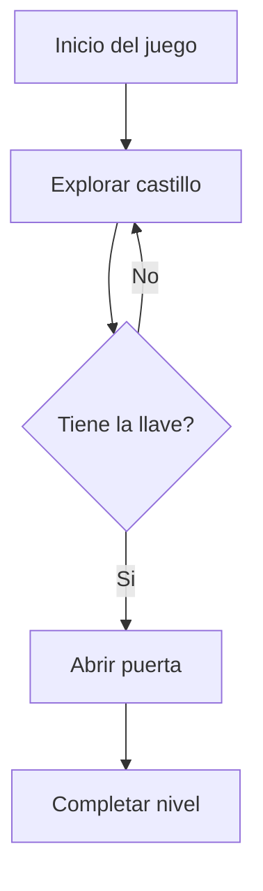

 # **MonkeyEscape**

## **Descripcion**

**MonkeyEscape** es un videojuego de plataforma 2D donde el jugador toma control de un mono y debe explorar y avanzar en un castillo. 

El jugador debe explorar el castillo, buscando llaves y saltando en plataformas para encontrar la salida. 

## **Objetivo**

El objetivo de MonkeyEscape es crear un juego de plataforma entretendio para jugador, que permita que permita practicar conceptos basicos de programacion y diseno de videojuegos. 

 **Movimiento**
- El personaje se pdora mover a cuatro direcciones
- El jugador podra saltar en plataformas para explorar los niveles.

 **Combate** 
- Los enemigos tendran 1 punto de vida. 
- El Jugador tendra que atacar sus puntos deviles 
- El jugador podra attacar a 4 direcciones. 

 **Exploracion** 
- Los niveles tendran puertas que lleven a otros niveles.
- Algunas puertas necesitaran llaves. 

 **Objetos**
   - Llaves para abrir puertas.
   - Bananas para recuperar salud.
   - Monedas para aumentar la puntuación.

  **Sistema de niveles**
   - El jugador debera encontrar la salida.
   - Cada nivel tendra una dificultad mayor.


   ## Instalacion y Configuracion 

MonkeyEscape es un videojuego 2D que se podrá descargar y jugar desde un ordenador.

### Instalación

1. Entrar en la página del proyecto.
2. Descargar el archivo del videojuego.
3. Descomprimir la carpeta descargada.
4. Abrir la carpeta del juego.
5. Ejecutar el archivo **MonkeyEscape.exe**.

### Configuración

Los controles del videojuego serán:

- **W**: Moverse hacia arriba.
- **A**: Moverse hacia la izquierda.
- **S**: Moverse hacia abajo.
- **D**: Moverse hacia la derecha.
- **Espacio**: Atacar.

## Tecnologías utilizadas

Para el desarrollo de Dungeon Escape se propone utilizar las siguientes tecnologías:

| Tecnología | Versión | Descripción | Uso en el proyecto |
|:-----------|:-------:|:------------|-------------------:|
| **Godot** | 4.x | Motor para crear videojuegos. | Desarrollo del juego 2D. |
| **GDScript** | 4.x | Lenguaje de programación de Godot. | Programar movimientos y enemigos. |
| *Aseprite* | 1.3 | Programa para crear dibujos pixel art. | Diseñar personajes y escenarios. |
| `Git` | 2.x | Herramienta de control de versiones. | Guardar los cambios del proyecto. |


## Arquitectura o funcionamiento

MonkeyEscape es un videojuego 2D donde el jugador debe explorar una castillo y encontrar la salida.

El funcionamiento básico del juego es el siguiente:

1. El jugador inicia una partida.
2. Explora la mazmorra y busca una llave.
3. Si encuentra la llave, puede abrir la puerta.
4. Si no tiene la llave, debe continuar explorando.
5. Al abrir la puerta, completa el nivel.

### Diagrama de flujo




## Ejemplos de uso

A continuación se muestran dos ejemplos de cómo se jugaría MonkeyEscape.

### Ejemplo 1: Mover al personaje

El jugador puede explorar el castillo utilizando las teclas del teclado.

Los controles principales son:

```text
W = Mover hacia arriba
A = Mover hacia la izquierda
S = Mover hacia abajo
D = Mover hacia la derecha
Espacio = Atacar
```

### Ejemplo 2: Encontrar una llave

El jugador debe encontrar una llave para abrir la puerta y completar el nivel.

Un ejemplo de los mensajes que podrían aparecer durante el juego sería:

```text
Jugador encuentra una puerta.
La puerta está cerrada.
Jugador recoge una llave.
Jugador abre la puerta.
Nivel completado.
```


## Información adicional


### Nota importante

> **Nota:** MonkeyEscape es un proyecto ficticio creado para practicar Markdown. El videojuego todavia no estaa desarrollado.


### Preguntas frecuentes

<details>
<summary>¿En qué plataformas estará disponible?</summary>

El videojuego está pensado para ordenadores Windows.

</details>

<details>
<summary>¿Se podrá jugar sin conexión a internet?</summary>

Sí, la idea es que el videojuego pueda funcionar sin conexión a internet.

</details>

### Contacto
:smile:
 Para obtener mas informacion sobre el proyecto:

- **Correo electrónico:** [contacto@ejemplo.com](mailto:contacto@ejemplo.com)
- **Página del proyecto:** [GitHub

## Elementos visuales y avanzados
\*MonkeyEscape\*
\# MonkeyEscape


### Indice de Contenido

- [Descripcion](#descripcion)


- [Elementos visuales y avanzados](#elementos-visuales-y-avanzados)

##