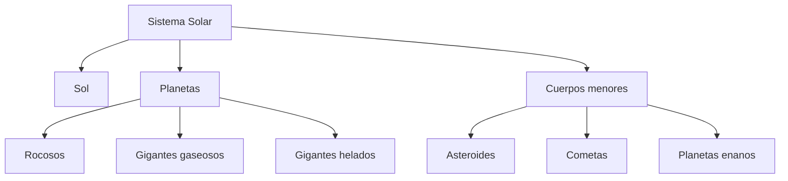
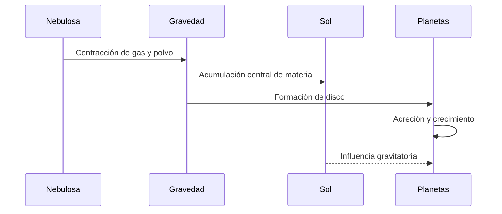

# 🪐 Artículo 1: El Sistema Solar

**Navegación:** [🏠 Inicio](index.md) > Astronomía > Sistema Solar

**Fecha de creación:** 04/11/2026  
**Última actualización:** 04/11/2026  
**Tiempo de lectura:** 10 minutos  
**Etiquetas:** `Astronomía` `Planetas` `Sol` `Espacio`

---

## 📑 Tabla de contenidos

1. [Introducción](#introducción)
2. [Origen del Sistema Solar](#origen-del-sistema-solar)
3. [El Sol](#el-sol)
4. [Los planetas](#los-planetas)
5. [Otros cuerpos celestes](#otros-cuerpos-celestes)
6. [Diagramas](#diagramas)
7. [Conclusiones](#conclusiones)
8. [Notas y referencias](#notas-y-referencias)

---

## Introducción

El Sistema Solar es uno de los sistemas planetarios más estudiados por la humanidad. Está formado por el Sol y todos los objetos que permanecen bajo su influencia gravitatoria, incluyendo ocho planetas, planetas enanos, satélites naturales, asteroides, cometas y partículas de polvo espacial.

Nuestro planeta, la Tierra, forma parte de este sistema y ocupa una posición privilegiada para la existencia de vida tal como la conocemos.

Desde hace miles de años, diferentes civilizaciones han observado el movimiento de los planetas y las estrellas para comprender el cielo. Los antiguos griegos desarrollaron modelos astronómicos, mientras que científicos como Nicolás Copérnico, Galileo Galilei y Johannes Kepler contribuyeron a transformar nuestra comprensión del universo.

Actualmente, gracias a los telescopios y las misiones espaciales, sabemos que el Sistema Solar se formó hace aproximadamente 4.600 millones de años a partir de una nube de gas y polvo.

El estudio del Sistema Solar es fundamental porque permite comprender el origen de nuestro planeta, los fenómenos astronómicos y las condiciones necesarias para la existencia de vida.

Además, conocer sus características ayuda a los científicos a comparar nuestro entorno con otros sistemas planetarios de la galaxia.

Esta información está relacionada con el estudio de las [estrellas](articulo-2.md), las [galaxias](articulo-3.md) y los [exoplanetas](articulo-5.md).

---

## Origen del Sistema Solar

### 1. La nebulosa solar

La teoría más aceptada indica que el Sistema Solar comenzó como una enorme nube de gas y polvo denominada **nebulosa solar**.

La gravedad provocó que parte de esta nube comenzara a contraerse.

### 2. Formación del Sol

En el centro de la nube se acumuló la mayor parte de la materia.

La temperatura y presión aumentaron hasta que comenzaron las reacciones de fusión nuclear.

De esta manera nació el Sol.

### 3. Formación de los planetas

El material restante formó un disco alrededor del Sol.

Las partículas comenzaron a unirse mediante colisiones, originando cuerpos cada vez mayores.

Este proceso se denomina *acreción*.

> El Sistema Solar se formó aproximadamente hace 4.600 millones de años.

### 4. Evolución del sistema

Con el paso de millones de años, los planetas alcanzaron órbitas relativamente estables.

Los restos de material dieron origen a otros cuerpos menores.

**Fuente:** NASA [1].

---

## El Sol

### 1. Características principales

El Sol es una estrella de tipo G situada en el centro del Sistema Solar.

Contiene aproximadamente el 99,8 % de la masa total del sistema.

Su gravedad mantiene a los planetas orbitando a su alrededor.

### 2. Producción de energía

El Sol produce energía mediante la **fusión nuclear**.

En su núcleo, el hidrógeno se transforma principalmente en helio, liberando enormes cantidades de energía.

Esta energía viaja hasta la Tierra en forma de radiación.

### 3. Importancia para la vida

La energía solar permite mantener temperaturas adecuadas para numerosos ecosistemas.

También impulsa procesos como:

- La fotosíntesis.
- El ciclo del agua.
- La circulación atmosférica.
- La regulación de numerosos procesos naturales.

### 4. Estructura solar

Las principales regiones del Sol incluyen:

- Núcleo.
- Zona radiativa.
- Zona convectiva.
- Fotosfera.
- Cromosfera.
- Corona.

> Sin la energía del Sol, la vida terrestre como la conocemos no podría mantenerse.

**Fuente:** NASA [2].

---

## Los planetas

### 1. Planetas rocosos

Los cuatro planetas interiores son:

- Mercurio.
- Venus.
- Tierra.
- Marte.

Se caracterizan por poseer superficies sólidas.

### 2. Gigantes gaseosos

Júpiter y Saturno son gigantes gaseosos.

Están compuestos principalmente de hidrógeno y helio.

Júpiter es el planeta más grande del Sistema Solar.

### 3. Gigantes helados

Urano y Neptuno pertenecen a la categoría de gigantes helados.

Poseen importantes cantidades de sustancias como agua, amoníaco y metano en su composición interna.

### 4. Comparación planetaria

| Planeta | Tipo | Satélites naturales | Posición |
|:---|:---:|---:|---:|
| Mercurio | Rocoso | 0 | 1 |
| Venus | Rocoso | 0 | 2 |
| Tierra | Rocoso | 1 | 3 |
| Marte | Rocoso | 2 | 4 |
| Júpiter | Gigante gaseoso | Numerosos | 5 |
| Saturno | Gigante gaseoso | Numerosos | 6 |
| Urano | Gigante helado | Numerosos | 7 |
| Neptuno | Gigante helado | Numerosos | 8 |

### Datos de los planetas

| Planeta | Distancia media al Sol (UA) | Duración aproximada del año |
|---|---:|---|
| Mercurio | 0,39 | 88 días |
| Venus | 0,72 | 225 días |
| Tierra | 1,00 | 365 días |
| Marte | 1,52 | 687 días |
| Júpiter | 5,20 | 11,9 años |
| Saturno | 9,58 | 29,4 años |
| Urano | 19,2 | 84 años |
| Neptuno | 30,1 | 165 años |

**UA** significa *unidad astronómica*.

Una UA equivale aproximadamente a la distancia media entre la Tierra y el Sol.

Puedes consultar su definición en el [glosario](glosario.md).

**Fuente:** NASA [1].

---

## Otros cuerpos celestes

### 1. Asteroides

Los asteroides son cuerpos rocosos que orbitan el Sol.

Muchos se encuentran en el cinturón de asteroides entre Marte y Júpiter.

### 2. Cometas

Los cometas están formados principalmente por materiales helados, polvo y roca.

Cuando se acercan al Sol, algunos desarrollan una atmósfera temporal y colas visibles.

### 3. Planetas enanos

Los planetas enanos orbitan el Sol y poseen suficiente gravedad para adoptar una forma aproximadamente redondeada.

Sin embargo, no han despejado su región orbital de otros objetos.

Algunos ejemplos son:

- Plutón.
- Ceres.
- Eris.
- Haumea.
- Makemake.

### 4. Satélites naturales

Son cuerpos que orbitan planetas u otros objetos mayores.

Un ejemplo es la Luna, el satélite natural de la Tierra.

> Los planetas no son los únicos objetos importantes del Sistema Solar: los asteroides y cometas también conservan información sobre su origen.

---

## Diagramas

### Diagrama 1: Estructura conceptual

### Diagrama 2: Proceso de formación

---

## 💡 Información adicional

Información adicional

El Sistema Solar se encuentra en la galaxia Vía Láctea y tarda aproximadamente 230 millones de años en completar una órbita alrededor del centro galáctico.

Consulta el artículo sobre [galaxias](articulo-3.md).

Ejemplo detallado

La Tierra tarda aproximadamente 365,25 días en completar una vuelta alrededor del Sol.

Por eso, nuestro calendario utiliza años de 365 días y añade días adicionales según las reglas de los años bisiestos.

Datos históricos

En 1543, Nicolás Copérnico publicó su modelo heliocéntrico, que situaba al Sol cerca del centro del sistema planetario.

Posteriormente, las observaciones de Galileo y las leyes de Kepler ayudaron a consolidar esta transformación científica.

---

## ⚠️ Alertas importantes

> [!NOTE]
> El Sol es una estrella, no un planeta.

> [!IMPORTANT]
> Desde 2006, Plutón está clasificado como planeta enano por la Unión Astronómica Internacional.

> [!TIP]
> Para recordar el orden de los planetas, memoriza primero los cuatro interiores y después los cuatro exteriores.

---

## Conclusiones

El Sistema Solar constituye nuestro entorno astronómico y ofrece información fundamental sobre el origen de la Tierra.

| Elemento | Importancia | Conclusión |
|---|---|---|
| Sol | Fuente principal de energía | Mantiene unido gravitacionalmente el sistema |
| Planetas | Diversidad de mundos | Permiten estudiar distintas condiciones físicas |
| Asteroides | Material antiguo | Ayudan a investigar el origen del sistema |
| Cometas | Materiales helados | Conservan pistas de etapas tempranas |
| Satélites | Mundos secundarios | Algunos pueden tener océanos internos |

La exploración científica continúa aumentando nuestro conocimiento sobre estos objetos.

Para comprender mejor este tema, es importante estudiar también las estrellas y los sistemas planetarios extrasolares.

---

## Notas y referencias

[1] NASA. (s. f.). *Solar System Exploration*.  
https://science.nasa.gov/solar-system/

[2] NASA. (s. f.). *Sun*.  
https://science.nasa.gov/sun/

[3] Encyclopaedia Britannica. (s. f.). *Solar System*.  
https://www.britannica.com/science/solar-system

Consulta también la [bibliografía general](referencias.md).

---

## 🌐 Explora todos los artículos

| Artículo | Enlace |
|---|---|
| 🪐 Sistema Solar | [Leer](articulo-1.md) |
| ⭐ Estrellas | [Leer](articulo-2.md) |
| 🌌 Galaxias | [Leer](articulo-3.md) |
| 🚀 Exploración espacial | [Leer](articulo-4.md) |
| 🔭 Exoplanetas | [Leer](articulo-5.md) |

---
## 🔗 Ver también

- [⭐ Estrellas](articulo-2.md)
- [🌌 Galaxias](articulo-3.md)
- [🚀 Exploración espacial](articulo-4.md)
- [🔭 Exoplanetas](articulo-5.md)
- [📖 Glosario](glosario.md)

---

[← Anterior: Inicio](index.md) | [Siguiente: Estrellas →](articulo-2.md)

[↑ Volver arriba](#inicio)

---

**Autor:** Daniel Godefroy  
**Cosmos Wiki © 2026**
