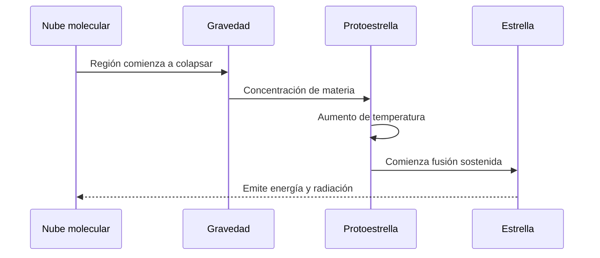

# ⭐ Artículo 2: Las estrellas y su ciclo de vida

**Navegación:** [🏠 Inicio](index.md) > Astronomía > Estrellas

**Fecha de creación:** 04/11/2026  
**Última actualización:** 04/11/2026  
**Tiempo de lectura:** 10 minutos  
**Etiquetas:** `Astronomía` `Estrellas` `Fusión nuclear` `Supernovas`

---

## 📑 Tabla de contenidos

1. [Introducción](#introducción)
2. [Formación de las estrellas](#formación-de-las-estrellas)
3. [Características y clasificación](#características-y-clasificación)
4. [Ciclo de vida de una estrella](#ciclo-de-vida-de-una-estrella)
5. [Importancia de las estrellas](#importancia-de-las-estrellas)
6. [Diagramas](#diagramas)
7. [Conclusiones](#conclusiones)
8. [Notas y referencias](#notas-y-referencias)

---

## Introducción

Las estrellas son enormes esferas de plasma que producen energía mediante procesos de fusión nuclear en su interior. Constituyen algunos de los objetos más importantes del universo, ya que proporcionan energía, participan en la formación de elementos químicos y permiten estudiar la evolución de las galaxias.

La estrella más cercana a nuestro planeta es el Sol, situado en el centro del [Sistema Solar](articulo-1.md). Aunque desde la Tierra parece mucho más grande y brillante que las demás estrellas, esto se debe principalmente a su cercanía.

Desde tiempos antiguos, la humanidad ha observado las estrellas para orientarse, establecer calendarios y explicar fenómenos naturales. Civilizaciones como la egipcia, la griega y la mesopotámica utilizaron las posiciones de los astros para organizar actividades agrícolas y desarrollar conocimientos astronómicos.

Con la invención del telescopio y el desarrollo de la física moderna, los científicos descubrieron que las estrellas nacen, evolucionan y finalmente llegan al final de sus vidas.

Actualmente sabemos que su evolución depende principalmente de su masa inicial. Algunas terminan como enanas blancas, mientras que otras pueden producir explosiones de supernova y dejar estrellas de neutrones o agujeros negros.

Estudiar las estrellas permite comprender el origen de muchos elementos presentes en nuestro planeta y analizar cómo evoluciona el universo. También resulta fundamental para estudiar las [galaxias](articulo-3.md), los [exoplanetas](articulo-5.md) y las posibilidades de encontrar vida fuera de la Tierra.

---

## Formación de las estrellas

### 1. Las nebulosas

Las estrellas se forman en regiones de grandes nubes de gas y polvo llamadas **nubes moleculares**.

Estas regiones contienen principalmente hidrógeno y helio.

La gravedad puede provocar que algunas zonas comiencen a contraerse.

### 2. La protoestrella

Cuando una región de la nube colapsa, la materia comienza a concentrarse.

La temperatura del centro aumenta y se forma una *protoestrella*.

Durante esta etapa, el objeto todavía no produce energía de manera sostenida mediante fusión de hidrógeno.

### 3. Inicio de la fusión nuclear

Cuando el núcleo alcanza condiciones suficientes de temperatura y presión, comienza la fusión sostenida del hidrógeno.

La estrella entra en la etapa denominada **secuencia principal**.

Este proceso libera energía durante millones o miles de millones de años.

### 4. Equilibrio estelar

La gravedad intenta comprimir la estrella, mientras que la presión interna se opone a esa compresión.

El equilibrio entre ambas permite mantener una estructura relativamente estable.

> La masa inicial de una estrella es uno de los factores principales que determinan su evolución.

---

## Características y clasificación

### 1. Temperatura y color

Las estrellas presentan diferentes colores debido a sus temperaturas superficiales.

Las estrellas más calientes suelen tener tonos azulados.

Las estrellas más frías pueden presentar tonos rojizos.

### 2. Masa y tamaño

Las estrellas pueden tener masas muy diferentes.

Las más masivas consumen su combustible nuclear con mayor rapidez y generalmente tienen vidas más cortas.

Las estrellas de menor masa pueden permanecer activas durante períodos extremadamente largos.

### 3. Luminosidad

La luminosidad representa la cantidad total de energía que emite una estrella por unidad de tiempo.

No debe confundirse con el brillo aparente, que también depende de la distancia.

### 4. Clasificación espectral

| Tipo | Color característico | Temperatura aproximada |
|:---|:---:|---:|
| O | Azul | Más de 30.000 K |
| B | Azul-blanco | 10.000–30.000 K |
| A | Blanco | 7.500–10.000 K |
| F | Blanco-amarillo | 6.000–7.500 K |
| G | Amarillo-blanco | 5.200–6.000 K |
| K | Naranja | 3.700–5.200 K |
| M | Rojo | Menos de 3.700 K |

El Sol pertenece a la clase espectral `G2V`.

La letra `V` indica que se encuentra en la secuencia principal.

### 5. Ejemplos de estrellas

| Estrella | Constelación | Característica |
|---|---|---|
| Sol | No aplica | Estrella central del Sistema Solar |
| Sirio A | Can Mayor | Muy brillante en el cielo nocturno |
| Betelgeuse | Orión | Supergigante roja |
| Rigel | Orión | Supergigante azul |
| Próxima Centauri | Centauro | Estrella más cercana al Sol |
| Vega | Lira | Referencia astronómica importante |

---

## Ciclo de vida de una estrella

### 1. Secuencia principal

La mayor parte de la vida de una estrella transcurre en la secuencia principal.

Durante esta fase, transforma hidrógeno en helio en su núcleo.

El Sol se encuentra actualmente en esta etapa.

### 2. Evolución hacia gigante roja

Cuando una estrella similar al Sol agota el hidrógeno central, su estructura cambia.

Las capas externas se expanden y la estrella puede convertirse en una gigante roja.

### 3. Final de estrellas de baja y mediana masa

Las estrellas similares al Sol pueden expulsar sus capas exteriores y formar nebulosas planetarias.

El núcleo restante se convierte en una **enana blanca**.

### 4. Final de estrellas masivas

Las estrellas suficientemente masivas pueden experimentar un colapso del núcleo.

En determinados casos, este proceso produce una explosión de supernova.

El objeto remanente puede ser una estrella de neutrones o un agujero negro.

> No todas las estrellas terminan convirtiéndose en agujeros negros: su destino depende principalmente de la masa y de su evolución.

---

## Importancia de las estrellas

### 1. Producción de elementos químicos

Las estrellas producen nuevos elementos mediante reacciones nucleares.

El carbono, el oxígeno y otros elementos están relacionados con procesos de evolución estelar.

### 2. Formación de sistemas planetarios

Muchas estrellas se forman junto con discos de gas y polvo.

En estos discos pueden originarse planetas.

Puedes estudiar estos mundos en el artículo sobre [exoplanetas](articulo-5.md).

### 3. Evolución de las galaxias

Las estrellas son componentes fundamentales de las galaxias.

Su formación y desaparición modifican el gas y el polvo del medio interestelar.

Consulta el artículo de [galaxias](articulo-3.md).

### 4. Investigación científica

El estudio de las estrellas permite investigar fenómenos como la gravedad, el magnetismo y las reacciones nucleares.

La [exploración espacial](articulo-4.md) y los telescopios modernos ayudan a obtener datos sobre estos objetos.

---

## Diagramas

### Diagrama 1: Clasificación conceptual

### Diagrama 2: Proceso de formación

---

## 📚 Información adicional

Información adicional

Las estrellas pueden formar sistemas binarios o múltiples, en los cuales dos o más estrellas se encuentran unidas gravitacionalmente.

Estos sistemas permiten estudiar las masas estelares y sus interacciones.

Ejemplo detallado

El Sol transforma hidrógeno en helio mediante fusión nuclear.

Parte de la energía liberada llega a la Tierra y permite procesos como la fotosíntesis.

Para profundizar, consulta [El Sistema Solar](articulo-1.md).

Datos históricos

En el siglo XX, los avances de la física nuclear permitieron explicar el origen de la energía estelar.

Hans Bethe realizó contribuciones fundamentales a la comprensión de las reacciones nucleares en las estrellas.

---

## ⚠️ Alertas

> [!NOTE]
> El color de una estrella está relacionado con su temperatura superficial.

> [!IMPORTANT]
> Una estrella masiva generalmente vive menos tiempo que una estrella de baja masa.

> [!TIP]
> Recuerda la secuencia espectral con las letras: O, B, A, F, G, K, M.

---

## Conclusiones

Las estrellas desempeñan un papel fundamental en la evolución del universo.

| Concepto | Importancia | Conclusión |
|---|---|---|
| Nebulosas | Regiones de formación | Originan nuevas estrellas |
| Fusión nuclear | Producción de energía | Mantiene activas muchas estrellas |
| Masa | Determina la evolución | Influye en el destino final |
| Supernovas | Dispersión de materia | Enriquecen el medio interestelar |
| Enanas blancas | Remanentes estelares | Representan el final de muchas estrellas |

La comprensión de su ciclo de vida ayuda a explicar la formación de los elementos químicos y la evolución de las galaxias.

---

## Notas y referencias

[1] NASA. (s. f.). *Stars*.  
https://science.nasa.gov/universe/stars/

[2] Encyclopaedia Britannica. (s. f.). *Star*.  
https://www.britannica.com/science/star-astronomy

[3] ESA. (s. f.). *Gaia*.  
https://www.esa.int/Science_Exploration/Space_Science/Gaia

[📚 Bibliografía general](referencias.md)

---

## 🌐 Explora todos los artículos

| Artículo | Enlace |
|---|---|
| 🪐 Sistema Solar | [Leer](articulo-1.md) |
| ⭐ Estrellas | [Leer](articulo-2.md) |
| 🌌 Galaxias | [Leer](articulo-3.md) |
| 🚀 Exploración espacial | [Leer](articulo-4.md) |
| 🔭 Exoplanetas | [Leer](articulo-5.md) |

---
## 🔗 Ver también

- [🪐 Sistema Solar](articulo-1.md)
- [🌌 Galaxias](articulo-3.md)
- [🚀 Exploración espacial](articulo-4.md)
- [🔭 Exoplanetas](articulo-5.md)
- [📖 Glosario](glosario.md)

---

[← Anterior: Sistema Solar](articulo-1.md) | [Siguiente: Galaxias →](articulo-3.md)

[↑ Volver arriba](#inicio)

---

**Autor:** Daniel Godefroy  
**Cosmos Wiki © 2026**
