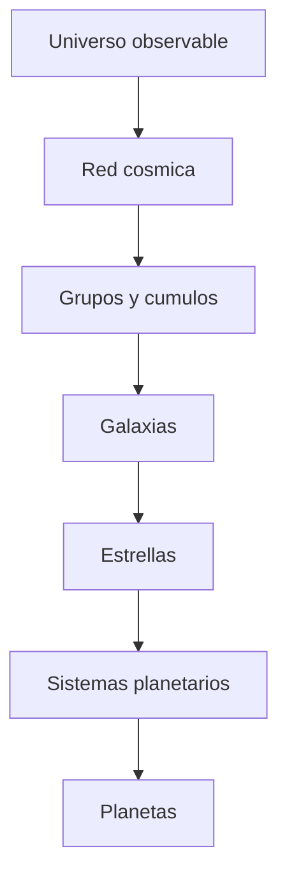
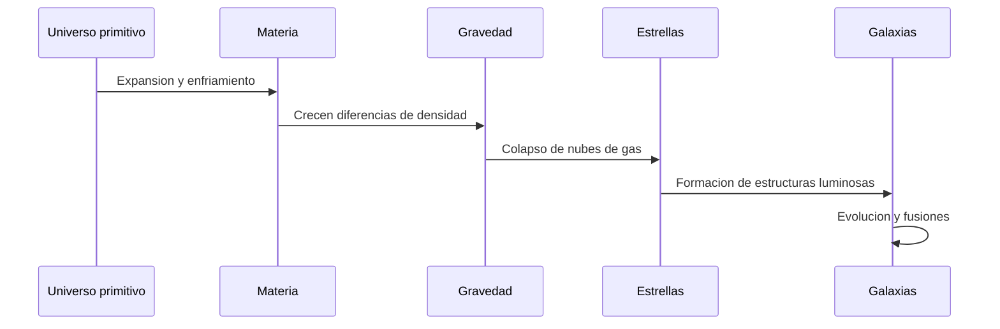

# 🌌 Artículo 3: Las galaxias y el universo

**Navegación:** [🏠 Inicio](index.md) > Astronomía > Galaxias

**Fecha de creación:** 04/11/2026  
**Última actualización:** 04/11/2026  
**Tiempo estimado de lectura:** 10 minutos  
**Etiquetas:** `Astronomía` `Galaxias` `Universo` `Cosmología`

---

## 📑 Tabla de contenidos

1. [Introducción](#introducción)
2. [Formación de las galaxias](#formación-de-las-galaxias)
3. [Tipos de galaxias](#tipos-de-galaxias)
4. [La Vía Láctea](#la-vía-láctea)
5. [Estructura del universo](#estructura-del-universo)
6. [Diagramas](#diagramas)
7. [Conclusiones](#conclusiones)
8. [Notas y referencias](#notas-y-referencias)

---

## Introducción

El universo contiene una enorme cantidad de galaxias, cada una formada por estrellas, gas, polvo y materia oscura que interactúan bajo la influencia de la gravedad. Las galaxias son estructuras fundamentales para comprender la organización del cosmos y su evolución a lo largo de miles de millones de años.

Nuestro [Sistema Solar](articulo-1.md) se encuentra dentro de una galaxia llamada **Vía Láctea**, que contiene una gran cantidad de estrellas, sistemas planetarios y regiones de formación estelar.

Durante siglos, los astrónomos observaron objetos difusos en el cielo sin comprender completamente su naturaleza. Con el desarrollo de instrumentos más avanzados, especialmente durante el siglo XX, se descubrió que muchas de estas estructuras eran galaxias independientes, situadas a enormes distancias.

El astrónomo Edwin Hubble contribuyó a demostrar que existen otras galaxias fuera de la Vía Láctea y a establecer evidencias de la expansión del universo.

Actualmente, los científicos utilizan telescopios espaciales y observatorios terrestres para estudiar galaxias cercanas y lejanas. Estas observaciones permiten investigar cómo se formaron las primeras estructuras cósmicas y cómo evolucionaron hasta convertirse en las galaxias que conocemos.

El estudio de las galaxias está relacionado con la formación de las [estrellas](articulo-2.md), la búsqueda de [exoplanetas](articulo-5.md) y los avances de la [exploración espacial](articulo-4.md).

Comprender las galaxias nos ayuda a conocer mejor el lugar que ocupa la humanidad dentro del universo.

---

## Formación de las galaxias

### 1. El universo primitivo

Después del Big Bang, el universo comenzó a expandirse y enfriarse.

Con el tiempo, pequeñas diferencias en la distribución de materia favorecieron el crecimiento de estructuras bajo la influencia de la gravedad.

### 2. Acumulación de materia

La materia oscura desempeñó un papel importante en la formación de las primeras estructuras gravitacionales.

El gas se acumuló en regiones de mayor densidad, donde posteriormente pudieron formarse estrellas.

### 3. Nacimiento de las primeras galaxias

Las primeras galaxias surgieron durante las etapas tempranas de la historia cósmica.

Muchas eran pequeñas e irregulares y evolucionaron mediante la formación de estrellas y la acumulación de materia.

### 4. Fusiones galácticas

Las galaxias pueden interactuar y fusionarse entre sí.

Estas interacciones modifican su estructura y pueden estimular nuevos episodios de formación estelar.

> Las galaxias no son estructuras completamente estáticas: evolucionan mediante procesos gravitacionales y la formación de nuevas estrellas.

**Fuente:** NASA [1].

---

## Tipos de galaxias

### 1. Galaxias espirales

Presentan un disco con brazos espirales.

Muchas contienen gas y polvo donde pueden formarse nuevas estrellas.

La Vía Láctea pertenece a esta categoría.

### 2. Galaxias elípticas

Tienen formas redondeadas o alargadas.

Generalmente contienen proporciones reducidas de gas frío y muchas estrellas antiguas.

### 3. Galaxias irregulares

No poseen una estructura espiral o elíptica claramente definida.

Algunas presentan formas irregulares debido a interacciones gravitacionales.

### 4. Galaxias lenticulares

Poseen un disco y una región central prominente, pero carecen de brazos espirales bien definidos.

### Tabla comparativa

| Tipo | Forma | Gas y polvo | Formación estelar |
|:---|:---:|---:|---|
| Espiral | Disco con brazos | Abundante en muchas | Activa |
| Elíptica | Ovalada | Generalmente reducido | Habitualmente baja |
| Irregular | Variable | Variable | Puede ser intensa |
| Lenticular | Disco sin brazos definidos | Generalmente limitado | Habitualmente baja |

### Ejemplos de galaxias

| Galaxia | Tipo | Característica |
|---|---|---|
| Vía Láctea | Espiral barrada | Contiene el Sistema Solar |
| Andrómeda | Espiral | Galaxia grande cercana |
| Triángulo | Espiral | Miembro del Grupo Local |
| Gran Nube de Magallanes | Irregular | Galaxia satélite de la Vía Láctea |
| M87 | Elíptica | Contiene un agujero negro supermasivo |
| Sombrero | Disco con gran bulbo | Aspecto característico |

---

## La Vía Láctea

### 1. Características generales

La Vía Láctea es una galaxia espiral barrada.

Contiene estrellas, gas, polvo, sistemas planetarios y materia oscura.

### 2. Ubicación del Sistema Solar

El [Sistema Solar](articulo-1.md) se encuentra en una región del disco galáctico asociada al brazo de Orión.

No está situado en el centro de la galaxia.

### 3. El centro galáctico

En el centro de la Vía Láctea se encuentra Sagittarius A*, asociado a un agujero negro supermasivo.

Su masa equivale aproximadamente a cuatro millones de veces la del Sol.

### 4. Movimiento galáctico

El Sol y los planetas orbitan alrededor del centro galáctico.

Una vuelta completa tarda aproximadamente entre 225 y 250 millones de años.

> Nuestro planeta forma parte de un sistema planetario, que pertenece a una galaxia integrada en estructuras cósmicas todavía mayores.

---

## Estructura del universo

### 1. Grupos de galaxias

Son conjuntos de galaxias unidas gravitacionalmente.

La Vía Láctea pertenece al **Grupo Local**, junto con Andrómeda, Triángulo y otras galaxias.

### 2. Cúmulos de galaxias

Los cúmulos contienen numerosas galaxias y grandes cantidades de gas caliente y materia oscura.

Se encuentran entre las estructuras gravitacionalmente ligadas más grandes del universo.

### 3. La red cósmica

A gran escala, la materia se distribuye formando filamentos y regiones de gran densidad, separados por enormes vacíos.

Esta organización se conoce como *red cósmica*.

### 4. Expansión del universo

Las observaciones muestran que el universo se está expandiendo.

En promedio, las galaxias suficientemente lejanas presentan un desplazamiento al rojo relacionado con la expansión del espacio.

Este fenómeno constituye una de las principales evidencias de la cosmología moderna.

**Fuente:** ESA [2].

---

## Diagramas

### Diagrama 1: Organización del universo

### Diagrama 2: Formación de estructuras

---

## 📚 Información adicional

Información adicional

La luz tarda mucho tiempo en recorrer las distancias entre galaxias.

Por ejemplo, cuando observamos una galaxia situada a millones de años luz, vemos la luz que emitió hace millones de años.

Ejemplo detallado

Andrómeda se encuentra aproximadamente a 2,5 millones de años luz de la Tierra.

Esto significa que la luz que recibimos actualmente salió de esa galaxia hace unos 2,5 millones de años.

Datos históricos

En la década de 1920, Edwin Hubble identificó estrellas variables cefeidas en Andrómeda.

Sus observaciones ayudaron a demostrar que esta galaxia se encuentra fuera de la Vía Láctea.

---

## ⚠️ Alertas

> [!NOTE]
> Una galaxia puede contener miles de millones de estrellas.

> [!IMPORTANT]
> El Sistema Solar y la Vía Láctea no son lo mismo: el primero es un sistema planetario y la segunda es una galaxia.

> [!TIP]
> Para recordar los principales tipos de galaxias, utiliza: espirales, elípticas, irregulares y lenticulares.

---

## Conclusiones

Las galaxias representan estructuras esenciales en la organización del universo.

| Concepto | Importancia | Conclusión |
|---|---|---|
| Galaxias | Agrupan sistemas estelares | Son componentes fundamentales del cosmos |
| Vía Láctea | Nuestro hogar galáctico | Contiene el Sistema Solar |
| Materia oscura | Influencia gravitacional | Participa en la formación de estructuras |
| Fusiones | Evolución galáctica | Pueden modificar la forma de las galaxias |
| Expansión cósmica | Evolución del universo | Permite estudiar la historia cósmica |

El estudio de las galaxias permite comprender cómo evolucionó el universo desde sus primeras etapas hasta la actualidad.

---

## Notas y referencias

[1] NASA. (s. f.). *Galaxies*.  
https://science.nasa.gov/universe/galaxies/

[2] ESA. (s. f.). *Euclid*.  
https://www.esa.int/Science_Exploration/Space_Science/Euclid

[3] Encyclopaedia Britannica. (s. f.). *Galaxy*.  
https://www.britannica.com/science/galaxy

[📚 Bibliografía general](referencias.md)

---

## 🔗 Ver también

- [🪐 Sistema Solar](articulo-1.md)
- [⭐ Estrellas](articulo-2.md)
- [🚀 Exploración espacial](articulo-4.md)
- [🔭 Exoplanetas](articulo-5.md)
- [📖 Glosario](glosario.md)

---

[← Anterior: Estrellas](articulo-2.md) | [Siguiente: Exploración espacial →](articulo-4.md)

[↑ Volver arriba](#inicio)

---

**Autor:** Daniel Godefroy  
**Cosmos Wiki © 2026**
