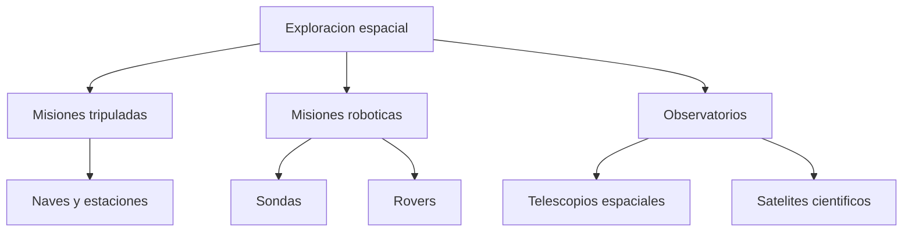
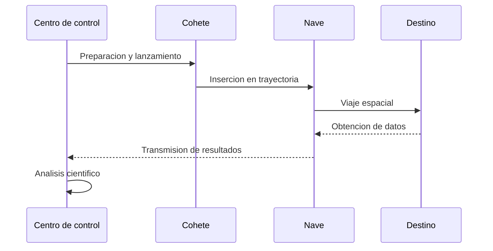

# 🚀 Artículo 4: La exploración espacial

**Navegación:** [🏠 Inicio](index.md) > Tecnología espacial > Exploración espacial

**Fecha de creación:** 04/11/2026  
**Última actualización:** 04/11/2026  
**Tiempo estimado de lectura:** 12 minutos  
**Etiquetas:** `Astronomía` `NASA` `Cohetes` `Misiones espaciales` `Tecnología`

---

## 📑 Tabla de contenidos

1. [Introducción](#introducción)
2. [Historia de la exploración espacial](#historia-de-la-exploración-espacial)
3. [Tecnologías espaciales](#tecnologías-espaciales)
4. [Misiones espaciales importantes](#misiones-espaciales-importantes)
5. [Beneficios y desafíos](#beneficios-y-desafíos)
6. [Diagramas](#diagramas)
7. [Conclusiones](#conclusiones)
8. [Notas y referencias](#notas-y-referencias)

---

## Introducción

La exploración espacial representa uno de los mayores logros científicos y tecnológicos de la humanidad. Desde tiempos antiguos, las personas han observado el cielo con curiosidad e intentado comprender qué existe más allá de nuestro planeta. Sin embargo, fue durante el siglo XX cuando los avances en ingeniería, física y tecnología permitieron enviar los primeros objetos artificiales fuera de la atmósfera terrestre.

El lanzamiento del satélite Sputnik 1 en 1957 marcó el inicio de la era espacial. Posteriormente, Yuri Gagarin se convirtió en el primer ser humano en viajar al espacio en 1961. Estos acontecimientos impulsaron una etapa de competencia científica que culminó con la llegada de los primeros astronautas a la Luna en 1969, durante la misión Apolo 11.

Desde entonces, la exploración espacial ha evolucionado considerablemente. Actualmente existen satélites que permiten estudiar el clima, sistemas de navegación global, telescopios espaciales, estaciones orbitales y sondas robóticas capaces de investigar planetas y otros cuerpos celestes.

La exploración espacial no consiste únicamente en enviar astronautas al espacio. También incluye el desarrollo de instrumentos que permiten estudiar el [Sistema Solar](articulo-1.md), observar las [estrellas](articulo-2.md), analizar las [galaxias](articulo-3.md) e investigar los [exoplanetas](articulo-5.md).

Estas actividades contribuyen al conocimiento científico, al desarrollo de nuevas tecnologías y a la cooperación entre diferentes países.

En este artículo conoceremos los acontecimientos más importantes de la exploración espacial, sus principales tecnologías, algunas misiones destacadas y los desafíos que deberán superarse para continuar investigando el universo.

---

## Historia de la exploración espacial

### 1. Los primeros cohetes

El desarrollo de los cohetes modernos se relaciona con avances científicos realizados durante los siglos XIX y XX.

Investigadores como Konstantín Tsiolkovski, Robert Goddard y Hermann Oberth contribuyeron al estudio de la propulsión espacial.

Los cohetes funcionan gracias al principio de acción y reacción descrito por la tercera ley de Newton.

### 2. El lanzamiento del Sputnik 1

El 4 de octubre de 1957, la Unión Soviética lanzó el Sputnik 1.

Fue el primer satélite artificial que logró orbitar la Tierra.

Este acontecimiento marcó el comienzo de la era espacial.

### 3. Primer ser humano en el espacio

El 12 de abril de 1961, Yuri Gagarin realizó el primer vuelo espacial tripulado.

Su misión, Vostok 1, completó una órbita alrededor de la Tierra.

Este acontecimiento demostró que los seres humanos podían viajar al espacio.

### 4. Llegada a la Luna

El 20 de julio de 1969, la misión Apolo 11 consiguió el primer alunizaje tripulado.

Neil Armstrong y Buzz Aldrin caminaron sobre la superficie lunar, mientras Michael Collins permaneció en órbita.

> La llegada a la Luna demostró la capacidad humana para desarrollar sistemas tecnológicos extremadamente complejos.

### 5. La exploración moderna

Las décadas posteriores permitieron desarrollar estaciones espaciales, telescopios orbitales y vehículos robóticos.

Hoy, numerosos países participan en proyectos científicos relacionados con el espacio.

**Fuente:** NASA [1].

---

## Tecnologías espaciales

### 1. Los cohetes

Los cohetes permiten transportar cargas útiles fuera de la atmósfera terrestre.

Funcionan expulsando gases a gran velocidad para generar empuje.

Sus principales componentes incluyen:

- Motores.
- Tanques de combustible.
- Sistemas de navegación.
- Estructuras de soporte.
- Sistemas de separación.

### 2. Satélites artificiales

Los satélites son objetos fabricados por el ser humano que se colocan en órbita.

Se utilizan para comunicaciones, meteorología, navegación y observación de la Tierra.

### 3. Telescopios espaciales

Los telescopios espaciales permiten observar el universo desde fuera de la atmósfera.

Algunos ejemplos importantes son:

- Telescopio Espacial Hubble.
- Telescopio Espacial James Webb.
- Observatorio Chandra.

Estos instrumentos permiten estudiar las [galaxias](articulo-3.md) y las [estrellas](articulo-2.md).

### 4. Robots y sondas

Las sondas espaciales investigan regiones del espacio sin transportar astronautas.

Los vehículos exploradores, también llamados *rovers*, pueden desplazarse por superficies planetarias.

Un ejemplo es Perseverance, que estudia Marte.

### Tabla comparativa de tecnologías

| Tecnología | Función principal | Ventaja | Limitación |
|:---|:---:|---:|---|
| Cohete | Transportar cargas | Gran capacidad de impulso | Elevado consumo energético |
| Satélite | Operar en órbita | Cobertura extensa | Vida útil limitada |
| Telescopio espacial | Observar el cosmos | Evita efectos atmosféricos | Mantenimiento complejo |
| Sonda robótica | Explorar destinos | No necesita tripulación | Comunicación distante |
| Rover | Estudiar superficies | Investigación directa | Movimiento limitado |

---

## Misiones espaciales importantes

### 1. Apolo 11

Fue la primera misión que consiguió llevar seres humanos a la superficie lunar.

Se realizó en julio de 1969.

### 2. Voyager 1 y Voyager 2

Estas sondas fueron lanzadas en 1977.

Exploraron planetas exteriores y continuaron investigando el entorno espacial más allá de la heliopausa.

### 3. Estación Espacial Internacional

La Estación Espacial Internacional, conocida como `ISS`, es un laboratorio que orbita la Tierra.

Su construcción comenzó en 1998.

Permite desarrollar experimentos científicos en condiciones de microgravedad.

### 4. Telescopio James Webb

El telescopio James Webb fue lanzado en diciembre de 2021.

Observa principalmente en longitudes de onda infrarrojas.

Ayuda a estudiar galaxias lejanas, formación estelar y atmósferas de algunos exoplanetas.

### 5. Exploración de Marte

Numerosas misiones han investigado Marte mediante orbitadores, módulos de aterrizaje y vehículos exploradores.

Entre ellas destacan Viking, Curiosity y Perseverance.

### Tabla de misiones históricas

| Año | Misión | Organización | Logro |
|---|---|---|---|
| 1957 | Sputnik 1 | Unión Soviética | Primer satélite artificial |
| 1961 | Vostok 1 | Unión Soviética | Primer humano en el espacio |
| 1969 | Apolo 11 | NASA | Primer alunizaje tripulado |
| 1977 | Voyager 1 y 2 | NASA | Exploración del Sistema Solar exterior |
| 1990 | Hubble | NASA/ESA | Observación astronómica orbital |
| 1998 | ISS | Cooperación internacional | Inicio de construcción |
| 2021 | James Webb | NASA/ESA/CSA | Observatorio espacial infrarrojo |

**Fuentes:** NASA [1] y ESA [2].

---

## Beneficios y desafíos

### 1. Avances científicos

La exploración espacial permite estudiar fenómenos imposibles de investigar directamente desde la Tierra.

Entre ellos se encuentran las atmósferas planetarias, la microgravedad y la evolución estelar.

### 2. Aplicaciones cotidianas

Las tecnologías espaciales contribuyen a servicios utilizados diariamente.

Por ejemplo:

- Navegación mediante satélites.
- Predicción meteorológica.
- Comunicaciones.
- Observación ambiental.
- Investigación de materiales.

### 3. Riesgos de las misiones

Las misiones espaciales presentan dificultades como radiación, temperaturas extremas, fallos tecnológicos y largas distancias.

Las misiones tripuladas requieren además sistemas de soporte vital.

### 4. Sostenibilidad espacial

El aumento de objetos artificiales en órbita genera preocupación por la basura espacial.

Los fragmentos orbitales pueden representar riesgos para satélites y estaciones espaciales.

La cooperación internacional y el diseño responsable son esenciales para reducir estos problemas.

> Explorar el espacio requiere equilibrar el progreso científico, la seguridad y la sostenibilidad.

---

## Diagramas

### Diagrama 1: Tecnologías de exploración

### Diagrama 2: Proceso de una misión espacial

---

## 📚 Información adicional

Información adicional

La velocidad necesaria para mantener un objeto en órbita depende de su distancia al cuerpo central y de la masa de dicho cuerpo.

Los satélites en órbita terrestre baja suelen desplazarse a velocidades cercanas a 7,8 kilómetros por segundo.

Ejemplo detallado

Un rover que explora Marte puede fotografiar rocas, analizar muestras y enviar información a la Tierra.

Debido a las grandes distancias, las señales de comunicación tardan varios minutos en viajar entre ambos planetas.

Datos históricos

El programa Apolo fue desarrollado durante la década de 1960.

Apolo 11 fue la primera misión tripulada que logró aterrizar en la Luna, aunque otras misiones Apolo continuaron explorando la superficie lunar hasta 1972.

---

## ⚠️ Alertas importantes

> [!NOTE]
> Los astronautas que se encuentran en órbita siguen bajo la influencia de la gravedad terrestre.

> [!IMPORTANT]
> La exploración espacial presenta riesgos relacionados con la radiación, el aislamiento y los fallos tecnológicos.

> [!TIP]
> Recuerda esta secuencia histórica: Sputnik 1 (1957), Gagarin (1961) y Apolo 11 (1969).

---

## Conclusiones

La exploración espacial ha transformado nuestra comprensión del universo y ha impulsado importantes desarrollos tecnológicos.

| Aspecto | Beneficio | Conclusión |
|---|---|---|
| Satélites | Comunicaciones y navegación | Mejoran servicios cotidianos |
| Telescopios | Observación astronómica | Amplían el conocimiento científico |
| Sondas | Investigación de planetas | Permiten explorar lugares distantes |
| Misiones tripuladas | Investigación humana | Impulsan nuevas tecnologías |
| Cooperación internacional | Recursos compartidos | Favorece proyectos complejos |

La investigación espacial continuará siendo importante para comprender nuestro origen y desarrollar nuevas herramientas científicas.

---

## Notas y referencias

[1] NASA. (s. f.). *NASA History*.  
https://www.nasa.gov/history/

[2] Agencia Espacial Europea. (s. f.). *ESA Missions*.  
https://www.esa.int/ESA/Our_Missions

[3] NASA. (s. f.). *International Space Station*.  
https://www.nasa.gov/international-space-station/

[📚 Bibliografía general](referencias.md)

---

## 🔗 Ver también

- [🪐 Sistema Solar](articulo-1.md)
- [⭐ Estrellas](articulo-2.md)
- [🌌 Galaxias](articulo-3.md)
- [🔭 Exoplanetas](articulo-5.md)
- [📖 Glosario](glosario.md)

---

[← Anterior: Galaxias](articulo-3.md) | [Siguiente: Exoplanetas →](articulo-5.md)

[↑ Volver arriba](#inicio)

---

**Autor:** Daniel Godefroy  
**Cosmos Wiki © 2026**
