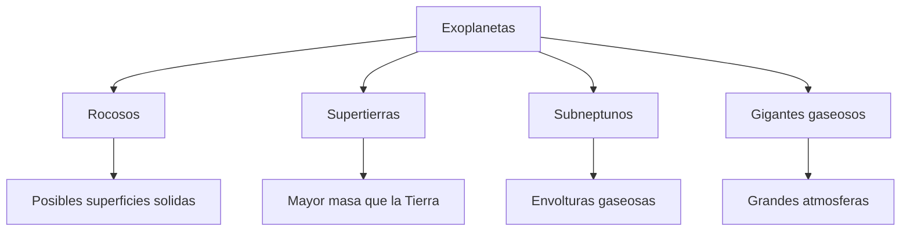
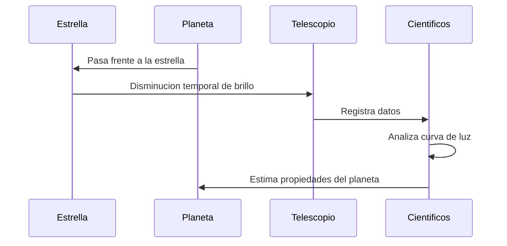

# 🔭 Artículo 5: Exoplanetas y búsqueda de vida

**Navegación:** [🏠 Inicio](index.md) > Astronomía > Exoplanetas

**Fecha de creación:** 04/11/2026  
**Última actualización:** 04/11/2026  
**Tiempo estimado de lectura:** 12 minutos  
**Etiquetas:** `Exoplanetas` `Astrobiología` `Telescopios` `Vida extraterrestre`

---

## 📑 Tabla de contenidos

1. [Introducción](#introducción)
2. [Qué son los exoplanetas](#qué-son-los-exoplanetas)
3. [Métodos de detección](#métodos-de-detección)
4. [Habitabilidad y vida extraterrestre](#habitabilidad-y-vida-extraterrestre)
5. [Exoplanetas destacados](#exoplanetas-destacados)
6. [Diagramas](#diagramas)
7. [Conclusiones](#conclusiones)
8. [Notas y referencias](#notas-y-referencias)

---

## Introducción

Durante siglos, la humanidad se ha preguntado si existen otros mundos fuera de nuestro [Sistema Solar](articulo-1.md) y si alguno de ellos podría albergar vida. Actualmente sabemos que existen miles de planetas que orbitan estrellas diferentes del Sol. Estos mundos reciben el nombre de **exoplanetas**.

El descubrimiento y estudio de los exoplanetas representa uno de los avances más importantes de la astronomía moderna. Gracias a instrumentos científicos cada vez más precisos, los investigadores pueden detectar planetas situados a enormes distancias, estimar sus tamaños, calcular sus masas y estudiar determinadas características de sus atmósferas.

Aunque los planetas de nuestro Sistema Solar son relativamente cercanos y pueden investigarse mediante sondas espaciales, los exoplanetas se encuentran generalmente demasiado lejos para ser visitados con la tecnología actual. Por esta razón, su estudio depende principalmente de observaciones indirectas.

Los científicos utilizan técnicas como el método del tránsito y la velocidad radial para identificar planetas alrededor de otras [estrellas](articulo-2.md). Algunos telescopios también permiten analizar la luz que atraviesa sus atmósferas y buscar moléculas que aporten información sobre sus condiciones físicas y químicas.

Uno de los principales objetivos de esta investigación es comprender si la Tierra es un planeta excepcional o si existen otros mundos con condiciones similares.

La búsqueda de vida extraterrestre combina conocimientos de astronomía, biología, química y geología, formando parte de una disciplina conocida como *astrobiología*.

En este artículo estudiaremos qué son los exoplanetas, cómo se descubren, cuáles resultan especialmente interesantes y qué dificultades existen para identificar señales de vida más allá de nuestro planeta.

---

## Qué son los exoplanetas

### 1. Definición

Un exoplaneta es un planeta que se encuentra fuera de nuestro Sistema Solar.

La mayoría de los exoplanetas conocidos orbitan otras estrellas.

Estos cuerpos pueden tener características muy diferentes a las de los ocho planetas que conocemos.

### 2. Tipos de exoplanetas

Los científicos clasifican los exoplanetas según características como su tamaño, masa y composición.

Entre las principales categorías se encuentran:

- Planetas terrestres.
- Supertierras.
- Subneptunos.
- Gigantes gaseosos.
- Gigantes helados.

### 3. Diferencias con los planetas solares

Algunos exoplanetas orbitan extremadamente cerca de sus estrellas.

Otros poseen órbitas muy alejadas o se encuentran en sistemas con varias estrellas.

También se han descubierto sistemas planetarios muy compactos.

### 4. Importancia científica

Los exoplanetas permiten estudiar cómo se forman y evolucionan los sistemas planetarios.

Su investigación complementa el conocimiento del [Sistema Solar](articulo-1.md) y de la formación de las [estrellas](articulo-2.md).

> El descubrimiento de exoplanetas demuestra que los sistemas planetarios existen más allá de nuestro entorno solar.

**Fuente:** NASA [1].

---

## Métodos de detección

### 1. Método del tránsito

El método del tránsito detecta pequeñas disminuciones periódicas en el brillo de una estrella.

Esto ocurre cuando un planeta pasa frente a ella desde la perspectiva de la Tierra.

La profundidad del tránsito permite estimar la relación entre el tamaño del planeta y el de su estrella.

### 2. Velocidad radial

La gravedad de un planeta provoca pequeños movimientos en la estrella que orbita.

Estos movimientos pueden detectarse mediante variaciones en el espectro de la luz estelar.

Este método permite estimar la masa mínima de un planeta en determinadas condiciones.

### 3. Imagen directa

En algunos casos es posible obtener imágenes de exoplanetas.

Esta técnica es especialmente difícil porque las estrellas suelen ser mucho más brillantes que los planetas que las orbitan.

### 4. Microlente gravitacional

La gravedad de un objeto puede amplificar temporalmente la luz de una estrella situada detrás de él.

La presencia de un planeta puede producir una señal adicional en esta amplificación.

### Tabla comparativa

| Método | Principio | Ventaja | Limitación |
|:---|:---:|---:|---|
| Tránsito | Disminución de brillo | Permite estimar tamaño relativo | Requiere alineación favorable |
| Velocidad radial | Movimiento estelar | Permite estimar masa | Señales pequeñas y complejas |
| Imagen directa | Luz del planeta | Estudio directo de algunos mundos | Gran contraste con la estrella |
| Microlente | Efecto gravitacional | Detecta planetas lejanos | Eventos difíciles de repetir |

Para ampliar información sobre los telescopios empleados, consulta [Exploración espacial](articulo-4.md).

---

## Habitabilidad y vida extraterrestre

### 1. Zona habitable

La zona habitable es la región alrededor de una estrella donde, bajo condiciones atmosféricas apropiadas, podría existir agua líquida en la superficie de un planeta.

Sin embargo, encontrarse en esa región no garantiza que un planeta sea habitable.

### 2. El papel del agua

El agua líquida es fundamental para la vida conocida en la Tierra.

Por eso, los científicos investigan mundos donde pudiera mantenerse durante largos períodos.

### 3. Atmósferas planetarias

Las atmósferas pueden influir en la temperatura y la protección de la superficie.

Los telescopios modernos permiten investigar algunas de sus características mediante espectroscopia.

### 4. Biofirmas

Una *biofirma* es una característica que podría indicar procesos biológicos.

Algunos gases atmosféricos pueden estudiarse como posibles biofirmas, pero también pueden producirse mediante procesos no biológicos.

Por tanto, cualquier hallazgo necesita una interpretación cuidadosa.

### 5. Dificultades científicas

Las distancias interestelares, las limitaciones de los telescopios y la diversidad de condiciones planetarias complican esta búsqueda.

Hasta ahora no existe evidencia científica confirmada de vida fuera de la Tierra.

> Estar en la zona habitable no significa que un planeta tenga vida.

---

## Exoplanetas destacados

### 1. Próxima Centauri b

Es un planeta que orbita Próxima Centauri, la estrella más cercana al Sol.

Su proximidad relativa lo convierte en un objetivo importante para la investigación.

### 2. TRAPPIST-1 e

Forma parte de un sistema con siete planetas de tamaño aproximado al terrestre.

Su sistema es especialmente interesante para estudiar planetas rocosos.

### 3. 51 Pegasi b

Fue el primer exoplaneta descubierto alrededor de una estrella similar al Sol mediante un método que permitió confirmar su existencia en 1995.

Es un gigante gaseoso que orbita muy cerca de su estrella.

### 4. Kepler-186 f

Fue uno de los primeros planetas de tamaño similar al terrestre identificados dentro de la zona habitable de su estrella.

### 5. WASP-39 b

Es un gigante gaseoso cuya atmósfera ha sido estudiada mediante observaciones del telescopio James Webb.

### Tabla de datos

| Exoplaneta | Sistema estelar | Característica |
|---|---|---|
| Próxima Centauri b | Próxima Centauri | Planeta cercano al Sistema Solar |
| TRAPPIST-1 e | TRAPPIST-1 | Planeta rocoso |
| 51 Pegasi b | 51 Pegasi | Gigante gaseoso cercano a su estrella |
| Kepler-186 f | Kepler-186 | Tamaño aproximado al terrestre |
| WASP-39 b | WASP-39 | Atmósfera estudiada con James Webb |
| HD 209458 b | HD 209458 | Importante para estudios de tránsitos |

**Fuente:** NASA [2].

---

## Diagramas

### Diagrama 1: Clasificación de exoplanetas

### Diagrama 2: Proceso de detección

---

## 📚 Elementos interactivos

Información adicional

El catálogo de exoplanetas confirmados cambia a medida que se publican nuevos descubrimientos.

La NASA mantiene una base de datos especializada que permite consultar sus principales características.

[Consultar el archivo de exoplanetas de NASA](https://exoplanetarchive.ipac.caltech.edu/)

Ejemplo detallado

Supongamos que un telescopio observa una estrella durante varias semanas y detecta pequeñas disminuciones de brillo cada cinco días.

Si estas disminuciones presentan características compatibles con un tránsito planetario, los científicos pueden investigar la posibilidad de que exista un planeta con un período orbital de aproximadamente cinco días.

Sin embargo, necesitan descartar otras explicaciones antes de confirmar el descubrimiento.

Datos históricos

En 1995, Michel Mayor y Didier Queloz anunciaron el descubrimiento de 51 Pegasi b.

Este hallazgo transformó el estudio de los sistemas planetarios y abrió nuevas líneas de investigación astronómica.

Ambos científicos recibieron parte del Premio Nobel de Física de 2019 por este descubrimiento.

---

## ⚠️ Alertas importantes

> [!NOTE]
> Un exoplaneta no tiene que ser parecido a la Tierra.

> [!IMPORTANT]
> No se ha confirmado científicamente la existencia de vida extraterrestre.

> [!TIP]
> Para recordar los principales métodos de detección, utiliza: tránsito, velocidad radial, imagen directa y microlente.

---

## Conclusiones

El estudio de los exoplanetas ha cambiado nuestra comprensión de los sistemas planetarios.

| Concepto | Importancia | Conclusión |
|---|---|---|
| Exoplanetas | Diversidad planetaria | Existen muchos tipos de mundos |
| Tránsitos | Detección indirecta | Permiten estimar propiedades |
| Velocidad radial | Movimiento gravitacional | Ayuda a calcular masas |
| Zona habitable | Condiciones potenciales | No garantiza presencia de vida |
| Biofirmas | Investigación astrobiológica | Requieren evidencia rigurosa |

La investigación continuará desarrollándose gracias a nuevos telescopios y técnicas científicas.

---

## Notas y referencias

[1] NASA. (s. f.). *Exoplanets*.  
https://science.nasa.gov/exoplanets/

[2] NASA Exoplanet Science Institute. (s. f.). *NASA Exoplanet Archive*.  
https://exoplanetarchive.ipac.caltech.edu/

[3] ESA. (s. f.). *Exoplanets*.  
https://www.esa.int/Science_Exploration/Space_Science/Exoplanets

[📚 Bibliografía general](referencias.md)

---

## 🌐 Explora todos los artículos

| Artículo | Enlace |
|---|---|
| 🪐 Sistema Solar | [Leer](articulo-1.md) |
| ⭐ Estrellas | [Leer](articulo-2.md) |
| 🌌 Galaxias | [Leer](articulo-3.md) |
| 🚀 Exploración espacial | [Leer](articulo-4.md) |
| 🔭 Exoplanetas | [Leer](articulo-5.md) |

---
## 🔗 Ver también

- [🪐 Sistema Solar](articulo-1.md)
- [⭐ Estrellas](articulo-2.md)
- [🌌 Galaxias](articulo-3.md)
- [🚀 Exploración espacial](articulo-4.md)
- [📖 Glosario](glosario.md)

---

[← Anterior: Exploración espacial](articulo-4.md) | [Siguiente: Inicio →](index.md)

[↑ Volver arriba](#inicio)

---

**Autor:** Daniel Godefroy  
**Cosmos Wiki © 2026**
