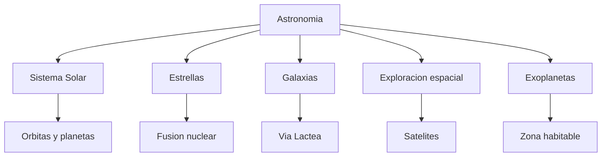

# 📖 Glosario de Cosmos Wiki

**Navegación:** [🏠 Inicio](index.md) > Glosario

**Última actualización:** 04/11/2026  
**Categorías:** 🪐 Sistema Solar · ⭐ Estrellas · 🌌 Galaxias · 🚀 Exploración · 🔭 Exoplanetas

---

## 📚 Introducción

Este glosario reúne los principales términos utilizados en Cosmos Wiki, organizados alfabéticamente.

Cada concepto incluye su definición, categoría y un enlace al artículo donde puede estudiarse con mayor profundidad.

---

## 🔤 Diccionario astronómico

| Término | Definición | Categoría | Artículo relacionado |
|:---|---|:---:|---|
| **Acreción** | Proceso por el cual partículas y cuerpos pequeños se acumulan para formar objetos mayores. | 🪐 | [Sistema Solar](articulo-1.md) |
| **Agujero negro** | Región del espacio delimitada por un horizonte de sucesos del que no puede escapar la luz. | ⭐ | [Estrellas](articulo-2.md) |
| **Año luz** | Distancia que recorre la luz en el vacío durante un año. | 🌌 | [Galaxias](articulo-3.md) |
| **Asteroide** | Cuerpo celeste pequeño, generalmente rocoso, que orbita el Sol. | 🪐 | [Sistema Solar](articulo-1.md) |
| **Astrobiología** | Disciplina científica que estudia el origen, evolución y posibilidad de vida en el universo. | 🔭 | [Exoplanetas](articulo-5.md) |
| **Cometa** | Cuerpo formado por hielo, polvo y roca que puede desarrollar una cola al acercarse al Sol. | 🪐 | [Sistema Solar](articulo-1.md) |
| **Exoplaneta** | Planeta que se encuentra fuera de nuestro Sistema Solar. | 🔭 | [Exoplanetas](articulo-5.md) |
| **Fusión nuclear** | Proceso en el que núcleos atómicos se unen y liberan energía. | ⭐ | [Estrellas](articulo-2.md) |
| **Galaxia** | Sistema de estrellas, gas, polvo y materia oscura unido por gravedad. | 🌌 | [Galaxias](articulo-3.md) |
| **Gravedad** | Interacción física responsable de la atracción gravitacional entre objetos con masa o energía. | 🌌 | [Galaxias](articulo-3.md) |
| **Nebulosa** | Nube interestelar de gas y polvo. | ⭐ | [Estrellas](articulo-2.md) |
| **Órbita** | Trayectoria de un cuerpo bajo la influencia gravitatoria de otros objetos. | 🪐 | [Sistema Solar](articulo-1.md) |
| **Planeta enano** | Cuerpo que orbita el Sol, posee forma aproximadamente redondeada y no ha despejado su región orbital. | 🪐 | [Sistema Solar](articulo-1.md) |
| **Protoestrella** | Etapa temprana de formación de una estrella, anterior a la fusión sostenida de hidrógeno. | ⭐ | [Estrellas](articulo-2.md) |
| **Satélite artificial** | Objeto fabricado por el ser humano que se coloca en órbita. | 🚀 | [Exploración espacial](articulo-4.md) |
| **Supernova** | Explosión estelar extremadamente energética asociada a ciertos procesos de evolución estelar. | ⭐ | [Estrellas](articulo-2.md) |
| **Telescopio espacial** | Instrumento astronómico que funciona fuera de la atmósfera terrestre. | 🚀 | [Exploración espacial](articulo-4.md) |
| **Unidad astronómica** | Unidad de distancia equivalente a aproximadamente 149,6 millones de kilómetros. | 🪐 | [Sistema Solar](articulo-1.md) |
| **Vía Láctea** | Galaxia espiral barrada donde se encuentra nuestro Sistema Solar. | 🌌 | [Galaxias](articulo-3.md) |
| **Zona habitable** | Región alrededor de una estrella donde podría existir agua líquida superficial bajo condiciones apropiadas. | 🔭 | [Exoplanetas](articulo-5.md) |

---

## 🗂️ Categorías de términos

| Categoría | Emoji | Contenido |
|---|:---:|---|
| Sistema Solar | 🪐 | Planetas, asteroides y órbitas |
| Estrellas | ⭐ | Formación y evolución estelar |
| Galaxias | 🌌 | Estructura del universo |
| Exploración espacial | 🚀 | Satélites, telescopios y misiones |
| Exoplanetas | 🔭 | Planetas extrasolares y habitabilidad |

---

## 🧠 Mapa conceptual del glosario

---

## 🔗 Navegación

- [🪐 Sistema Solar](articulo-1.md)
- [⭐ Estrellas](articulo-2.md)
- [🌌 Galaxias](articulo-3.md)
- [🚀 Exploración espacial](articulo-4.md)
- [🔭 Exoplanetas](articulo-5.md)
- [📚 Referencias](referencias.md)

---

[← Volver al inicio](index.md)

[↑ Volver arriba](#inicio)

**Cosmos Wiki © 2026 — Daniel Godefroy**
