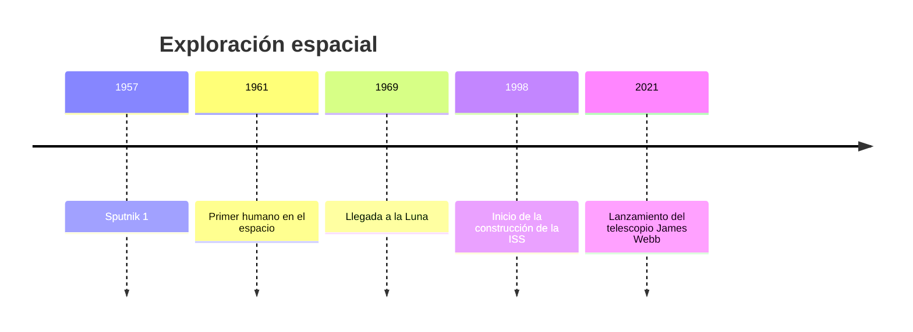
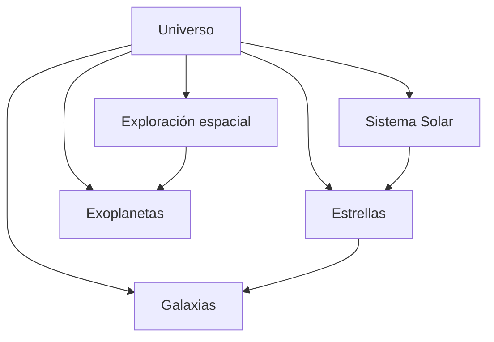

# 🌌 COSMOS WIKI
### Una aventura por el universo

**Proyecto de Markdown — Arquitectura de Computadores**

---

## 🚀 Bienvenido a Cosmos Wiki

Cosmos Wiki es una enciclopedia digital dedicada a explorar el universo, los planetas, las estrellas y los grandes descubrimientos de la humanidad.

Este proyecto permite aprender sobre astronomía mediante artículos interconectados, tablas comparativas, diagramas y referencias científicas.

## 📚 Índice de artículos

| Artículo | Tema | Acceso |
|---|---|---|
| 🪐 1 | Sistema Solar | [Leer](articulo-1.md) |
| ⭐ 2 | Estrellas | [Leer](articulo-2.md) |
| 🌌 3 | Galaxias | [Leer](articulo-3.md) |
| 🚀 4 | Exploración espacial | [Leer](articulo-4.md) |
| 🔭 5 | Exoplanetas | [Leer](articulo-5.md) |

## 📊 Estadísticas

| Elemento | Cantidad |
|---|---:|
| Artículos previstos | 5 |
| Glosarios | 1 |
| Diagramas previstos | 12 |
| Preguntas frecuentes previstas | 10 |

## 🕰️ Historia de la exploración espacial

## 🧠 Mapa conceptual

## 🌟 Artículo destacado del mes

### 🚀 Exploración espacial

Descubre cómo la humanidad pasó de observar las estrellas a enviar naves al espacio.

[Leer artículo destacado](articulo-4.md)

## 💡 ¿Sabías que...?

La luz del Sol tarda aproximadamente 8 minutos y 20 segundos en llegar a la Tierra.

## ❓ Preguntas frecuentes

1. ¿Qué es el universo?

Es el conjunto de todo el espacio, el tiempo, la materia y la energía.

2. ¿Qué es una galaxia?

Es un sistema de estrellas, gas, polvo y materia oscura unido por gravedad.

3. ¿Cuántos planetas tiene el Sistema Solar?

Ocho planetas.

4. ¿Qué es una estrella?

Es un cuerpo celeste que produce energía mediante fusión nuclear.

5. ¿Qué es un exoplaneta?

Un planeta que orbita una estrella distinta del Sol.

6. ¿Qué es un agujero negro?

Una región del espacio de la que ni siquiera la luz puede escapar.

7. ¿Cuál es el planeta más grande?

Júpiter.

8. ¿Qué es la Vía Láctea?

Es la galaxia donde se encuentra nuestro Sistema Solar.

9. ¿Qué es la ISS?

La Estación Espacial Internacional, un laboratorio orbital.

10. ¿Qué es un año luz?

La distancia que recorre la luz en un año.

## 📖 Recursos

- [Glosario](glosario.md)
- [Referencias](referencias.md)

## 👨‍💻 Contribuidores

- Daniel Godefroy — Autor y desarrollador

## 📅 Últimas actualizaciones

| Fecha | Actualización |
|---|---|
| 04/11/2026 | Creación de Cosmos Wiki |
| 04/11/2026 | Organización de artículos |

---

**Cosmos Wiki © 2026 — Daniel Godefroy**

Proyecto académico desarrollado con Markdown.

