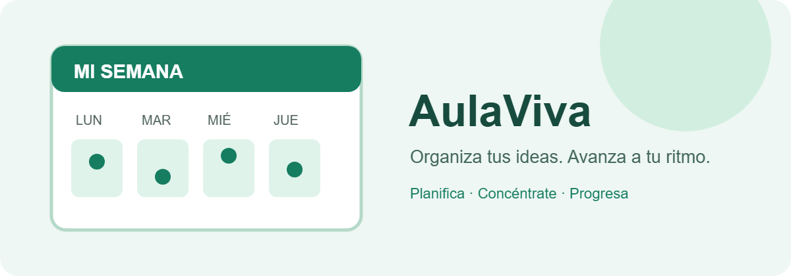
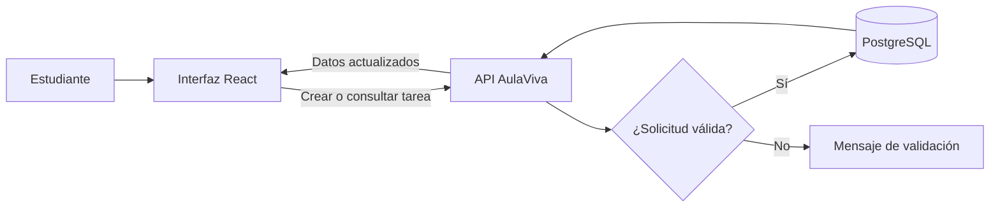

# AulaViva 📚




**AulaViva** es una aplicación web ficticia para planificar sesiones de estudio, organizar entregas y seguir el progreso semanal. Su objetivo es ayudar a estudiantes a convertir una lista dispersa de tareas en un plan claro y realista.

> [!NOTE]
> AulaViva es un proyecto educativo de ejemplo. No almacena datos reales ni está publicado.

## Índice

- [Características](#características)
- [Instalación y configuración](#instalación-y-configuración)
- [Tecnologías](#tecnologías)
- [Arquitectura y funcionamiento](#arquitectura-y-funcionamiento)
- [Ejemplos de uso](#ejemplos-de-uso)
- [Información adicional](#información-adicional)
- [Elementos visuales y avanzados](#elementos-visuales-y-avanzados)
- [Contacto](#contacto)

## Características

1. **Plan semanal:** distribuir sesiones por día y duración.
2. **Tareas y fechas límite:** ordenar entregas por prioridad.
3. **Temporizador de concentración:** alternar trabajo y pausas.
4. **Seguimiento de progreso:** consultar minutos estudiados y tareas terminadas.
5. **Recordatorios:** recibir avisos antes de una fecha límite.
6. **Etiquetas por asignatura:** filtrar el plan por materia.

Estado del desarrollo:

- [x] Crear y editar tareas
- [x] Vista semanal
- [ ] Sincronización entre dispositivos
- [ ] Exportar el plan a calendario

## Instalación y configuración

Necesitas Node.js 20 o superior y npm. En una terminal:

1. Clona el repositorio.
2. Instala las dependencias.
3. Crea la configuración local.
4. Inicia el servidor de desarrollo.

```bash
git clone https://github.com/ejemplo/aulaviva.git
cd aulaviva
npm install
cp .env.example .env
npm run dev
```

Abre `http://localhost:3000`. La variable `VITE_API_URL` del archivo `.env` define la dirección del servicio API.

## Tecnologías

| Tecnología | Versión | Descripción | Uso en el proyecto |
| :--- | :---: | :--- | :--- |
| **React** | `19.x` | Biblioteca de interfaces | Vistas y componentes reutilizables |
| *TypeScript* | `5.x` | JavaScript con tipos | Lógica de la aplicación |
| `Vite` | `6.x` | Herramienta de desarrollo | Servidor local y compilación |
| **Node.js** | `20+` | Entorno de ejecución | Scripts y servidor de desarrollo |
| PostgreSQL | `17.x` | Base de datos relacional | Tareas, sesiones y preferencias |

## Arquitectura y funcionamiento

La interfaz envía las acciones del estudiante a una API. La API valida la solicitud y guarda los cambios en PostgreSQL; después devuelve los datos actualizados para refrescar el panel.



## Ejemplos de uso

### Añadir una sesión de estudio

```javascript
const sesion = {
  asignatura: "Biología",
  tema: "Genética",
  minutos: 40,
  fecha: "2026-11-05"
};

await aulaViva.sesiones.crear(sesion);
```

### Consultar tareas pendientes con la API

```bash
curl "http://localhost:3000/api/tareas?estado=pendiente" \
  -H "Accept: application/json"
```

Consulta la [guía de Markdown de GitHub](https://docs.github.com/es/get-started/writing-on-github) y la [documentación de Mermaid](https://mermaid.js.org/intro/).

## Información adicional

> **Recomendación:** reserva pausas entre sesiones y ajusta el plan al tiempo disponible; una agenda sostenible funciona mejor que una lista imposible.

<details>
<summary>Detalles de la configuración local</summary>

En `.env`, configura `VITE_API_URL` con la URL del servicio local. No guardes credenciales reales en el repositorio. El archivo `.env` debe permanecer fuera del control de versiones.

</details>

<!-- TODO: sustituir los datos ficticios cuando el proyecto tenga un repositorio real. -->

Caracteres especiales en Markdown: para mostrar literalmente `*texto*`, escapa los asteriscos como `\*texto\*`.

---
## Elementos visuales y avanzados


Para mostrar literalmente *texto* sin aplicar cursiva, escapa los asteriscos: `\*texto\*`.

---

## Contacto

Proyecto académico ficticio. Para consultas de ejemplo: [equipo@aulaviva.example](mailto:equipo@aulaviva.example) · [Repositorio de demostración](https://github.com/ejemplo/aulaviva).

- **Correo:** [Mariano.filiaggi@alumnos.uneatlantico.es](mailto:Mariano.filiaggi@alumnos.uneatlantico)
- **Repositorio:** [IGPS en GitHub](https://github.com/marianofiliaggi/IGPS)