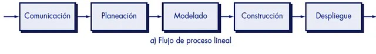
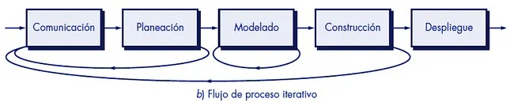
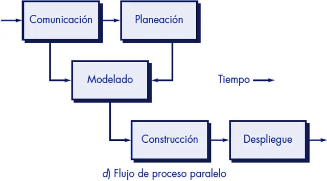
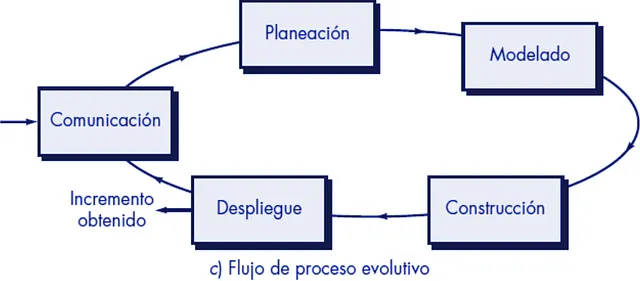
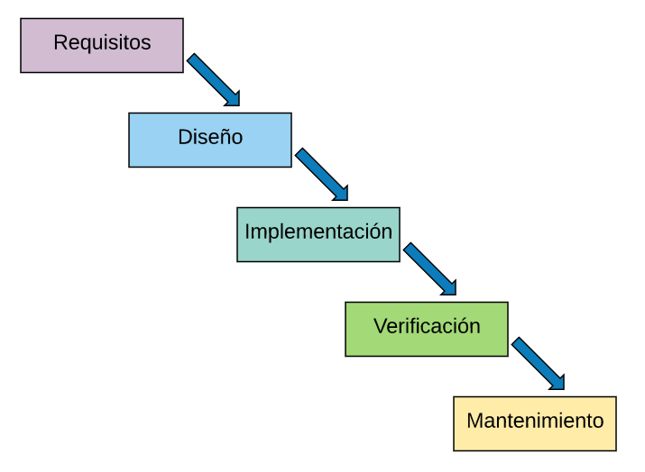
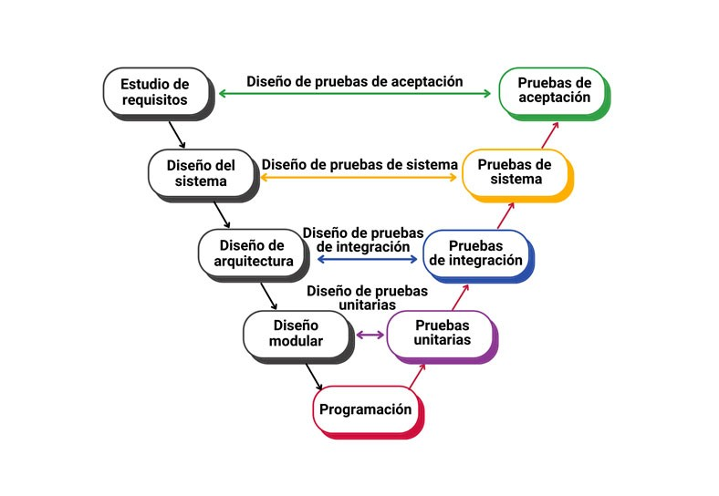
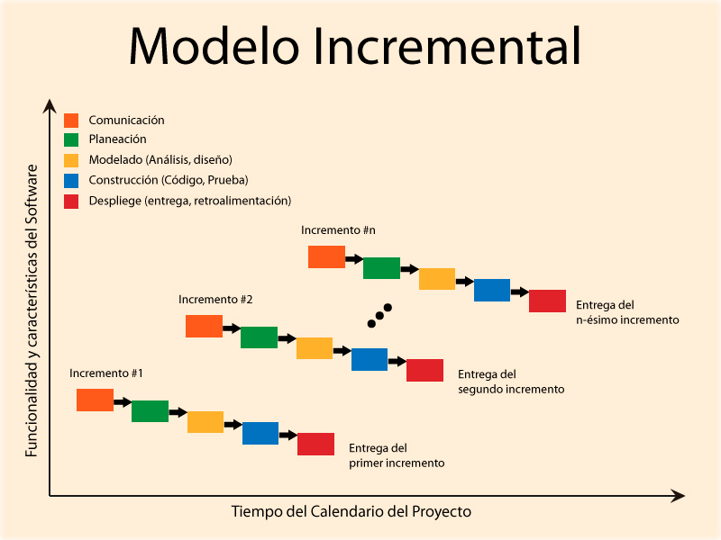
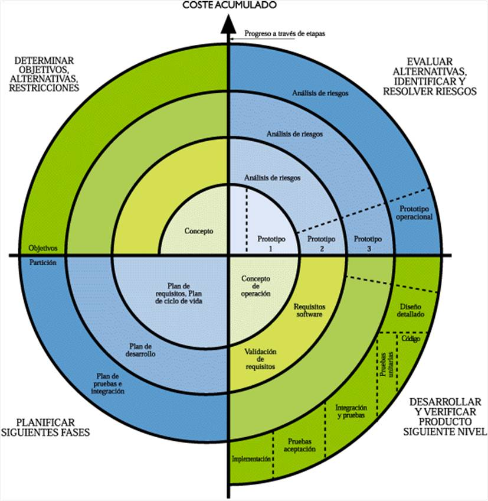
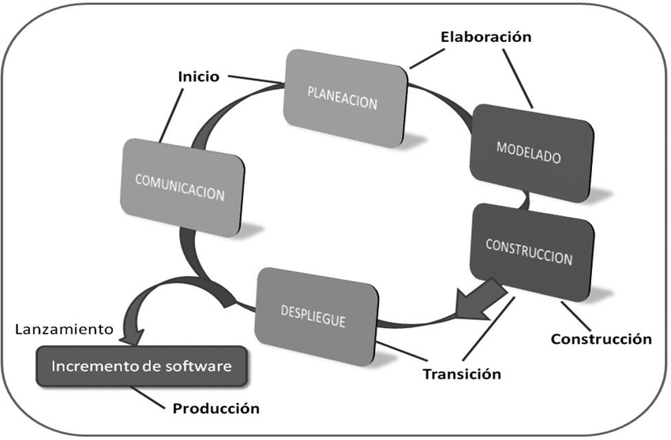

# Software Processes

## What Is Software?

**Software**[(1)](#bibliography) is the formal system[(2)](#bibliography) of a computer system. It comprises the set of logical components required to perform specific tasks, as opposed to the physical components, which are known as hardware. Software is therefore responsible for sending instructions to the hardware so that it can operate. Basically, it acts as an intermediary between you and the machine.

Software can be divided into three main categories:

### System Software

System software includes everything that properly connects both programmers and users to the machine. It provides high-level interfaces that shield them from physical aspects such as memory, processing, ports, keyboards, etc. It includes:

- Operating systems
- BIOS
- Drivers
- Servers

### Programming Software

Programming software includes all the tools that allow programmers to create computer applications using different programming languages. These include:

- Compilers
- Text editors
- IDEs
- Interpreters

### Application Software

This includes all software that allows users to perform one or more specific tasks. This category includes:

- Office software
- Databases
- Medical software
- Telecommunications software
- Video games

## Who Builds It?

Software technicians and engineers analyze real-world problems, design solutions, and develop applications (in this case, computer applications), along with everything that this entails: architecture, patterns, costs, etc.

## How Is It Built?

Software is not built; it is developed. This means that the process involves planning and modeling, in addition to actually building the program.

Software development can be divided into two groups: **framework activities** and **umbrella activities**. Although umbrella activities are not strictly necessary for software to go from nothing to a finished product, they make a significant contribution to creating a better system.

### Framework Activities

#### Requirements Gathering / Communication

The first thing we need is to understand that someone or something requires a software solution to a particular problem. Good communication must be maintained, and all the necessary information must be gathered to determine when the software can be considered complete (the so-called *scope*). During this stage, we will also be informed of the project deadlines, including the final delivery date.

This communication can take place both at the beginning and continuously throughout the process, involving the client in software development.

#### Planning

At this stage, we must define the other challenges involved in developing the software. This includes choosing the technologies, organizing the requested functionalities, and addressing other aspects that will determine the project's costs.

Analyzing the project's feasibility to determine whether the requested solution is achievable, as well as assessing risks to prepare for potential situations, are also activities included in this phase.

#### Modeling

It is time to start designing the solution. To do so, we must take into account all the environments and functionalities that our software will include.

If the software is going to have a **database**, we must design a structure that facilitates its implementation, subsequent maintenance, and future development. The way data will move through the system must be clearly specified using diagrams. A good diagram can help identify where an error is occurring before the software has even been built.

It is also important to start designing the **user interfaces** and have the client approve their visual appearance. This will help ensure that the application's user flow is as smooth as possible and prevent the creation of an application with a steep learning curve.

#### Construction

We now reach the stage where technical knowledge is put into practice. With the technology selected, the data and interface designs completed, and the other relevant aspects defined, it is time to program both the product itself and its tests.

This may also be the right time to develop tools and automations that support both the construction and deployment processes.

#### Deployment

Finally, once the software has been created and tested (both internally and with the client during a beta phase), it is time to deploy it.

At this point, users can interact with a specific version of the product, which the client (or other users) will be able to use freely.

This is one of the shortest phases if the previous stages have been carried out properly. However, it is also where the most critical problems may come to light. Any failure can undermine the perception of the software as a good product and, consequently, damage user trust.

### Umbrella Activities

As mentioned above, **umbrella activities** are not essential to the development of software itself, but they are essential to developing *good software*.

These activities include everything related to **process and product monitoring and control**; **risk management** to handle risks as effectively as possible; and **quality assurance**, whether at the code level through patterns, syntax, etc., or at the overall product level through testing.

**Technical and configuration reviews** are also important to keep our program up to date and in good working order, both in terms of its technology and its configuration.

## Software Processes[(3)](#bibliography)

### Linear Process

The linear process follows the "natural" sequence of activities, with each activity starting only when the previous one has finished.

### Iterative Process

The iterative process has the advantage of allowing each activity to be improved and revisited before moving on to the next one. It is very useful for creating high-quality deliverables.

### Parallel Process

The parallel process allows one or more activities to be carried out simultaneously while the others are still in progress.

### Evolutionary Process

The evolutionary process iterates over itself, creating a complete cycle of activities and increasing the value of the software with each iteration. It is useful for the continuous delivery of deliverables.

## Software Development Models

A model can use any process to generate steps that are executed in different ways. The most commonly used models are:

### Waterfall Model

Very similar to the linear process, each phase is completed before moving on to the next one.

### V-Model

First, we follow the classic linear Waterfall process. Then, we work our way back step by step, verifying and correcting the results through different types of testing.

### Incremental Process Model

Using a Waterfall process, we add value with each iteration.

### Evolutionary Process Model

Using an incremental process, we add value with each iteration.

### Unified Model

The Unified Model is characterized by building upon all the work completed in previous stages. It combines iterative and incremental processes and is one of the most widely used models today.

## What Makes Software Good?

Although the word *good* is subjective and depends both on whom you ask and on the project itself, there are several areas that deserve special attention when trying to build software that is considered good, or that aims to be good:

### Maintainable

The software we build must be maintainable over time. Its code, architecture, processes, and integrations must be understandable so that, in the future, when team members change, the time required for new members to adapt is kept to a minimum (or even eliminated, if simply reading the documentation is enough to understand the system).

This will make the software easier to evolve and fix.

### Secure

Engineers must ensure that every system they create is as resistant as possible to unwanted modifications. The integrity of the processes, data, and other parts of the software is what helps build trust in the system.

### Reliable

Reliability does not depend solely on how secure our software is. We must also provide the functions and behavior expected and agreed upon with the client.

Ensuring that the software behaves as expected and that information remains intact is so important that it is the first requirement expected in a professional environment.

### Efficient

Efficiency is the most flexible aspect, provided that the other requirements are met. A good engineer will always consider the efficiency of their software solution, but this is not always possible.

What must be avoided at all costs is wasting resources without justification. Every decision that affects this aspect must be analyzed and weighed carefully to achieve the right balance between quality and efficiency.

### Adaptable

Software, especially when it needs to interact with other systems, must be flexible enough to support integrations, both with our own system and with external systems.

This requires a broader view of the software and multi-layered reasoning to gain a complete understanding of the potential risks and benefits of each integration.

## What Are the Challenges of Software Development?

When creating software, we will always face certain constraints that must be taken into account during the design process. As engineers, we must consider the following aspects:

1. Time
2. Quality
3. Maintenance
4. Reusability
5. The end user

These five aspects must be balanced to ensure that everyone is satisfied.

## Bibliography

1. [Wikipedia - Software](https://en.wikipedia.org/wiki/Software)
2. [Wikipedia - Formal System](https://en.wikipedia.org/wiki/Formal_system)
3. [Medium - Software Development Processes](https://medium.com/@ramiroec/procesos-de-desarrollo-de-software-d06d18ebd78f)
