# PlantUML – Modelado mediante código (Parte 1)

## 1. Introducción al modelado de software

Antes de desarrollar una aplicación o un videojuego, es importante comprender qué vamos a construir, cómo se organizarán sus componentes y cómo interactuarán entre sí.

En proyectos pequeños podemos explicar estas decisiones mediante texto o esquemas sencillos. Sin embargo, cuando aumenta la complejidad del proyecto, necesitamos herramientas que permitan representar la información de manera visual, organizada y comprensible.

Aquí es donde entran en juego los lenguajes y herramientas de modelado.

### 1.1. ¿Qué es UML?

**UML (Unified Modeling Language o Lenguaje Unificado de Modelado)** es un lenguaje estándar de modelado visual utilizado para especificar, visualizar y documentar sistemas.

Su finalidad es representar diferentes aspectos de un sistema informático mediante diagramas que faciliten su comprensión y diseño.

UML permite representar, entre otras cosas:

- **Estructura:** qué componentes forman el sistema y cómo se relacionan.
- **Comportamiento:** qué acciones puede realizar el sistema.
- **Interacciones:** cómo se comunican los diferentes componentes.
- **Procesos:** qué pasos se ejecutan para completar una operación.
- **Despliegue:** dónde se ejecutan los diferentes componentes del sistema.

Por ejemplo, si queremos desarrollar un videojuego, UML nos puede ayudar a representar:

- Los personajes y sus características.
- Las relaciones entre jugadores, partidas y objetos.
- Las interacciones entre el jugador y el inventario.
- Los estados de un personaje.
- La comunicación entre el cliente y el servidor.

Es importante entender que UML **no es un lenguaje de programación**. No sirve directamente para ejecutar una aplicación, sino para describir y comunicar cómo está diseñado un sistema.

### 1.2. Tipos de diagramas UML

UML dispone de diferentes tipos de diagramas que podemos agrupar en dos grandes categorías:

**Diagramas estructurales**

Representan cómo está organizado un sistema.

Algunos ejemplos son:
- Diagramas de clases.
- Diagramas de componentes.
- Diagramas de despliegue.
- Diagramas de objetos.

**Diagramas de comportamiento**

Representan cómo funciona un sistema y cómo interactúan sus elementos.

Algunos ejemplos son:
- Diagramas de casos de uso.
- Diagramas de actividad.
- Diagramas de secuencia.
- Diagramas de estados.

En esta primera parte no profundizaremos en todos estos diagramas. Nos centraremos en aprender PlantUML y utilizar diferentes representaciones visuales para documentar proyectos.

---

## 2. ¿Qué es PlantUML?

[PlantUML](https://plantuml.com/es/) es una herramienta de código abierto que permite generar diagramas mediante un lenguaje de texto sencillo.

En lugar de crear los diagramas arrastrando y colocando elementos en una interfaz gráfica, escribimos instrucciones que describen los elementos y sus relaciones. PlantUML interpreta ese texto y genera una representación visual.

Por ejemplo, podemos escribir:

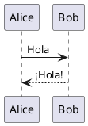

Y obtener un diagrama de interacción entre dos participantes.

La principal ventaja es que podemos modificar el diagrama editando directamente el texto, sin necesidad de reorganizar manualmente todos sus elementos.

### 2.1. Ventajas de PlantUML

**1. Rapidez de creación**

Permite generar diagramas mediante instrucciones sencillas, sin tener que dibujar manualmente cada elemento.

**2. Control de versiones**

Al tratarse de archivos de texto, podemos almacenarlos en Git y consultar su historial de cambios.

Por ejemplo, si modificamos la arquitectura de una aplicación, podemos consultar qué elementos han cambiado entre dos versiones del proyecto.

**3. Consistencia**

Los diagramas pueden seguir una sintaxis y unos estilos comunes, facilitando su lectura y revisión.

**4. Integración con otras herramientas**

PlantUML puede integrarse en editores, documentación técnica, wikis y repositorios de código.

**5. Automatización**

Podemos generar diagramas a partir de procesos automatizados e incorporarlos a los sistemas de documentación de un proyecto.

**6. Código abierto**

PlantUML es un proyecto gratuito y de código abierto.

Repositorio oficial: <https://github.com/plantuml/plantuml>

### 2.2. ¿Dónde podemos utilizar PlantUML?

PlantUML resulta especialmente útil en entornos donde necesitamos documentar o planificar sistemas.

Algunos ejemplos:

- Documentación técnica de aplicaciones.
- Diseño de arquitecturas de software.
- Planificación de proyectos.
- Documentación de APIs.
- Diseño de bases de datos.
- Elaboración de documentación para GitHub.
- Wikis de equipos de desarrollo.
- Presentaciones técnicas.
- Diseño inicial de interfaces.
- Organización de ideas y funcionalidades.

**Ejemplo práctico: documentación de una aplicación como Spotify**

Un equipo que desarrolla una aplicación de música puede utilizar PlantUML para documentar:

- Las funcionalidades disponibles.
- La estructura de los datos de los usuarios.
- Las tareas necesarias para implementar una nueva funcionalidad.
- El diseño inicial de la interfaz.
- La planificación de una nueva versión.

De esta manera, los diagramas forman parte de la documentación técnica del proyecto y pueden evolucionar junto con el código.

---

## 3. Configuración del entorno

Podemos trabajar con PlantUML de diferentes maneras. Para comenzar, utilizaremos dos alternativas.

### 3.1. Opción 1: herramientas online

Es la opción más sencilla para empezar, ya que no requiere instalar herramientas adicionales.

Podemos utilizar:

- [PlantUML Online Server](https://www.plantuml.com/plantuml/uml/): permite generar diagramas a partir de código.
- [PlantText](https://www.planttext.com/): editor online que permite escribir PlantUML y visualizar el resultado.
- [PlantUML](https://plantuml.com/): página oficial con documentación y ejemplos.

**Ventajas:**
- No necesitamos configurar un entorno de desarrollo.
- Podemos realizar pruebas rápidamente.
- Es una buena alternativa para ejercicios puntuales.

### 3.2. Opción 2: Visual Studio Code

Para trabajar de forma habitual, podemos integrar PlantUML en Visual Studio Code.

**Instalación:**

1. Abrir Visual Studio Code.
2. Acceder al apartado Extensions mediante `Ctrl + Shift + X`.
3. Buscar `PlantUML`.
4. Instalar la extensión **PlantUML**, desarrollada por jebbs.

**Requisitos para la generación de diagramas:**

Dependiendo del modo de renderizado elegido, podemos necesitar:

- Java instalado para la generación local.
- Graphviz para determinados tipos de diagramas y representaciones.
- O utilizar un servidor PlantUML remoto para evitar parte de la configuración local.

Es importante comprobar la configuración de renderizado de la extensión.

**Crear nuestro primer archivo:**

1. Crear un archivo con extensión `.puml`.
2. Escribir el código PlantUML.
3. Abrir la vista previa mediante `Alt + D`.
4. También podemos utilizar `Ctrl + Shift + P` y buscar `PlantUML: Preview Current Diagram`.

Ejemplo de archivo:

`primer-diagrama.puml`

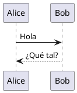

---

## 4. Estructura básica de PlantUML

Todos los diagramas de PlantUML utilizan una estructura delimitada por instrucciones de inicio y finalización.

En los diagramas UML tradicionales utilizaremos:

```plantuml
@startuml

' Aquí escribimos el contenido del diagrama

@enduml
```

En otros tipos de diagramas, como MindMap, JSON, Gantt o Salt, utilizaremos instrucciones específicas.

### 4.1. Elementos principales

| Elemento | Función |
|---|---|
| `@startuml` | Inicia un diagrama UML. |
| `@enduml` | Finaliza un diagrama UML. |
| `'` | Permite escribir comentarios. |
| `title` | Define el título del diagrama. |
| `skinparam` | Permite modificar determinados parámetros visuales. |
| `!define` | Permite definir macros y elementos reutilizables. |

### 4.2. Comentarios

Los comentarios permiten añadir explicaciones al código sin que aparezcan en el diagrama.

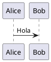

### 4.3. Títulos

Podemos establecer un título para identificar el contenido del diagrama.

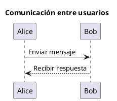

### 4.4. Personalización visual

PlantUML permite modificar colores, tipografías, tamaños y otros aspectos de los diagramas.

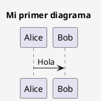

**Recomendación:** no debemos abusar de los colores y los estilos. La finalidad principal de un diagrama es comunicar información de manera clara.

---

# 5. MindMaps (mapas mentales)

## 5.1. ¿Qué es un mapa mental?

Un mapa mental (*MindMap*) es una representación visual que permite organizar ideas, conceptos, funcionalidades o tareas alrededor de un elemento principal.

Se construye mediante una estructura jerárquica de ramas que relacionan los diferentes conceptos.

Es especialmente útil durante las primeras fases de un proyecto, cuando necesitamos organizar información y establecer qué elementos forman parte de un sistema.

Podemos utilizar mapas mentales para:

- Organizar las funcionalidades de una aplicación.
- Planificar un videojuego.
- Diseñar un plan de aprendizaje.
- Estructurar un proyecto.
- Realizar sesiones de brainstorming.
- Organizar tareas y objetivos.

## 5.2. Sintaxis básica

Para crear un mapa mental utilizamos:

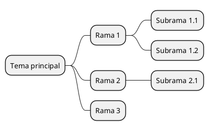

Los asteriscos indican los diferentes niveles de profundidad:

| Sintaxis | Nivel |
|---|---|
| `*` | Elemento principal |
| `**` | Primera rama |
| `***` | Segunda rama |
| `****` | Tercera rama |

Cuantos más asteriscos utilicemos, mayor será la profundidad del elemento.

## 5.3. Distribución de los elementos

Una de las características de PlantUML es que permite distribuir las ramas a ambos lados del elemento principal.

Podemos utilizar:

- `+` para desarrollar ramas hacia la derecha.
- `-` para desarrollar ramas hacia la izquierda.

Ejemplo:

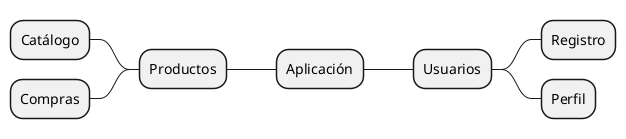

También podemos utilizar colores para diferenciar las ramas y destacar determinados conceptos.

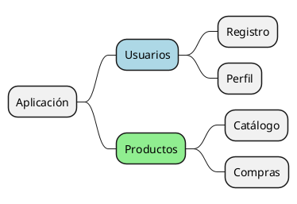

## 5.4. Ejemplos prácticos

### Ejemplo 1: organización de un plan de aprendizaje

Imaginemos que queremos aprender desarrollo web.

Podemos utilizar un mapa mental para organizar las diferentes áreas de conocimiento.

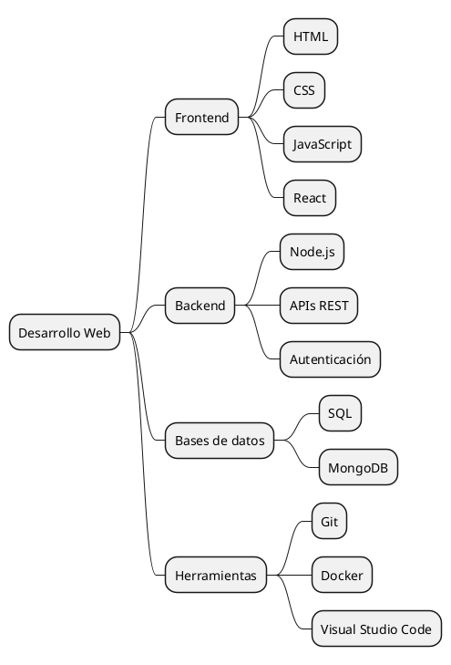

Este tipo de representación permite visualizar rápidamente las áreas que debemos estudiar y las tecnologías relacionadas.

### Ejemplo 2: planificación de un proyecto como Minecraft

Vamos a representar los principales sistemas que podría incluir un videojuego de construcción y exploración inspirado en Minecraft.

El objetivo es identificar los subsistemas que forman parte del juego.

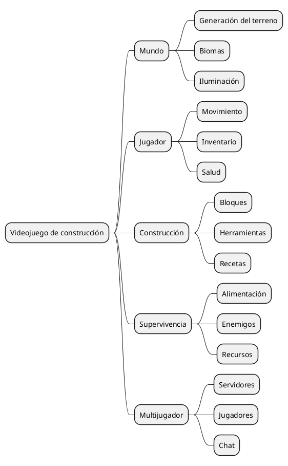

El mapa permite identificar las principales áreas de desarrollo y dividir el trabajo entre diferentes equipos.

### Ejemplo 3: organización de las funcionalidades de Spotify

Podemos representar las principales funcionalidades visibles de una aplicación de música como Spotify.

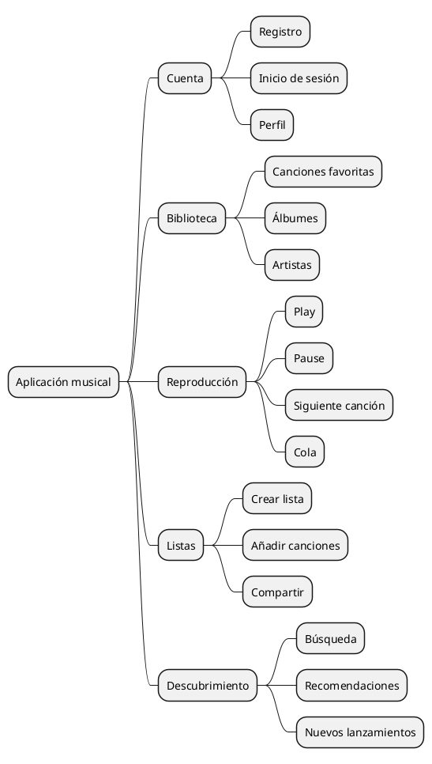

Este ejemplo muestra cómo podemos utilizar un mapa mental para identificar y organizar funcionalidades antes de comenzar su implementación.

## 5.5. Ejercicio práctico 1

**Objetivo:** aprender a organizar información mediante mapas mentales utilizando PlantUML.

Crear un mapa mental sobre uno de los siguientes temas:

- Tu carrera profesional: estudios, habilidades, experiencia y objetivos.
- Un videojuego: personajes, escenarios, mecánicas, enemigos y progresión.
- Una aplicación: usuarios, funcionalidades, pantallas y servicios.
- Un plan de viaje: destino, transporte, alojamiento y actividades.
- Un proyecto personal: objetivos, recursos, tareas y entregables.

**Requisitos:**

1. Incluir un elemento principal.
2. Incorporar al menos 3 ramas principales.
3. Utilizar un mínimo de 2 niveles de profundidad.
4. Distribuir las ramas a ambos lados del elemento principal.
5. Utilizar al menos 2 colores para diferenciar las categorías.
6. Añadir comentarios en el código para identificar las diferentes secciones.

---

# 6. JSON Visualizer

## 6.1. ¿Qué es JSON?

JSON (JavaScript Object Notation) es un formato de texto utilizado para representar e intercambiar información entre diferentes aplicaciones y sistemas.

Es especialmente habitual en el desarrollo de aplicaciones web y móviles, ya que permite transmitir datos de forma estructurada y sencilla.

Por ejemplo, cuando una aplicación móvil solicita información a un servidor, este puede responder mediante un objeto JSON que contiene los datos solicitados.

JSON permite representar:

- Datos simples.
- Listas de elementos.
- Objetos.
- Estructuras anidadas.
- Información de usuarios.
- Respuestas de APIs.
- Configuraciones de aplicaciones.

## 6.2. Tipos de datos

JSON dispone de seis categorías de valores:

| Tipo | Ejemplo | Descripción |
|---|---|---|
| String | `"Ana"` | Texto. |
| Number | `30` | Número entero o decimal. |
| Boolean | `true` | Valor verdadero o falso. |
| Null | `null` | Ausencia de valor. |
| Array | `[1, 2, 3]` | Colección ordenada. |
| Object | `{"nombre":"Ana"}` | Conjunto de propiedades. |

Ejemplo:

```json
{
  "nombre": "Ana",
  "edad": 30,
  "es_empleado": true,
  "altura": 1.68,
  "hobbies": ["leer", "caminar", "cocinar"],
  "direccion": {
    "calle": "Calle Falsa 123",
    "ciudad": "Santander",
    "codigo_postal": "39001"
  },
  "telefono_secundario": null
}
```

Es importante recordar que JSON utiliza comillas dobles para las claves y los valores de tipo texto. No admite comentarios ni valores como `undefined`.

## 6.3. ¿Qué es JSON Visualizer en PlantUML?

PlantUML permite representar visualmente estructuras JSON mediante diagramas jerárquicos.

En lugar de leer un objeto JSON completo, podemos visualizar sus propiedades, objetos anidados y colecciones.

Para crear este tipo de diagrama utilizamos:

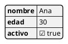

**Importante:** JSON Visualizer no sustituye a un validador JSON ni modifica los datos. Su función es facilitar la comprensión visual de su estructura.

## 6.4. Ejemplos prácticos

### Ejemplo 1: configuración de usuario

Imaginemos que estamos desarrollando una aplicación como Spotify.

Cada usuario dispone de un perfil con información personal y preferencias de reproducción.

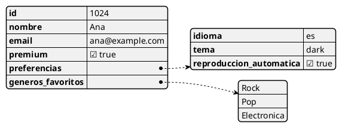

En este ejemplo podemos observar:

- Información básica del usuario.
- Un objeto anidado con sus preferencias.
- Un array con los géneros musicales favoritos.
- Diferentes tipos de datos.

### Ejemplo 2: respuesta de una API

Imaginemos que una aplicación de streaming solicita información sobre una película o serie a un servidor.

El servidor devuelve una respuesta estructurada con los datos del contenido.

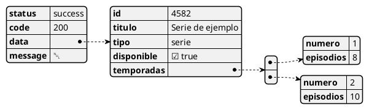

Este ejemplo representa una respuesta ficticia de una API, con un código de estado, información principal y un conjunto de temporadas.

### Ejemplo 3: configuración de un videojuego

Vamos a representar una configuración de partida inspirada en un videojuego multijugador como Fortnite.

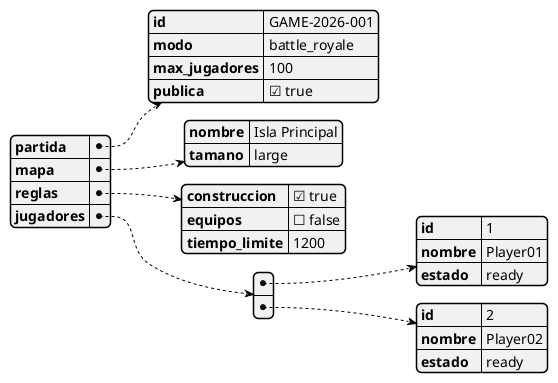

Este modelo permite representar cómo podría estructurarse la información de una partida.

No representa el formato interno real utilizado por Fortnite.

## 6.5. Ejercicio práctico 2

**Objetivo:** representar visualmente información estructurada utilizando JSON y PlantUML.

Crear un documento JSON para uno de los siguientes casos:

- Perfil de usuario de una aplicación.
- Catálogo de productos de una tienda online.
- Información de un videojuego.
- Respuesta de una API.
- Configuración de una aplicación móvil.

**Requisitos:**

1. Incluir al menos 5 propiedades principales.
2. Incorporar al menos un objeto anidado.
3. Incluir al menos un array.
4. Utilizar diferentes tipos de datos.
5. Generar su representación visual mediante PlantUML.
6. Comprobar que el JSON tiene una sintaxis válida.

---

# 7. Diagramas de Gantt

## 7.1. ¿Qué es un diagrama de Gantt?

Un diagrama de Gantt es una herramienta utilizada para planificar y representar temporalmente las actividades de un proyecto.

Permite visualizar:

- Las tareas que forman parte del proyecto.
- La duración de cada tarea.
- Las fechas de inicio y finalización.
- Las dependencias entre actividades.
- Los hitos importantes.
- El progreso de las tareas.

Cada actividad se representa mediante una barra horizontal cuya posición y longitud indican cuándo comienza y cuánto tiempo dura.

Los diagramas de Gantt son especialmente útiles en proyectos de desarrollo de software, ya que permiten organizar el trabajo y detectar posibles retrasos.

## 7.2. Sintaxis básica

Para crear un diagrama de Gantt utilizamos:

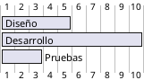

En este ejemplo tenemos tres tareas con diferentes duraciones.

### 7.3. Configurar el inicio del proyecto

Podemos definir una fecha de inicio para el proyecto:

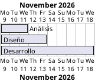

Esto permite establecer un calendario de referencia.

### 7.4. Dependencias entre tareas

En muchos proyectos existen actividades que no pueden comenzar hasta que otras hayan terminado.

PlantUML permite representar estas dependencias mediante la palabra `starts`.

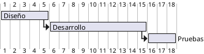

En este ejemplo:

1. Primero se realiza el diseño.
2. Cuando termina el diseño, comienza el desarrollo.
3. Cuando termina el desarrollo, comienzan las pruebas.

También podemos establecer tareas que comiencen simultáneamente cuando sus dependencias lo permitan.

### 7.5. Separadores y secciones

Los proyectos suelen dividirse en diferentes etapas.

Podemos utilizar separadores para distinguir visualmente las fases del proyecto.

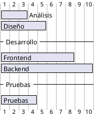

### 7.6. Hitos (milestones)

Un hito representa un acontecimiento importante dentro de un proyecto.

A diferencia de una tarea normal, un hito no tiene duración: representa un momento concreto.

Por ejemplo:

- Finalización del diseño.
- Entrega de un prototipo.
- Primera versión funcional.
- Lanzamiento del producto.

Ejemplo:

```plantuml
@startgantt

[Diseño] requires 5 days

-- Hito --

[Prototipo completado] happens at [Diseño]'s end

[Desarrollo] requires 10 days
[Desarrollo] starts at [Diseño]'s end

@endgantt
```

### 7.7. Colores y progreso

Podemos personalizar las tareas para diferenciar estados o destacar actividades importantes.

```plantuml
@startgantt

[Análisis] requires 3 days
[Análisis] is colored in LightGreen

[Diseño] requires 5 days
[Diseño] is colored in LightBlue

[Desarrollo] requires 10 days
[Desarrollo] is colored in LightSalmon

[Pruebas] requires 4 days
[Pruebas] is colored in LightPink

@endgantt
```

También podemos utilizar porcentajes para representar el progreso de las tareas mediante la sintaxis de progreso de PlantUML.

Por ejemplo:

```plantuml
@startgantt

[Análisis] requires 5 days
[Análisis] is 100% completed

[Diseño] requires 5 days
[Diseño] is 60% completed

[Desarrollo] requires 10 days
[Desarrollo] is 20% completed

@endgantt
```

El porcentaje representa el progreso indicado en el diagrama, no una medición automática del trabajo realizado.

## 7.8. Ejemplos prácticos

### Ejemplo 1: desarrollo de una aplicación web

Vamos a planificar el desarrollo de una aplicación web de gestión de tareas.

```plantuml
@startgantt

Project starts the 2026-11-09

title Desarrollo de aplicación de tareas

-- Análisis y diseño --

[Requisitos] requires 3 days
[Diseño UI] requires 4 days
[Modelo de datos] requires 3 days

[Diseño UI] starts at [Requisitos]'s end
[Modelo de datos] starts at [Requisitos]'s end

-- Desarrollo --

[Backend] requires 8 days
[Frontend] requires 8 days

[Backend] starts at [Modelo de datos]'s end
[Frontend] starts at [Diseño UI]'s end

-- Validación --

[Integración] requires 3 days
[Pruebas] requires 4 days
[Pruebas] starts at [Integración]'s end

[Integración] starts at [Backend]'s end
[Integración] starts at [Frontend]'s end

-- Entrega --

[Lanzamiento] happens at [Pruebas]'s end

@endgantt
```

Este ejemplo permite observar cómo algunas actividades pueden realizarse en paralelo y cómo otras necesitan que determinadas tareas hayan finalizado.

### Ejemplo 2: desarrollo de un videojuego independiente

Imaginemos un equipo que quiere desarrollar un videojuego de plataformas en 2D.

El proyecto se divide en diferentes etapas:

- Diseño del concepto.
- Creación de personajes y escenarios.
- Programación de mecánicas.
- Implementación de niveles.
- Pruebas.
- Publicación.

```plantuml
@startgantt

Project starts the 2026-11-09

title Desarrollo de videojuego 2D

-- Preproducción --

[Concepto y documentación] requires 4 days
[Diseño de niveles] requires 5 days
[Diseño de personajes] requires 5 days

[Diseño de niveles] starts at [Concepto y documentación]'s end
[Diseño de personajes] starts at [Concepto y documentación]'s end

-- Producción --

[Programación de movimiento] requires 6 days
[Arte y animaciones] requires 8 days
[Implementación de niveles] requires 7 days

[Programación de movimiento] starts at [Concepto y documentación]'s end
[Arte y animaciones] starts at [Diseño de personajes]'s end
[Implementación de niveles] starts at [Diseño de niveles]'s end

-- Pruebas --

[Integración] requires 3 days
[Testing] requires 5 days

[Integración] starts at [Programación de movimiento]'s end
[Integración] starts at [Arte y animaciones]'s end
[Integración] starts at [Implementación de niveles]'s end

[Testing] starts at [Integración]'s end

-- Entrega --

[Versión jugable] happens at [Integración]'s end
[Lanzamiento] happens at [Testing]'s end

@endgantt
```

El diagrama muestra cómo podemos dividir un videojuego en tareas independientes y coordinar el trabajo de diferentes perfiles.

### Ejemplo 3: sprint de desarrollo ágil

En un equipo que utiliza Scrum, podemos representar las actividades de un sprint.

Imaginemos que queremos implementar un sistema de favoritos en una aplicación de música.

```plantuml
@startgantt

Project starts the 2026-11-09

title Sprint - Sistema de favoritos

-- Planificación --

[Definir historias de usuario] requires 1 day
[Diseñar solución] requires 1 day

[Diseñar solución] starts at [Definir historias de usuario]'s end

-- Implementación --

[API de favoritos] requires 3 days
[Interfaz de favoritos] requires 3 days

[API de favoritos] starts at [Diseñar solución]'s end
[Interfaz de favoritos] starts at [Diseñar solución]'s end

-- Validación --

[Integración] requires 1 day
[Pruebas] requires 2 days

[Integración] starts at [API de favoritos]'s end
[Integración] starts at [Interfaz de favoritos]'s end
[Pruebas] starts at [Integración]'s end

-- Entrega --

[Demo del sprint] happens at [Pruebas]'s end

@endgantt
```

Este ejemplo representa una planificación simplificada. En Scrum, las actividades pueden solaparse y adaptarse durante el sprint, por lo que el diagrama no debe interpretarse como una secuencia rígida obligatoria.

## 7.9. Ejercicio práctico 3

**Objetivo:** planificar un proyecto utilizando diagramas de Gantt.

Elegir uno de los siguientes proyectos:

- Desarrollo de una aplicación móvil.
- Desarrollo de un videojuego.
- Creación de una tienda online.
- Organización de un evento.
- Preparación de un examen.
- Aprendizaje de una tecnología nueva.

**Requisitos:**

1. Definir una fecha de inicio.
2. Incluir al menos 8 tareas.
3. Organizar las tareas en un mínimo de 2 secciones.
4. Establecer al menos 3 dependencias.
5. Incorporar un hito importante.
6. Utilizar colores para diferenciar las fases.
7. Indicar el porcentaje de progreso de algunas tareas.

---

# 8. Mockups, Salt y Wireframes

## 8.1. ¿Qué es un wireframe?

Un *wireframe* es una representación esquemática de la interfaz de una aplicación o página web.

Su objetivo es mostrar cómo se organizan los diferentes elementos de una pantalla antes de desarrollar su diseño visual definitivo.

Permite definir:

- Distribución de los elementos.
- Organización del contenido.
- Estructura de navegación.
- Formularios.
- Botones.
- Menús.
- Tablas.
- Áreas de información.

Un wireframe no pretende mostrar cómo quedará exactamente la aplicación. Su finalidad es definir la estructura y la funcionalidad de la interfaz.

## 8.2. Diferencias entre wireframe, mockup y prototipo

Aunque a veces se utilizan como sinónimos, representan conceptos diferentes.

| Concepto | Descripción |
|---|---|
| Wireframe | Esquema estructural de una pantalla. |
| Mockup | Representación visual más elaborada, normalmente estática. |
| Prototipo | Modelo que permite simular o probar interacciones y flujos de navegación. |

PlantUML incorpora **Salt**, un lenguaje específico para generar wireframes y esquemas de interfaces.

No sustituye a herramientas especializadas de diseño visual como Figma, pero resulta útil para documentar rápidamente la estructura de una interfaz.

## 8.3. Sintaxis básica de Salt

Para generar una interfaz utilizamos:

```plantuml
@startsalt

{
  Elemento de interfaz
  [Botón]
  "Campo de texto"
}

@endsalt
```

Salt dispone de diferentes elementos:

| Sintaxis | Elemento |
|---|---|
| `[Texto]` | Botón. |
| `"Texto"` | Campo de texto. |
| `^Opción^` | Lista desplegable. |
| `()` | Radio button sin seleccionar. |
| `(X)` | Radio button seleccionado. |
| `[]` | Checkbox sin seleccionar. |
| `[X]` | Checkbox seleccionado. |
| `{` y `}` | Contenedor de la interfaz. |
| `\|` | Separador de columnas. |

## 8.4. Organización mediante Grid

Podemos organizar los elementos en filas y columnas.

Ejemplo:

```plantuml
@startsalt

{
  Nombre | "Ana"
  Email | "ana@example.com"
  Ciudad | "Santander"
  [Cancelar] | [Guardar]
}

@endsalt
```

Esta estructura permite organizar formularios de manera sencilla.

## 8.5. Elementos de formulario

Los formularios son componentes habituales en cualquier aplicación.

Podemos representar campos de texto, opciones y botones.

```plantuml
@startsalt

{
  == Registro de usuario ==

  Nombre
  "Introduce tu nombre"

  Email
  "Introduce tu email"

  Contraseña
  "********"

  País
  ^España^ 

  Acepto las condiciones [X]

  [Cancelar] | [Registrarse]
}

@endsalt
```

## 8.6. Listas desplegables y scroll

Las interfaces pueden contener listas con muchas opciones o grandes cantidades de información.

Salt permite representar listas desplegables y áreas con desplazamiento.

Ejemplo:

```plantuml
@startsalt

{
  == Preferencias ==

  Idioma
  ^Español^ 

  Categorías
  {SI
    [X] Tecnología
    [ ] Videojuegos
    [X] Diseño
    [ ] Ciencia
    [ ] Música
  }

  [Guardar preferencias]
}

@endsalt
```

## 8.7. Tabs y navegación

Las pestañas permiten dividir una interfaz en diferentes secciones sin necesidad de cambiar de pantalla.

Podemos utilizar este recurso para representar diferentes apartados de una aplicación.

```plantuml
@startsalt

{
  <b>Mi aplicación

  [Inicio] | [Biblioteca] | [Perfil]

  == Contenido principal ==

  Bienvenido a la aplicación.

  Últimos elementos consultados

  * Elemento 1
  * Elemento 2
  * Elemento 3
}

@endsalt
```

## 8.8. Tablas de datos

Las tablas permiten presentar información organizada en filas y columnas.

```plantuml
@startsalt

{
  == Usuarios ==

  | ID | Nombre | Estado |
  | 01 | Ana | Activo |
  | 02 | Pedro | Activo |
  | 03 | Laura | Inactivo |

  [Añadir usuario] | [Exportar]
}

@endsalt
```

## 8.9. Ejemplos prácticos

### Ejemplo 1: formulario de login

Vamos a representar la pantalla de acceso de una aplicación como Netflix.

La interfaz incluirá un campo para el correo electrónico, una contraseña y un botón de acceso.

```plantuml
@startsalt

{
  <b>NETFLIX - INICIAR SESIÓN

  Email o número de teléfono
  "usuario@example.com"

  Contraseña
  "************"

  [Iniciar sesión]

  [X] Recordarme

  ¿Necesitas ayuda?

  ¿Todavía no tienes cuenta?
  [Registrarse]
}

@endsalt
```

El ejemplo representa únicamente la estructura de una pantalla de acceso, no una reproducción exacta de la interfaz oficial de Netflix.

### Ejemplo 2: dashboard principal

Imaginemos el panel principal de una aplicación de gestión de tareas.

El usuario puede consultar sus tareas pendientes, las tareas completadas y acceder a diferentes apartados.

```plantuml
@startsalt

{
  <b>Dashboard de tareas

  [Inicio] | [Proyectos] | [Calendario] | [Perfil]

  == Resumen ==

  Tareas pendientes: 8
  Tareas completadas: 15
  Proyectos activos: 3

  == Mis tareas ==

  | Tarea | Estado |
  | Diseño UI | Completada |
  | API Backend | En curso |
  | Testing | Pendiente |

  [Nueva tarea] | [Ver todas]
}

@endsalt
```

### Ejemplo 3: aplicación de tareas (To-Do)

Podemos diseñar una pantalla para gestionar tareas personales.

```plantuml
@startsalt

{
  <b>Mis tareas

  Nueva tarea
  "Escribe una tarea..."

  Prioridad
  ^Media^

  [Añadir tarea]

  == Pendientes ==

  [ ] Estudiar PlantUML
  [ ] Preparar documentación
  [X] Revisar ejercicios

  == Acciones ==

  [Editar] | [Eliminar]
}

@endsalt
```

### Ejemplo 4: perfil de usuario de Spotify

Vamos a representar una pantalla simplificada del perfil de usuario de una aplicación musical.

```plantuml
@startsalt

{
  <b>Mi perfil musical

  [Inicio] | [Buscar] | [Biblioteca]

  == Usuario ==

  Nombre
  "Ana"

  Email
  "ana@example.com"

  Tipo de cuenta
  ^Premium^

  == Preferencias ==

  Idioma
  ^Español^

  Calidad de audio
  ^Alta^

  [Guardar cambios]
}

@endsalt
```

### Ejemplo 5: configuración de una aplicación

Vamos a diseñar una pantalla de configuración para una aplicación móvil.

```plantuml
@startsalt

{
  <b>Configuración

  == Apariencia ==

  Tema
  () Claro
  (X) Oscuro
  () Automático

  == Notificaciones ==

  [X] Notificaciones generales
  [X] Actualizaciones
  [ ] Promociones

  == Privacidad ==

  [X] Perfil privado

  == Acciones ==

  [Guardar] | [Cancelar]
}

@endsalt
```

## 8.10. Ejercicio práctico 4

**Objetivo:** diseñar una interfaz mediante wireframes utilizando Salt.

Elegir una de las siguientes opciones:

- Formulario de registro de usuarios.
- Página de búsqueda de productos.
- Carrito de compra de una tienda online.
- Pantalla principal de un videojuego.
- Panel de administración.
- Pantalla de configuración de una aplicación móvil.

**Requisitos:**

1. Incorporar un título identificativo.
2. Incluir al menos 5 elementos de interfaz.
3. Utilizar diferentes tipos de componentes.
4. Organizar los elementos mediante filas o columnas.
5. Incorporar al menos 2 botones de acción.
6. Utilizar una estructura visual clara y coherente.

---

# 9. Caso práctico integrador: diseño de una aplicación de videojuegos

En este apartado vamos a utilizar los diferentes tipos de diagramas aprendidos para documentar un mismo proyecto.

El objetivo será diseñar conceptualmente una aplicación complementaria para un videojuego multijugador.

La aplicación permitirá a los jugadores:

- Consultar su perfil.
- Revisar sus estadísticas.
- Consultar sus partidas.
- Gestionar sus amigos.
- Configurar sus preferencias.

Este proyecto nos permitirá comprobar cómo podemos utilizar PlantUML para representar diferentes aspectos de una misma aplicación.

## 9.1. MindMap: organización de funcionalidades

Primero identificaremos las funcionalidades principales.

```plantuml
@startmindmap

* Companion App
** Perfil
*** Nombre
*** Avatar
*** Nivel
** Estadísticas
*** Victorias
*** Derrotas
*** Tiempo jugado
** Amigos
*** Lista de amigos
*** Invitaciones
*** Estado
** Partidas
*** Historial
*** Resultados
*** Clasificación
** Configuración
*** Idioma
*** Notificaciones
*** Privacidad

@endmindmap
```

## 9.2. JSON: estructura de un jugador

Después definiremos cómo podríamos almacenar los datos de un jugador.

```plantuml
@startjson

{
  "id": 1001,
  "nickname": "PlayerOne",
  "nivel": 25,
  "experiencia": 4500,
  "activo": true,
  "estadisticas": {
    "victorias": 120,
    "derrotas": 45,
    "partidas": 165
  },
  "amigos": [
    "PlayerTwo",
    "PlayerThree"
  ],
  "preferencias": {
    "idioma": "es",
    "notificaciones": true
  }
}

@endjson
```

## 9.3. Gantt: planificación del desarrollo

Ahora organizaremos las tareas necesarias para implementar una primera versión de la aplicación.

```plantuml
@startgantt

Project starts the 2026-11-09

title Desarrollo Companion App

-- Análisis --

[Definir funcionalidades] requires 2 days
[Diseñar estructura de datos] requires 3 days

[Diseñar estructura de datos] starts at [Definir funcionalidades]'s end

-- Diseño --

[Diseñar interfaz] requires 4 days
[Prototipo navegable] requires 2 days

[Diseñar interfaz] starts at [Definir funcionalidades]'s end
[Prototipo navegable] starts at [Diseñar interfaz]'s end

-- Desarrollo --

[Backend] requires 6 days
[Frontend] requires 6 days

[Backend] starts at [Diseñar estructura de datos]'s end
[Frontend] starts at [Prototipo navegable]'s end

-- Validación --

[Integración] requires 2 days
[Pruebas] requires 3 days

[Integración] starts at [Backend]'s end
[Integración] starts at [Frontend]'s end
[Pruebas] starts at [Integración]'s end

-- Entrega --

[Primera versión] happens at [Pruebas]'s end

@endgantt
```

## 9.4. Salt: diseño de la interfaz

Por último, diseñaremos la pantalla principal de la aplicación.

```plantuml
@startsalt

{
  <b>COMPANION APP

  [Inicio] | [Estadísticas] | [Amigos] | [Perfil]

  == Perfil del jugador ==

  Nickname
  "PlayerOne"

  Nivel
  25

  Experiencia
  4500 XP

  == Estadísticas ==

  | Victorias | Derrotas |
  | 120 | 45 |

  == Amigos conectados ==

  * PlayerTwo
  * PlayerThree

  [Ver perfil] | [Configuración]
}

@endsalt
```

Este ejercicio demuestra que una misma aplicación puede documentarse mediante diferentes representaciones visuales, dependiendo de la información que queramos comunicar.

---

# 10. Buenas prácticas al utilizar PlantUML

Para trabajar correctamente con PlantUML es recomendable seguir algunas pautas:

### 10.1. Utilizar nombres descriptivos

Es preferible utilizar nombres que expliquen claramente el contenido de cada elemento.

Evitar nombres genéricos como:

- Elemento 1.
- Elemento 2.
- Dato A.

Utilizar nombres como:

- Usuario.
- Producto.
- Inventario.
- Sistema de autenticación.

### 10.2. Mantener una estructura organizada

Separar los diferentes apartados mediante comentarios y espacios ayuda a comprender el código.

### 10.3. Evitar diagramas excesivamente complejos

Un diagrama debe comunicar información, no convertirse en una representación difícil de interpretar.

Si contiene demasiados elementos, es mejor dividirlo en varios diagramas.

### 10.4. Mantener los diagramas actualizados

Si modificamos una funcionalidad de la aplicación, debemos revisar también su documentación.

Un diagrama desactualizado puede provocar errores de interpretación durante el desarrollo.

### 10.5. Utilizar Git

Al trabajar con archivos `.puml`, podemos guardar los cambios en un repositorio Git y consultar cómo ha evolucionado la documentación del proyecto.

Una estructura sencilla podría ser:

```text
proyecto/
│
├── docs/
│   ├── mindmaps/
│   │   └── funcionalidades.puml
│   │
│   ├── json/
│   │   └── usuario.puml
│   │
│   ├── gantt/
│   │   └── planificacion.puml
│   │
│   └── wireframes/
│       └── dashboard.puml
│
├── src/
└── README.md
```

---

# 11. Resumen de sintaxis

| Tipo de diagrama | Inicio | Finalización |
|---|---|---|
| UML | `@startuml` | `@enduml` |
| MindMap | `@startmindmap` | `@endmindmap` |
| JSON | `@startjson` | `@endjson` |
| Gantt | `@startgantt` | `@endgantt` |
| Salt | `@startsalt` | `@endsalt` |

## Recursos adicionales

- [Página oficial de PlantUML](https://plantuml.com/es/)
- [Guía de referencia de PlantUML](https://pdf.plantuml.net/PlantUML_Language_Reference_Guide_es.pdf)
- [Documentación de MindMap](https://plantuml.com/mindmap-diagram)
- [Documentación de JSON](https://plantuml.com/json)
- [Documentación de Gantt](https://plantuml.com/gantt-diagram)
- [Documentación de Salt](https://plantuml.com/salt)
- [Repositorio oficial de PlantUML](https://github.com/plantuml/plantuml)
- [PlantText – Editor online](https://www.planttext.com/)
