# PlantUML – Más allá de UML: Modelado avanzado (Parte 2)

## 1. Introducción

En la primera parte de este curso hemos explorado cómo utilizar PlantUML para crear MindMaps, visualizar estructuras JSON, planificar proyectos mediante diagramas de Gantt y diseñar wireframes básicos con Salt.

En esta segunda parte profundizaremos en las funcionalidades más avanzadas y las aplicaremos a escenarios más complejos y cercanos a proyectos reales.

El objetivo es ir más allá de los diagramas sencillos y aprender a crear documentación visual detallada para proyectos de software de mayor envergadura.

A lo largo de esta unidad utilizaremos ejemplos inspirados en videojuegos y aplicaciones conocidas, como Minecraft, Spotify, Netflix y plataformas de juegos online.

### Objetivos de aprendizaje

Al finalizar esta unidad, el alumnado será capaz de:

- Personalizar MindMaps mediante colores, estilos, iconos y símbolos.
- Representar arquitecturas de software y estructuras organizativas complejas.
- Crear diagramas de Gantt para proyectos empresariales con múltiples equipos y dependencias.
- Visualizar estructuras JSON complejas que incluyan entidades, relaciones y operaciones.
- Diseñar wireframes avanzados con Salt, incluyendo distribuciones en varias columnas y componentes complejos de interfaz.
- Aplicar estas técnicas para documentar un proyecto de software completo.

---

## 2. MindMaps avanzados

Los MindMaps permiten organizar información, pero sus posibilidades van mucho más allá de crear estructuras jerárquicas sencillas.

Con PlantUML podemos personalizar su apariencia, destacar elementos importantes, distribuir la información a ambos lados del diagrama y representar sistemas complejos.

### 2.1. Estilos y personalización avanzada

Un MindMap bien diseñado debe facilitar la comprensión de la información.

Cuando trabajamos con diagramas grandes, los colores, los estilos y los símbolos permiten diferenciar categorías y niveles de importancia.

Las técnicas más útiles son:

- **Colores personalizados:** asignar colores a diferentes ramas o categorías.
- **Colores por nodo individual:** destacar elementos concretos sin modificar todo el diagrama.
- **Iconos y símbolos:** utilizar referencias visuales para identificar distintos tipos de información.
- **Estilos coherentes:** aplicar un lenguaje visual común en todo el diagrama.

#### Colores y estilos personalizados

PlantUML permite personalizar los MindMaps mediante reglas de estilo y colores.

Por ejemplo, en un diagrama de arquitectura de software podemos utilizar diferentes colores para distinguir las capas frontend, backend, base de datos e infraestructura.

**Ejemplo: Arquitectura de desarrollo de software**

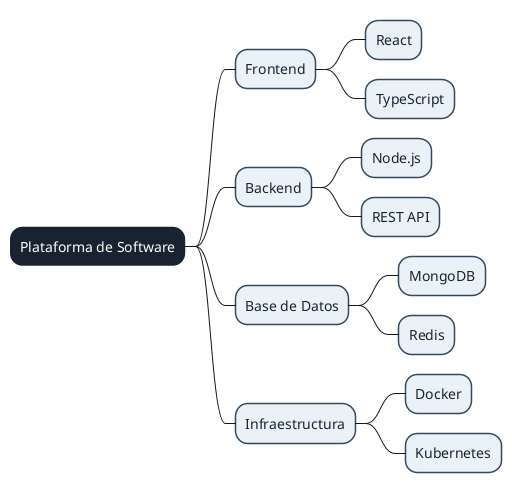

El ejemplo aplica un estilo visual coherente al diagrama, haciendo que el concepto principal destaque sobre sus ramas.

**Ejemplo de referencia:** [Colores y estilos personalizados](../../documentos/modelosUML/mindmap/mm-estilos.puml "Abrir ejemplo de colores y estilos")

#### Colores por nodo individual

En ocasiones necesitamos destacar determinados elementos sin aplicar el mismo estilo a todos los nodos.

Esta técnica resulta especialmente útil para representar prioridades, riesgos, fases de desarrollo o diferentes tipos de componentes.

**Ejemplo: Prioridades en el desarrollo de un videojuego**

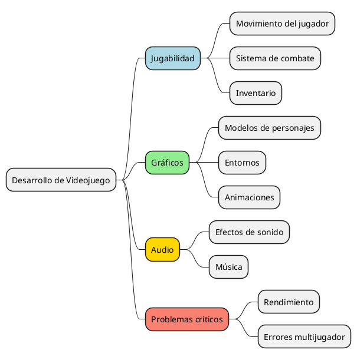

Los colores permiten diferenciar las distintas áreas de desarrollo y facilitan la identificación de los problemas críticos.

**Ejemplo de referencia:** [Colores por nodo individual](../../documentos/modelosUML/mindmap/mm-colores-nodo.puml "Abrir ejemplo de colores por nodo")

#### Iconos y símbolos especiales

Los iconos y símbolos proporcionan información visual adicional.

Son especialmente útiles cuando creamos diagramas para equipos que necesitan identificar rápidamente distintos tipos de recursos o componentes.

Por ejemplo:

- 🎮 Funcionalidades de videojuegos.
- 👤 Usuarios y perfiles de jugadores.
- 🗄️ Bases de datos.
- 🔒 Componentes de seguridad.
- ☁️ Infraestructura en la nube.
- ⚙️ Configuración y procesos.
- 🚀 Lanzamientos e hitos.

**Ejemplo: Plataforma de videojuegos online**

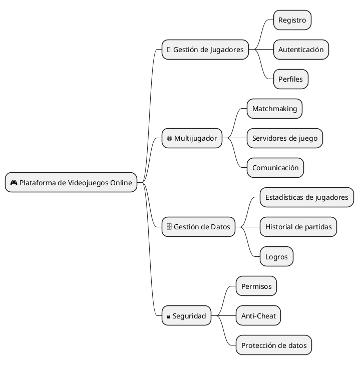

**Ejemplo de referencia:** [Iconos y símbolos especiales](../../documentos/modelosUML/mindmap/mm-iconos.puml "Abrir ejemplo de iconos y símbolos")

En la bibliografía de este documento encontrarás una lista de símbolos Unicode e iconos que puedes utilizar.

### 2.2. MindMaps organizativos complejos

Los MindMaps avanzados resultan especialmente útiles para representar sistemas con múltiples capas, departamentos o componentes interconectados.

Veamos dos ejemplos prácticos.

#### Ejemplo 1: Arquitectura completa de software

Imaginemos que estamos documentando una plataforma similar a Spotify.

El sistema incluye un frontend, servicios backend, bases de datos, integraciones externas e infraestructura.

**Diagrama 1. Arquitectura de una plataforma de música en streaming**

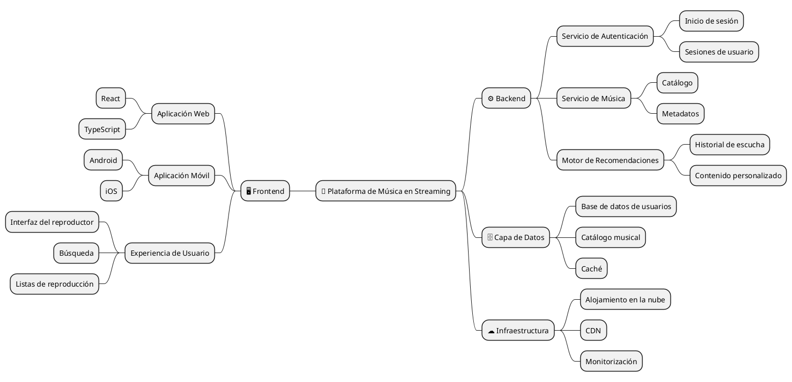

Este diagrama ofrece una visión general de la arquitectura y permite identificar las principales responsabilidades de cada componente del sistema.

Se trata de una representación conceptual, no de una reproducción de la arquitectura interna real de Spotify.

**Ejemplo de referencia:** [Arquitectura completa de software](../../documentos/modelosUML/mindmap/mm-arquitectura.puml "Abrir ejemplo de arquitectura")

#### Ejemplo 2: Roadmap técnico

Un roadmap técnico representa la evolución de un proyecto a lo largo del tiempo.

Permite a los equipos identificar mejoras previstas, prioridades técnicas y futuras etapas de desarrollo.

**Diagrama 2. Roadmap técnico de un videojuego multijugador**

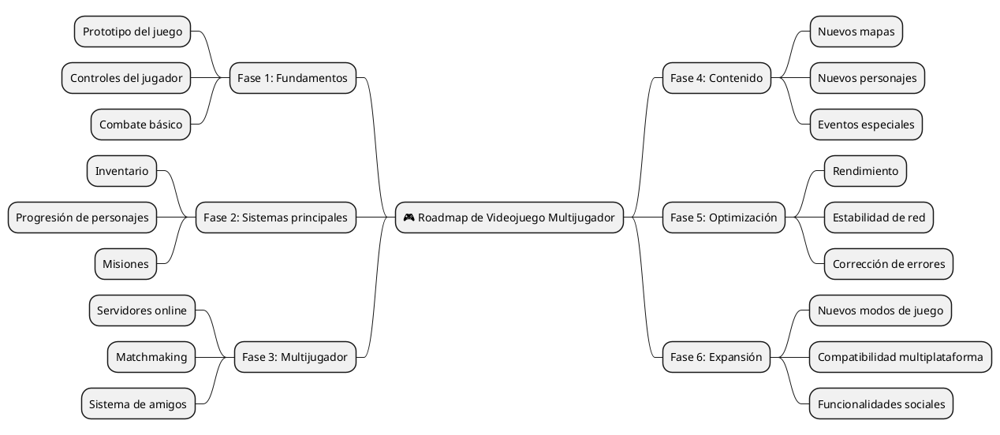

Este roadmap organiza el proceso de desarrollo en fases lógicas, desde el prototipo inicial hasta futuras ampliaciones.

**Ejemplo de referencia:** [Roadmap técnico](../../documentos/modelosUML/mindmap/mm-roadmap-tecnico.puml "Abrir ejemplo de roadmap técnico")

### 2.3. Ejercicio práctico 1 – MindMap avanzado

<badge color="info">Actividad individual</badge>

Crear un MindMap avanzado para uno de los siguientes escenarios:

1. **Arquitectura de software:** documentar la arquitectura de tu proyecto más complejo, incluyendo al menos cuatro niveles o capas.
2. **Plan de estudio para una certificación:** organizar un plan de estudio para una certificación profesional, incluyendo temas, calendario y recursos de aprendizaje.
3. **Estrategia de empresa o startup:** representar la estructura y estrategia de una empresa, incluyendo sus diferentes departamentos y responsabilidades.

**Requisitos:**

- [ ] Utilizar estilos personalizados.
- [ ] Incluir al menos cinco colores diferentes.
- [ ] Incluir un mínimo de cuatro niveles de profundidad.
- [ ] Incorporar emojis o símbolos especiales.
- [ ] Distribuir la información a ambos lados del MindMap.
- [ ] Utilizar una jerarquía lógica y coherente.
- [ ] Incluir suficiente detalle para que el diagrama resulte útil como documentación técnica u organizativa.

---

## 3. Diagramas de Gantt empresariales

Los diagramas de Gantt son útiles para planificar proyectos individuales, pero adquieren todavía más valor cuando se aplican a organizaciones y equipos de desarrollo de mayor tamaño.

En esta sección veremos cómo representar múltiples proyectos, sprints ágiles e iniciativas de infraestructura.

### 3.1. Planificación avanzada de proyectos

Cuando gestionamos proyectos complejos, un diagrama de Gantt debe ofrecer más información que los nombres de las tareas y sus duraciones.

Un plan de proyecto más completo puede incluir:

- Múltiples fases de proyecto.
- Diferentes equipos y responsabilidades.
- Dependencias entre tareas.
- Hitos importantes.
- Asignación de recursos.
- Porcentajes de progreso.
- Actividades paralelas.
- Fechas de entrega.

Estos elementos permiten a los responsables del proyecto comprender el proceso de desarrollo e identificar posibles cuellos de botella.

### 3.2. Planificación multiproyecto y asignación de recursos

En un entorno empresarial, varios proyectos pueden desarrollarse simultáneamente y compartir recursos.

Por ejemplo, una empresa que desarrolla varias aplicaciones puede contar con un único equipo de infraestructura que da soporte a todas ellas.

**Diagrama 3. Planificación empresarial de múltiples proyectos**

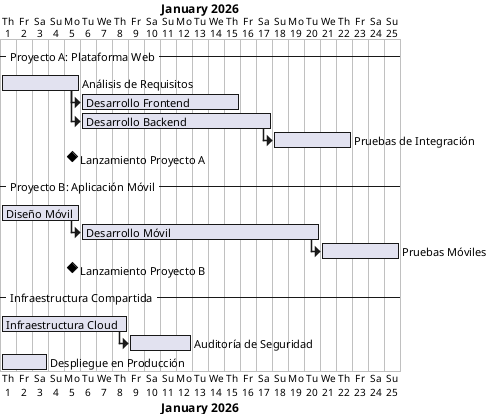

Este ejemplo muestra cómo dos proyectos pueden planificarse junto con actividades de infraestructura compartidas.

En un proyecto real, el calendario también debería identificar posibles conflictos de recursos y la disponibilidad de los equipos.

**Ejemplo de referencia:** [Gantt multiproyecto](../../documentos/modelosUML/gantt/gt-multiproyecto.puml "Abrir ejemplo de Gantt multiproyecto")

### 3.3. Desarrollo ágil y planificación de sprints

El desarrollo ágil divide el trabajo en iteraciones cortas denominadas *sprints*.

Cada sprint incluye un conjunto de tareas que el equipo pretende completar dentro de un periodo definido.

Un diagrama de Gantt puede proporcionar una visión general de la planificación de los sprints, sus entregables y los hitos de lanzamiento.

**Diagrama 4. Roadmap de desarrollo ágil de un videojuego**

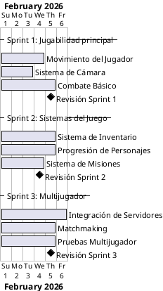

Este ejemplo ilustra cómo un equipo de desarrollo de videojuegos puede organizar el trabajo en sprints sucesivos.

**Ejemplo de referencia:** [Gantt con sprints ágiles](../../documentos/modelosUML/gantt/gt-sprints.puml "Abrir ejemplo de Gantt con sprints")

### 3.4. Planificación de infraestructura y DevOps

Los proyectos de infraestructura requieren una coordinación cuidadosa entre los equipos de desarrollo, operaciones y seguridad.

Un diagrama de Gantt de DevOps puede representar actividades como:

- Aprovisionamiento de infraestructura.
- Contenedorización.
- Configuración de CI/CD.
- Monitorización y registro de eventos.
- Auditorías de seguridad.
- Despliegue en producción.

**Diagrama 5. Migración de infraestructura DevOps**

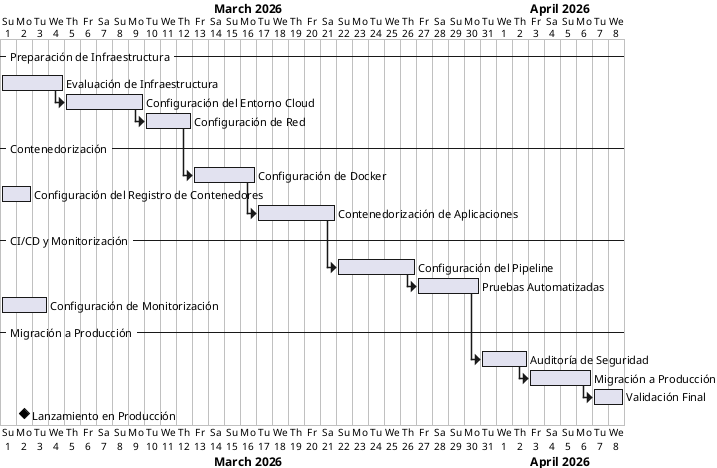

Este diagrama ofrece una visión simplificada de un proyecto de migración de infraestructura.

**Ejemplo de referencia:** [Gantt de infraestructura y DevOps](../../documentos/modelosUML/gantt/gt-devops.puml "Abrir ejemplo de Gantt DevOps")

### 3.5. Ejercicio práctico 2 – Gantt empresarial

<badge color="info">Actividad individual</badge>

Crear un diagrama de Gantt empresarial para uno de los siguientes escenarios:

1. **Lanzamiento de producto:** planificar el lanzamiento de un producto que implique a los equipos de marketing, desarrollo, diseño y legal.
2. **Transformación digital:** planificar la transformación digital de un departamento o empresa.
3. **Proyecto de investigación:** organizar un proyecto de investigación con diferentes fases, entregables, publicaciones y actividades de difusión.

**Requisitos:**

- [ ] Incluir al menos cuatro fases o secciones.
- [ ] Incluir al menos 15 tareas.
- [ ] Incluir tres o más hitos importantes.
- [ ] Utilizar colores para diferenciar categorías de tareas o equipos.
- [ ] Incluir dependencias entre tareas.
- [ ] Añadir notas que describan los recursos o equipos necesarios.
- [ ] Incluir porcentajes de finalización de las tareas.
- [ ] Elaborar un calendario coherente y realista.

---

## 4. Visualización avanzada de JSON

JSON se utiliza ampliamente para intercambiar datos entre aplicaciones y servicios.

En la primera parte hemos trabajado con estructuras JSON básicas y hemos aprendido a visualizarlas mediante PlantUML.

Ahora trabajaremos con estructuras más complejas que representan modelos completos de aplicaciones, incluyendo entidades, relaciones, operaciones y metadatos del sistema.

### 4.1. Modelado de estructuras de datos complejas

Una aplicación real suele contener varias entidades relacionadas entre sí.

Por ejemplo, una tienda online puede incluir:

- Clientes.
- Productos.
- Pedidos.
- Pagos.
- Información de envío.

Estas entidades contienen atributos y pueden hacer referencia a otras entidades.

Una estructura JSON bien organizada debe representar estas relaciones de forma clara.

### 4.2. Ejemplo: Plataforma de comercio electrónico

**Diagrama 6. Estructura de datos de una tienda online**

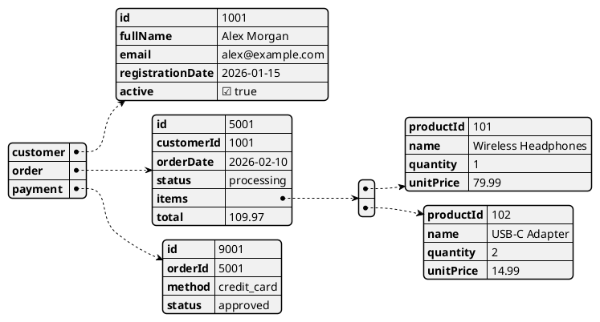

Este ejemplo representa varias entidades relacionadas dentro de una tienda online.

Observa cómo la información del cliente, el pedido, los productos y el pago se organiza en objetos diferenciados.

### 4.3. Ejemplo: Respuesta de API con metadatos

Las aplicaciones modernas utilizan frecuentemente API para intercambiar información.

Una respuesta de API puede contener no solo los datos solicitados, sino también metadatos que describen la respuesta, la paginación, el estado y las operaciones disponibles.

**Diagrama 7. Respuesta de API de una plataforma de videojuegos**

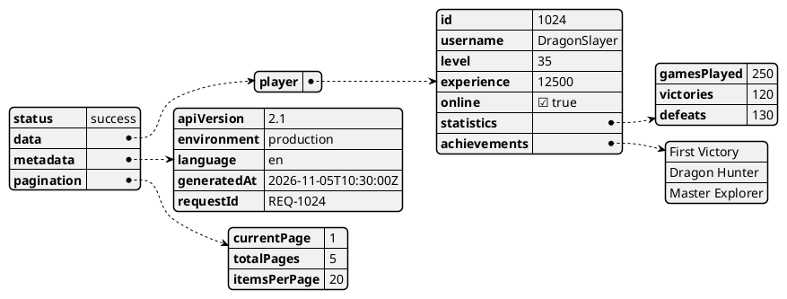

Este ejemplo muestra cómo una respuesta de API puede separar los datos de negocio de los metadatos técnicos.

También incluye objetos anidados, listas, valores numéricos, cadenas de texto y valores booleanos.

**Ejemplo de referencia:** [Respuesta de API con metadatos completos](../../documentos/modelosUML/json-visualizer/jv-api-response-metadata.puml "Abrir ejemplo de JSON API avanzado")

### 4.4. Representación de operaciones y métodos en JSON

JSON es un formato de intercambio de datos, no un lenguaje de programación.

No define métodos ejecutables ni clases de la misma manera que un lenguaje de programación orientado a objetos.

Sin embargo, podemos documentar las operaciones que admite un sistema mediante un objeto `actions` o `methods`.

Por ejemplo, una plataforma educativa podría definir operaciones como:

- `createUser`
- `enrollStudent`
- `submitAssignment`
- `calculateGrade`

Cada operación puede describir la entidad sobre la que actúa y los parámetros que necesita.

Esto resulta útil para documentar una API o diseñar un sistema antes de implementarlo.

### 4.5. Ejercicio práctico 3 – Diseña tu propio modelo de datos

<badge color="info">Actividad individual</badge>

Crear una estructura JSON para un sistema orientado a objetos.

Puedes elegir uno de los siguientes escenarios o proponer uno propio:

- Red social.
- Videojuego.
- Plataforma educativa.
- Sistema bancario.
- Tienda online.
- Sistema de gestión de bibliotecas.

La estructura JSON debe modelar las principales entidades, sus relaciones y las operaciones que admite el sistema.

**Requisitos:**

- [ ] Incluir al menos cuatro clases u objetos principales.
- [ ] Cada objeto debe tener atributos básicos como `id`, `name`, `date` y `status`, cuando corresponda.
- [ ] Al menos un objeto debe contener otros objetos.
- [ ] Utilizar colores en la visualización de PlantUML.
- [ ] Incluir diferentes tipos de datos: cadenas, números, booleanos, listas y objetos.
- [ ] Utilizar fechas en formato ISO (`YYYY-MM-DD` o `YYYY-MM-DDTHH:mm:ssZ`).
- [ ] Añadir un objeto `actions` o `methods` que describa las operaciones disponibles en el sistema.
- [ ] Cada acción debe indicar sobre qué entidad o clase actúa y qué parámetros necesita.
- [ ] Añadir un campo `metadata` o `config` con información del sistema, como versión, idioma, entorno y autor.
- [ ] Utilizar convenciones de nomenclatura claras y coherentes, siguiendo camelCase o PascalCase.
- [ ] Generar el diagrama correspondiente mediante PlantUML.

---

## 5. Wireframes avanzados con Salt

Salt permite crear estructuras de interfaz mediante descripciones basadas en texto.

En la primera parte hemos creado wireframes sencillos para pantallas de inicio de sesión, dashboards y reproductores multimedia.

En esta sección trabajaremos con distribuciones más complejas y componentes de interfaz reutilizables.

### 5.1. Sistemas de grid avanzados

Un sistema de grid divide una interfaz en áreas lógicas.

Es útil para diseñar dashboards, paneles de administración y aplicaciones con múltiples secciones.

Una interfaz de administración típica puede contener:

- Una barra lateral de navegación.
- Un área principal de contenido.
- Un panel secundario de información.
- Tablas de datos y filtros.
- Botones de acción.

**Diagrama 8. Dashboard de administración**

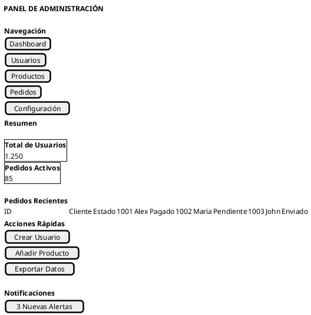

Este ejemplo representa una distribución de tres columnas con navegación, contenido principal y acciones rápidas.

**Ejemplo de referencia:** [Sistema de grid avanzado](../../documentos/modelosUML/mockups/wf-grid-adv.puml "Abrir ejemplo de grid avanzado")

### 5.2. Formularios complejos multipaso

Los formularios multipaso dividen formularios extensos en secciones más pequeñas.

Son útiles cuando necesitamos recopilar grandes cantidades de información, como en:

- Registros de usuarios.
- Compras online.
- Matriculaciones en cursos.
- Configuración de cuentas.
- Creación de proyectos.

Un formulario multipaso típico puede incluir:

1. Información personal.
2. Datos adicionales.
3. Preferencias o configuración.
4. Revisión y confirmación.

**Diagrama 9. Formulario de registro multipaso**

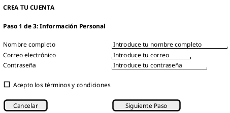

Este ejemplo representa el primer paso de un proceso de registro.

Un diseño completo también debería documentar los pasos restantes y la información necesaria en cada uno de ellos.

**Ejemplo de referencia:** [Formulario multipaso](../../documentos/modelosUML/mockups/wf-form-multistep.puml "Abrir ejemplo de formulario multipaso")

### 5.3. Componentes avanzados de interfaz y sistemas de diseño

Un sistema de diseño define componentes visuales y funcionales reutilizables.

Ayuda a los equipos de desarrollo a mantener la coherencia entre diferentes pantallas y aplicaciones.

Algunos componentes habituales son:

- Botones.
- Campos de entrada.
- Menús de navegación.
- Tarjetas.
- Tablas.
- Diálogos.
- Alertas.
- Pestañas.
- Menús desplegables.

**Diagrama 10. Biblioteca de componentes reutilizables**

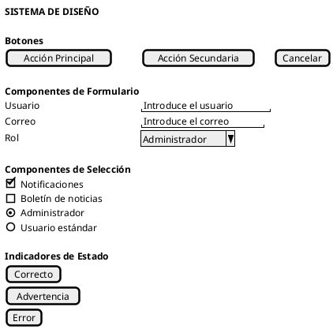

Este ejemplo muestra cómo documentar diferentes componentes de interfaz dentro de un mismo sistema de diseño.

**Ejemplo de referencia:** [Biblioteca de componentes](../../documentos/modelosUML/mockups/wf-component-library.puml "Abrir ejemplo de biblioteca de componentes")

### 5.4. Ejemplo: Aplicación de mensajería y chat

Las aplicaciones de mensajería combinan varios componentes de interfaz en una misma pantalla.

Una interfaz de chat suele incluir:

- Una lista de conversaciones.
- Información de contacto.
- Historial de mensajes.
- Un campo para escribir mensajes.
- Controles para adjuntar archivos y enviar mensajes.

**Diagrama 11. Interfaz de una aplicación de mensajería**

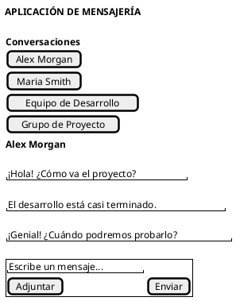

Este ejemplo muestra una interfaz de mensajería simplificada con una lista de conversaciones y un chat activo.

**Ejemplo de referencia:** [Aplicación de mensajería](../../documentos/modelosUML/mockups/wf-chat-app.puml "Abrir ejemplo de aplicación de mensajería")

### 5.5. Ejercicio práctico 4 – Diseño de wireframe avanzado

<badge color="info">Actividad individual</badge>

Diseñar un wireframe complejo para uno de los siguientes escenarios:

1. **Dashboard de administración:** crear una interfaz de gestión con tablas de datos, filtros y acciones masivas.
2. **Aplicación de streaming:** diseñar una interfaz con reproductor multimedia, listas de reproducción y controles de reproducción.
3. **Plataforma de e-learning:** crear una interfaz con contenido en vídeo, progreso de aprendizaje y recursos educativos.

**Requisitos:**

- [ ] Incluir una distribución de tres columnas.
- [ ] Incluir al menos una tabla de datos.
- [ ] Incluir una sección de navegación.
- [ ] Incluir al menos 10 elementos interactivos.
- [ ] Utilizar símbolos o emojis cuando corresponda.
- [ ] Organizar la interfaz en secciones claramente definidas.
- [ ] Garantizar que la distribución sea fácil de comprender y navegar.

---

## 6. Ejercicio integrador – Documentación de una aplicación completa

El ejercicio final combina las técnicas estudiadas en las dos partes de este curso.

### 6.1. Descripción del proyecto

Imagina que formas parte de un equipo de desarrollo que está creando una aplicación complementaria para un videojuego.

La aplicación permite a los jugadores:

- Gestionar sus perfiles.
- Consultar sus puntos de experiencia y niveles.
- Revisar sus logros.
- Consultar misiones y desafíos.
- Configurar sus preferencias.
- Recibir notificaciones sobre eventos del juego.

Tu tarea consiste en crear un conjunto de diagramas que documenten la estructura, los datos, el calendario de desarrollo y la interfaz de la aplicación.

### 6.2. Entregables obligatorios

**1. MindMap avanzado**

Representar la arquitectura y las principales funcionalidades de la aplicación.

Debe incluir al menos cuatro niveles de profundidad, estilos personalizados y diferentes colores.

**2. Visualización JSON avanzada**

Definir el modelo de datos de la aplicación.

Debe incluir jugadores, logros, misiones y configuraciones, además de un objeto `actions` y metadatos del sistema.

**3. Diagrama de Gantt empresarial**

Planificar el desarrollo de la aplicación.

Debe incluir al menos cuatro fases, 15 tareas, dependencias, hitos y porcentajes de progreso.

**4. Wireframe avanzado con Salt**

Diseñar el dashboard del jugador.

Debe incluir navegación, información del jugador, logros, misiones y controles interactivos.

### 6.3. Estructura de entrega

Organiza los archivos de la siguiente manera:

```text
game-companion-app/
└── diagrams/
    ├── architecture.puml
    ├── data-model.puml
    ├── development-plan.puml
    └── player-dashboard.puml
```

Todos los diagramas deben contener código PlantUML válido y generar las representaciones visuales esperadas.

---

## 7. Buenas prácticas para diagramas avanzados con PlantUML

Al crear diagramas complejos, conviene seguir estas recomendaciones:

- **Priorizar la legibilidad:** evitar incluir demasiada información en un único diagrama.
- **Utilizar colores coherentes:** asignar colores a las categorías y mantener su significado en todo el proyecto.
- **Organizar la información de forma lógica:** agrupar los elementos relacionados y utilizar jerarquías claras.
- **Utilizar nombres descriptivos:** evitar etiquetas ambiguas y abreviaturas.
- **Añadir contexto cuando sea necesario:** utilizar comentarios o notas para explicar decisiones importantes.
- **Mantener los diagramas actualizados:** la documentación debe reflejar el estado actual del proyecto.
- **Separar responsabilidades:** crear diagramas diferentes cuando uno solo resulte demasiado complejo.
- **Utilizar control de versiones:** almacenar los archivos `.puml` junto al código fuente del proyecto.

Recuerda que los diagramas avanzados deben mejorar la comunicación, no limitarse a añadir complejidad visual.

---

## 8. Resumen de funcionalidades

| Funcionalidad | Objetivo principal |
|---|---|
| Estilos de MindMap | Personalizar la apariencia de diagramas jerárquicos. |
| Colores por nodo | Destacar categorías o elementos concretos. |
| Iconos y símbolos | Añadir referencias visuales y mejorar la legibilidad. |
| MindMaps organizativos | Representar estructuras y arquitecturas complejas. |
| Gantt multiproyecto | Planificar varios proyectos y recursos compartidos. |
| Gantt Agile | Organizar el desarrollo en sprints. |
| Gantt DevOps | Planificar actividades de infraestructura y despliegue. |
| JSON avanzado | Visualizar estructuras de datos y respuestas de API complejas. |
| Grid con Salt | Diseñar interfaces con varias columnas. |
| Formularios multipaso | Representar procesos complejos de entrada de datos. |
| Bibliotecas de componentes | Documentar elementos reutilizables de interfaz. |

---

## 9. Bibliografía y recursos adicionales

Los siguientes recursos ofrecen información y ejemplos adicionales:

1. [PlantUML – Creole e iconos Unicode](https://plantuml.com/es/creole) – documentación sobre formato de texto, símbolos e iconos.
2. [Compart – Buscador de caracteres Unicode](https://www.compart.com/en/unicode) – base de datos consultable de caracteres y símbolos Unicode.
3. [PlantUML – Diagramas MindMap](https://plantuml.com/mindmap-diagram) – documentación oficial de MindMaps.
4. [PlantUML – Diagramas de Gantt](https://plantuml.com/gantt-diagram) – documentación oficial de diagramas de Gantt.
5. [PlantUML – Diagramas JSON](https://plantuml.com/json) – documentación oficial de visualización JSON.
6. [PlantUML – Diagramas Salt](https://plantuml.com/salt) – documentación oficial de wireframes e interfaces.
