# PlantUML - UML - Parte 1

## Diagramas de objetos

## Índice

- [¿Qué es UML?](#qué-es-uml)
- [¿Qué es PlantUML?](#qué-es-plantuml)
- [Diagrama de objetos](#diagrama-de-objetos)
  - [Sintaxis básica](#sintaxis-básica)
  - [Atributos y valores](#atributos-y-valores)
  - [Relaciones entre objetos](#relaciones-entre-objetos)
    - [Asociaciones y enlaces](#asociaciones-y-enlaces)
    - [Composición](#composición)
    - [Agregación](#agregación)
  - [Multiplicidad o cardinalidad](#multiplicidad-o-cardinalidad)
  - [Ejemplo completo](#ejemplo-completo)
- [Relaciones entre clases e interfaces](#relaciones-entre-clases-e-interfaces)
- [Recomendaciones](#recomendaciones)
- [Recursos](#recursos)
- [Bibliografía](#bibliografía)

---

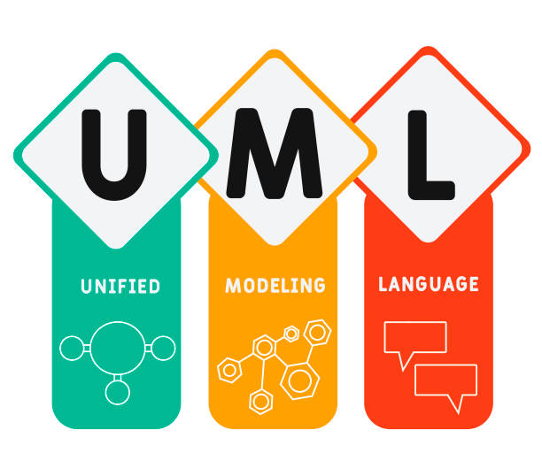

---

## ¿Qué es UML?

UML (*Unified Modeling Language*) o Lenguaje Unificado de Modelado es un lenguaje estándar de modelado utilizado para visualizar, especificar, diseñar y documentar sistemas.

Se trata de un lenguaje gráfico que permite representar diferentes aspectos de un sistema, como su estructura, comportamiento, componentes, procesos y relaciones.

UML se utiliza como un plano de referencia para comprender y comunicar cómo está organizado un sistema antes y durante su desarrollo.

Es importante tener en cuenta que **UML no es un lenguaje de programación**. Su finalidad es facilitar el análisis, el diseño y la documentación de sistemas mediante diferentes tipos de diagramas.

## ¿Qué es PlantUML?

PlantUML es una herramienta que permite crear diagramas utilizando un lenguaje de texto sencillo. A partir de instrucciones escritas, genera automáticamente representaciones gráficas de distintos tipos de diagramas UML.

Entre sus principales ventajas se encuentran:

- Permite crear diagramas sin necesidad de utilizar herramientas gráficas complejas.
- Facilita el mantenimiento de los diagramas mediante código de texto.
- Permite integrar los diagramas en documentación técnica.
- Admite distintos tipos de diagramas UML, como los de clases, objetos, secuencia, actividad y casos de uso.

Para generar un diagrama, normalmente se utilizan las etiquetas `@startuml` y `@enduml`, que delimitan el contenido del diagrama.

## Diagrama de objetos

Un **diagrama de objetos** es una representación gráfica de las instancias de un sistema y de las relaciones existentes entre ellas en un momento determinado.

Permite mostrar una instantánea de la estructura del sistema, incluyendo objetos concretos, los valores de sus atributos y los enlaces que existen entre ellos.

Dentro de UML, se considera un tipo de *diagrama estructural*. Se utiliza para representar ejemplos concretos de cómo se relacionan las instancias de las clases definidas en un sistema.

En programación orientada a objetos (POO), los diagramas de objetos permiten visualizar objetos concretos creados a partir de clases. También pueden resultar útiles para representar ejemplos de estructuras de datos y modelos de información.

### Diferencia entre diagrama de clases y diagrama de objetos

Aunque ambos diagramas representan elementos estructurales de un sistema, su finalidad es diferente:

| Diagrama de clases | Diagrama de objetos |
|:---|:---|
| Representa clases e interfaces. | Representa instancias concretas de clases. |
| Muestra atributos y métodos definidos en las clases. | Muestra valores concretos de los atributos de los objetos. |
| Define relaciones entre clases. | Muestra enlaces entre objetos en un momento determinado. |
| Describe la estructura general del sistema. | Representa una situación concreta del sistema. |

Por ejemplo, una clase `Cliente` define qué características tendrán los clientes del sistema. Un objeto `ana : Cliente` representa un cliente concreto, con sus propios valores para atributos como nombre o correo electrónico.

### Sintaxis básica

Podemos empezar a crear nuestros objetos utilizando la palabra reservada `object`:

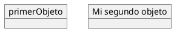

En este ejemplo:

- `object` permite declarar una instancia.
- `primerObjeto` es el nombre del primer objeto.
- `"Mi segundo objeto"` establece el nombre que se mostrará en el diagrama.
- `as o2` permite asignar un alias para utilizar ese objeto en otras instrucciones.

También podemos indicar la clase a la que pertenece una instancia mediante la notación `nombreObjeto : NombreClase`:

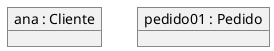

En este caso, `ana` es una instancia de la clase `Cliente`, mientras que `pedido01` es una instancia de la clase `Pedido`.

### Atributos y valores

Los objetos pueden contener atributos con valores concretos. Para declararlos, podemos utilizar el símbolo `:` seguido del nombre del objeto y del atributo:

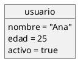

También es posible agrupar todos los atributos entre llaves `{}`:

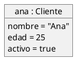

En este ejemplo, podemos observar que el objeto `ana` contiene tres atributos con valores específicos.

Esta característica permite representar situaciones concretas del sistema y comprender mejor el estado de sus objetos.

### Relaciones entre objetos

Los diagramas de objetos también permiten representar los enlaces que existen entre diferentes instancias.

PlantUML ofrece distintos símbolos para dibujar estas relaciones. Algunos de ellos también se utilizan en los diagramas de clases, aunque es importante distinguir su significado según el tipo de diagrama.

#### Asociaciones y enlaces

Una asociación entre clases define una relación estructural que puede existir entre sus instancias. En un diagrama de objetos, los enlaces representan las relaciones concretas que existen entre dichas instancias en un momento determinado.

Podemos representar un enlace utilizando una línea:

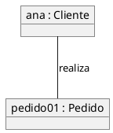

También podemos utilizar una flecha para orientar visualmente la relación:

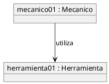

La etiqueta de una relación se añade mediante `:`, seguido del texto que queramos mostrar.

#### Composición

La **composición** representa una relación de tipo todo-parte con una dependencia fuerte entre ambos elementos. La parte forma parte del ciclo de vida del elemento que la contiene y, en el modelo, no puede existir de manera independiente de él.

En PlantUML se representa mediante el símbolo `*--`.

**Ejemplo:**

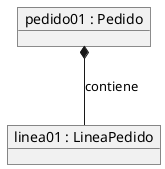

En este ejemplo, `pedido` representa el elemento compuesto y `linea` una de sus partes.

La relación se representa mediante un rombo relleno situado en el extremo del elemento que representa el todo.

#### Agregación

La **agregación** representa una relación de tipo todo-parte más débil que la composición. La parte puede existir de manera independiente del elemento que la agrupa.

En PlantUML se representa mediante el símbolo `o--`.

**Ejemplo:**

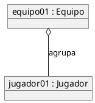

En este ejemplo, el equipo agrupa a un jugador, pero el jugador puede existir independientemente del equipo.

La relación se representa mediante un rombo vacío situado en el extremo del elemento que representa el todo.

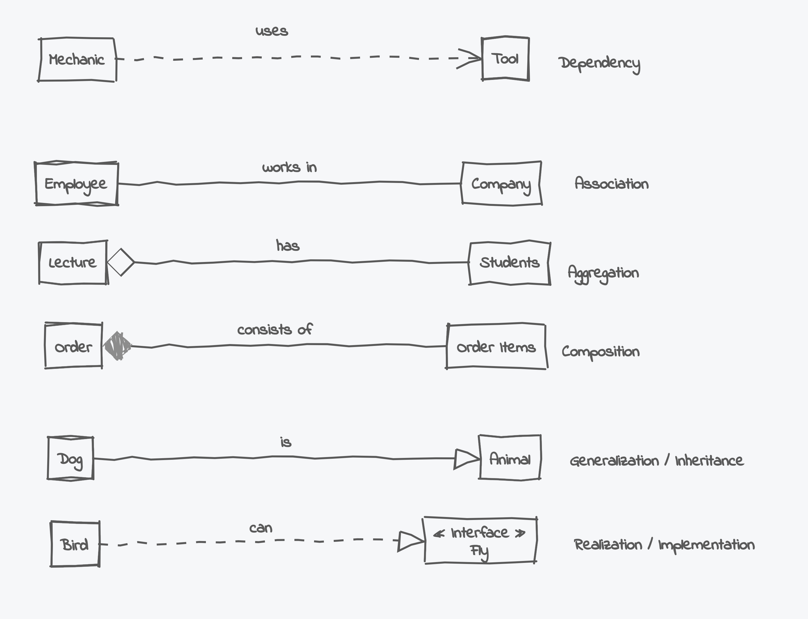

**Importante:** la composición y la agregación expresan relaciones entre un todo y sus partes. En un diagrama de objetos pueden utilizarse para representar los enlaces concretos correspondientes a esas relaciones. Su significado debe quedar definido correctamente en el modelo.

### Multiplicidad o cardinalidad

La **multiplicidad** de una relación indica cuántas instancias de una clase pueden participar en una asociación con una instancia de otra clase.

Se representa mediante valores o intervalos situados en los extremos de la relación. Cada extremo puede tener su propia multiplicidad.

Las multiplicidades más habituales son:

| Multiplicidad | Significado |
|:---:|---|
| `1` | Exactamente uno. |
| `0..1` | Cero o uno. |
| `0..*` | Cero o muchos. |
| `1..*` | Uno o muchos. |
| `n..m` | Desde `n` hasta `m` instancias. |

Por ejemplo, en una relación entre clientes y pedidos:

- Un cliente puede tener cero o muchos pedidos.
- Cada pedido pertenece a un único cliente.

Este tipo de restricción se define normalmente en el diagrama de clases, donde se establece la multiplicidad de la asociación.

**Ejemplo de multiplicidad en un diagrama de clases:**

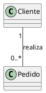

En este ejemplo:

- El extremo de `Cliente` tiene multiplicidad `1`: cada pedido está asociado a un único cliente.
- El extremo de `Pedido` tiene multiplicidad `0..*`: un cliente puede tener cero o muchos pedidos.

Es importante distinguir entre la multiplicidad definida en una asociación del modelo y los enlaces que aparecen en un diagrama de objetos. El diagrama de objetos muestra las relaciones existentes en una situación concreta, mientras que la multiplicidad establece los límites permitidos para esas relaciones.

### Ejemplo completo

Vamos a representar un pequeño sistema de pedidos. Un cliente puede realizar varios pedidos y cada pedido puede contener una o varias líneas de detalle.

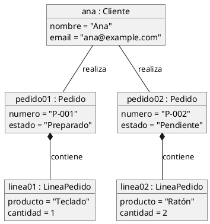

En este diagrama podemos observar:

- Un objeto `ana` que representa a una cliente concreta.
- Dos objetos de tipo `Pedido`, cada uno con sus propios atributos y valores.
- Dos enlaces que representan los pedidos realizados por la cliente.
- Dos objetos `LineaPedido` que forman parte de sus respectivos pedidos mediante composición.

Este ejemplo muestra cómo un diagrama de objetos permite representar una situación concreta de un sistema, incluyendo las instancias, sus valores y sus relaciones.

## Relaciones entre clases e interfaces

Algunos símbolos que aparecen en la documentación de PlantUML se utilizan principalmente para representar relaciones entre clases e interfaces. Aunque PlantUML permite dibujarlos también en diagramas de objetos, su significado conceptual corresponde al modelo de clases.

Por este motivo, es importante no confundirlos con los enlaces entre instancias.

### Generalización o herencia

La **generalización** representa una relación de herencia entre elementos. Un elemento especializado hereda las características y el comportamiento de otro elemento más general.

En programación orientada a objetos, permite definir clases específicas a partir de una clase base, reutilizando sus atributos y métodos y pudiendo añadir o especializar funcionalidades.

En PlantUML se representa mediante `<|--`.

**Ejemplo:**

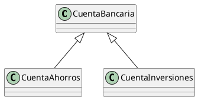

En este ejemplo, `CuentaAhorros` y `CuentaInversiones` heredan de `CuentaBancaria`.

### Realización o implementación

La **realización** representa cómo una clase concreta proporciona la implementación de las operaciones definidas por una interfaz o especificación abstracta.

En programación, permite establecer un contrato que las clases que implementan la interfaz deben cumplir, proporcionando su propia implementación de los métodos definidos.

En PlantUML se representa mediante `<|..`.

**Ejemplo:**

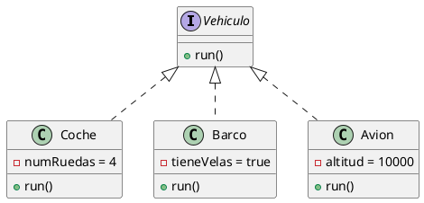

En este ejemplo, `Vehiculo` define una interfaz que implementan las clases `Coche`, `Barco` y `Avion`.

### Dependencia

La **dependencia** representa una relación en la que un elemento utiliza o necesita otro para realizar una determinada tarea. Un cambio en el elemento del que se depende puede afectar al elemento dependiente.

En PlantUML, las relaciones de dependencia se representan habitualmente mediante:

- `-->`: relación de dependencia.
- `..>`: forma discontinua de dependencia.

**Ejemplo en un diagrama de clases:**

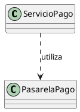

En este ejemplo, `ServicioPago` depende de `PasarelaPago` para realizar una operación.

## Recomendaciones

A la hora de crear diagramas con PlantUML, conviene tener en cuenta las siguientes recomendaciones:

1. **Utilizar nombres descriptivos:** los nombres de los objetos y sus relaciones deben facilitar la comprensión del diagrama.
2. **Diferenciar clases y objetos:** las clases definen estructuras generales, mientras que los objetos representan instancias concretas.
3. **Representar valores reales:** los atributos de los objetos deben mostrar valores que permitan entender la situación representada.
4. **Evitar relaciones innecesarias:** incluir únicamente los enlaces relevantes para explicar el sistema.
5. **Añadir etiquetas:** utilizar etiquetas para aclarar el significado de las relaciones.
6. **Mantener los diagramas legibles:** evitar incluir demasiados elementos en un mismo diagrama.
7. **Utilizar el diagrama adecuado:** reservar la herencia y la implementación para los diagramas de clases, y utilizar los diagramas de objetos para representar instancias y enlaces concretos.

## Recursos

- [Editor PlantUML Oficial](https://editor.plantuml.com): permite escribir código PlantUML y visualizar los diagramas generados.
- [Documentación oficial de PlantUML - Diagramas de objetos](https://plantuml.com/es/object-diagram): referencia de sintaxis y ejemplos para crear diagramas de objetos.
- [Documentación oficial de PlantUML - Diagramas de clases](https://plantuml.com/es/class-diagram): referencia para representar clases, interfaces y sus relaciones.

## Bibliografía

1. [PlantUML - Diagrama de objetos](https://plantuml.com/es/object-diagram)
2. [PlantUML - Diagrama de clases](https://plantuml.com/es/class-diagram)
3. [OMG - Unified Modeling Language (UML)](https://www.omg.org/spec/UML/)
