# PlantUML - UML - Parte 2

## Diagramas de casos de uso y diagramas de estado

## Índice

- [Diagrama de casos de uso](#diagrama-de-casos-de-uso)
  - [Casos de uso](#casos-de-uso)
    - [Descripción de los casos de uso](#descripcion-de-los-casos-de-uso)
  - [Actores](#actores)
  - [Paquetes y límites del sistema](#paquetes-y-limites-del-sistema)
  - [Relaciones entre casos de uso](#relaciones-entre-casos-de-uso)
  - [Otra sintaxis](#otra-sintaxis)
    - [Cambiar la dirección de las flechas](#cambiar-la-direccion-de-las-flechas)
    - [Etiquetas en las relaciones](#etiquetas-en-las-relaciones)
- [Diagramas de estado](#diagramas-de-estado)
  - [Estados simples](#estados-simples)
  - [Transiciones, eventos y acciones](#transiciones-eventos-y-acciones)
  - [Estados compuestos](#estados-compuestos)
  - [Estados con descripciones largas](#estados-con-descripciones-largas)
  - [Bifurcaciones y uniones](#bifurcaciones-y-uniones)
  - [Condicionales](#condicionales)
- [Recursos](#recursos)
- [Bibliografía](#bibliografia)

---

## Diagrama de casos de uso

Un **diagrama de casos de uso** es una representación visual que muestra cómo los actores externos interactúan con un sistema y qué funcionalidades ofrece dicho sistema.

Estos diagramas permiten identificar los requisitos funcionales desde el punto de vista de los usuarios y otros sistemas que interactúan con él. Son especialmente útiles durante las primeras fases del diseño, ya que ayudan a comprender el alcance del sistema y a comunicar sus funcionalidades.

### Casos de uso

Un **caso de uso** describe una funcionalidad o conjunto de interacciones que permite a un actor alcanzar un objetivo utilizando el sistema.

No se limita a representar una acción aislada, sino que describe qué puede conseguir un actor mediante el sistema.

En PlantUML, se puede definir un caso de uso de dos maneras:

- Escribir el nombre del caso de uso entre paréntesis. Ejemplo: `(Consultar productos)`.
- Utilizar la palabra reservada `usecase`. Ejemplo: `usecase "Consultar productos"`.

También se puede asignar un alias mediante la palabra reservada `as`. El alias permite referenciar el caso de uso posteriormente al definir sus relaciones.

**Ejemplo:**

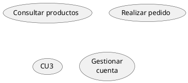

En este ejemplo se utilizan ambas formas de declarar casos de uso. El alias permite establecer relaciones con un elemento sin tener que repetir su descripción completa.

#### Descripción de los casos de uso

Podemos añadir descripciones más extensas a los casos de uso mediante cadenas de texto entre comillas.

PlantUML permite utilizar separadores para organizar la información dentro de la descripción:

- `--`
- `..`
- `==`
- `__`

También se pueden incorporar títulos entre determinados separadores.

**Ejemplo:**

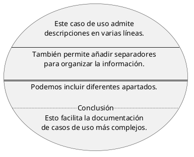

Esta característica resulta útil cuando queremos aportar más contexto sobre la funcionalidad representada.

### Actores

Los **actores** representan los roles externos que interactúan con el sistema o con alguno de sus casos de uso.

Un actor no tiene por qué ser una persona. También puede representar otro sistema informático, un dispositivo o cualquier elemento externo que intercambie información con el sistema.

En PlantUML, los actores se pueden declarar de dos maneras:

- Escribir su nombre entre dos puntos. Ejemplo: `:Usuario:`.
- Utilizar la palabra reservada `actor`. Ejemplo: `actor Administrador`.

También se puede asignar un alias mediante `as`.

**Ejemplo:**

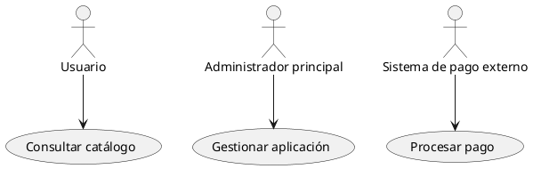

#### Cambiar el estilo de los actores

Podemos modificar la representación visual de los actores mediante `skinparam actorStyle`.

Los estilos más habituales son:

- `skinparam actorStyle awesome`: utiliza una representación alternativa del actor.
- `skinparam actorStyle hollow`: utiliza una representación hueca del actor.
- Si no se especifica ningún estilo, se utiliza la representación clásica de figura de palo.

**Ejemplo:**

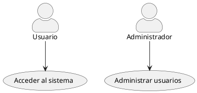

El estilo se aplica a los actores del diagrama. Se puede modificar cambiando el valor de `actorStyle`.

### Paquetes y límites del sistema

Podemos utilizar la palabra reservada `package` para agrupar actores o casos de uso que pertenezcan a un mismo contexto o área funcional del sistema.

También podemos utilizar `rectangle` para representar el límite del sistema y mostrar qué funcionalidades forman parte de él.

**Ejemplo:**

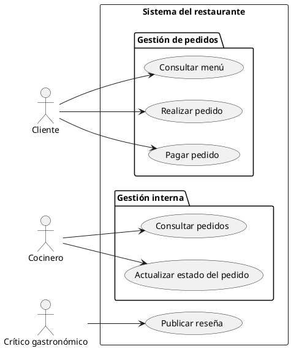

En este ejemplo:

- El rectángulo representa el sistema que estamos modelando.
- Los paquetes agrupan casos de uso relacionados.
- Los actores se sitúan fuera del límite del sistema, ya que representan elementos externos.
- Las relaciones muestran qué funcionalidades puede utilizar cada actor.

### Relaciones entre casos de uso

Además de las relaciones entre actores y casos de uso, UML permite establecer relaciones entre diferentes casos de uso.

Las más habituales son `include` y `extend`.

#### Inclusión (`<<include>>`)

La relación de **inclusión** permite incorporar el comportamiento de un caso de uso dentro de otro. Se utiliza cuando una funcionalidad necesita ejecutar obligatoriamente otra funcionalidad común o reutilizable.

En PlantUML se representa mediante una flecha discontinua y una etiqueta `<<include>>`.

**Ejemplo:**

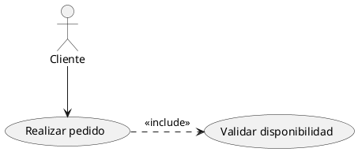

En este ejemplo, para realizar un pedido es necesario validar la disponibilidad de los productos.

#### Extensión (`<<extend>>`)

La relación de **extensión** permite añadir un comportamiento opcional o condicionado a otro caso de uso.

Se utiliza cuando una funcionalidad adicional solo se ejecuta bajo determinadas circunstancias, sin formar parte obligatoria del flujo principal.

En PlantUML se representa mediante una flecha discontinua y una etiqueta `<<extend>>`.

**Ejemplo:**

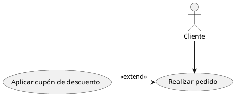

En este ejemplo, un cliente puede realizar un pedido sin utilizar un cupón de descuento. Sin embargo, si dispone de uno, puede incorporar ese comportamiento adicional.

**Importante:** la dirección de las relaciones es diferente:

- `<<include>>`: parte del caso de uso principal y apunta al caso de uso incluido.
- `<<extend>>`: parte del caso de uso que amplía y apunta al caso de uso base.

### Otra sintaxis

PlantUML permite personalizar diferentes aspectos de los diagramas de casos de uso, como la dirección de las relaciones y las etiquetas que aparecen en ellas.

#### Cambiar la dirección de las flechas

Podemos modificar la dirección de las flechas utilizando las palabras reservadas `left`, `right`, `up` y `down`.

**Ejemplo:**

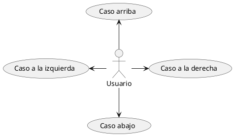

También podemos orientar el diagrama de manera general utilizando `left to right direction`, que organiza los elementos de izquierda a derecha.

**Ejemplo:**

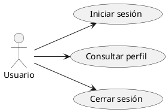

#### Etiquetas en las relaciones

Al igual que en otros diagramas de PlantUML, podemos añadir etiquetas a las relaciones utilizando `:` seguido del texto que queremos mostrar.

Para insertar saltos de línea dentro de una etiqueta, podemos utilizar `\n`.

**Ejemplo:**

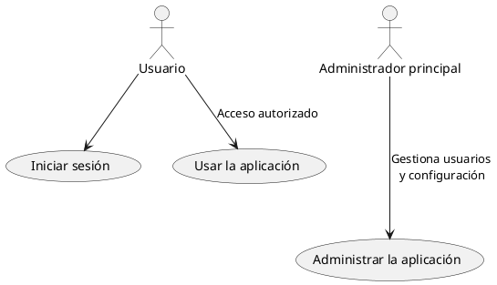

Para saber más sobre los diagramas de casos de uso, puedes consultar la [documentación oficial de PlantUML](https://plantuml.com/es/use-case-diagram).

---

## Diagramas de estado

Los **diagramas de estado** proporcionan una representación visual de los distintos estados en los que puede encontrarse un objeto o una entidad, así como de las transiciones entre esos estados.

Son esenciales para modelar el **comportamiento dinámico de los sistemas**, ya que muestran cómo responde una entidad a diferentes eventos a lo largo del tiempo.

Estos diagramas permiten representar el ciclo de vida de un objeto o entidad, facilitando la comprensión, el diseño y la documentación de su comportamiento.

Por ejemplo, un pedido puede pasar por diferentes estados durante su ciclo de vida: pendiente, confirmado, preparado, enviado y entregado.

### Estados simples

Un estado representa una situación en la que se encuentra un objeto o entidad durante un periodo de tiempo.

En PlantUML se utiliza `[*]` para representar el punto inicial y el punto final de un diagrama de estados.

Las transiciones entre estados se representan mediante flechas, normalmente con la sintaxis `-->`.

**Ejemplo:**

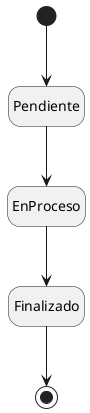

En este ejemplo:

- `[*]` representa el punto inicial del diagrama.
- `Pendiente`, `EnProceso` y `Finalizado` son estados.
- Las flechas representan las transiciones entre ellos.
- El segundo `[*]` representa la finalización del ciclo de vida.

Podemos añadir una descripción a un estado utilizando `:`:

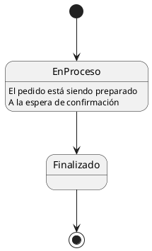

Con `hide empty description` conseguimos representar los estados como cajas simples, evitando mostrar un compartimento de descripción vacío.

### Transiciones, eventos y acciones

Una **transición** representa el paso de un estado a otro. Normalmente se produce como respuesta a un evento.

Podemos añadir información a una transición utilizando una etiqueta después de `:`.

Una etiqueta puede incluir:

- Un evento que provoca la transición.
- Una condición que debe cumplirse, escrita entre corchetes.
- Una acción que se ejecuta durante la transición, separada mediante `/`.

**Ejemplo:**

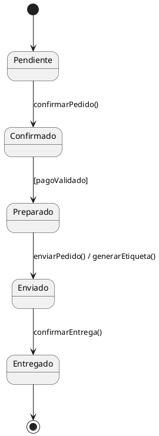

En este ejemplo, el pedido cambia de estado cuando se producen determinados eventos y se cumplen las condiciones necesarias.

### Estados compuestos

Un **estado compuesto** es un estado que contiene otros estados en su interior. Se utiliza para representar comportamientos más complejos y organizar el diagrama de manera jerárquica.

Para crear un estado compuesto se utiliza la palabra reservada `state`, seguida del nombre del estado y un bloque delimitado por llaves `{}`.

**Ejemplo:**

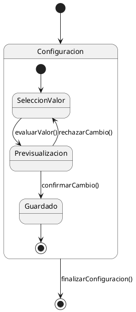

En este ejemplo:

- `Configuracion` es un estado compuesto.
- `SeleccionValor`, `Previsualizacion` y `Guardado` son sus estados internos.
- El punto inicial interno indica dónde comienza el comportamiento dentro del estado compuesto.
- El punto final interno indica cuándo termina ese comportamiento.

### Estados con descripciones largas

También podemos utilizar nombres y descripciones más extensas para los estados.

Para ello, podemos utilizar `state` junto con una etiqueta entre comillas y asignarle un alias mediante `as`.

**Ejemplo:**

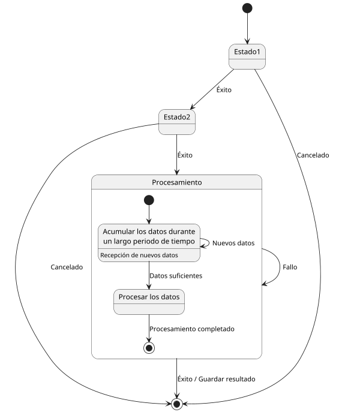

En este ejemplo, el estado `Procesamiento` contiene dos estados internos:

- `AcumularDatos`: recibe información durante un periodo de tiempo.
- `ProcesarDatos`: ejecuta el procesamiento cuando se dispone de suficientes datos.

El estado compuesto permite agrupar ambos comportamientos bajo un mismo contexto.

### Bifurcaciones y uniones

Cuando queremos dividir el flujo en varios caminos que se ejecutan en paralelo, podemos utilizar los pseud estados `<<fork>>` y `<<join>>`.

- `<<fork>>`: divide una transición en varios caminos concurrentes.
- `<<join>>`: sincroniza varios caminos concurrentes antes de continuar con una única transición.

**Ejemplo:**

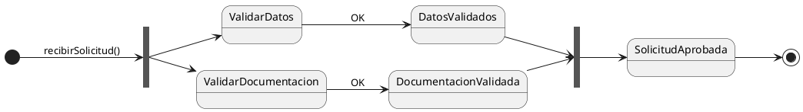

En este ejemplo:

1. Se recibe una solicitud.
2. El proceso se divide en dos tareas que se ejecutan en paralelo.
3. Se validan los datos y la documentación.
4. Ambas tareas deben finalizar antes de continuar.
5. La solicitud queda aprobada cuando se completan las dos validaciones.

### Condicionales

Un **condicional** permite dirigir el flujo hacia diferentes estados dependiendo de si se cumplen determinadas condiciones.

En PlantUML se utiliza el estereotipo `<<choice>>` para representar un punto de decisión.

Las condiciones se escriben entre corchetes `[]` en las transiciones que salen del punto de decisión.

**Ejemplo:**

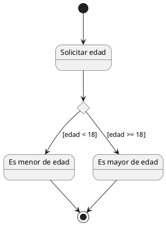

En este ejemplo:

1. Se solicita la edad del usuario.
2. El flujo llega al punto de decisión.
3. Si la edad es inferior a 18 años, se pasa al estado `Menor`.
4. Si la edad es igual o superior a 18 años, se pasa al estado `Mayor`.

Las condiciones entre corchetes permiten representar las reglas que determinan qué transición se ejecutará.

Para saber más sobre los diagramas de estado, puedes consultar la [documentación oficial de PlantUML](https://plantuml.com/state-diagram).

---

## Recursos

- [Editor PlantUML Online](https://editor.plantuml.com): permite escribir código PlantUML y visualizar los diagramas generados.
- [Documentación oficial de PlantUML - Casos de uso](https://plantuml.com/es/use-case-diagram): sintaxis, actores, relaciones y ejemplos de diagramas de casos de uso.
- [Documentación oficial de PlantUML - Diagramas de estado](https://plantuml.com/state-diagram): sintaxis, estados simples y compuestos, transiciones, bifurcaciones y condicionales.

## Bibliografía

1. [PlantUML - Diagrama de casos de uso](https://plantuml.com/es/use-case-diagram)
2. [PlantUML - Diagramas de estado](https://plantuml.com/state-diagram)
3. [PlantUML - Guía de referencia del lenguaje](https://pdf.plantuml.net/PlantUML_Language_Reference_Guide_es.pdf)
4. [OMG - Unified Modeling Language (UML)](https://www.omg.org/spec/UML/)
