# PlantUML – Code-Based Modeling (Part 1)

## 1. Introduction to UML and PlantUML

### 1.1. What is UML?

UML (Unified Modeling Language) is a standard visual modeling language used to represent, design, and document software systems.

It helps developers understand how a system is structured, how its components interact, and how it behaves without having to examine the source code.

UML diagrams are generally divided into two main categories:

- **Structural diagrams:** describe the static structure of a system, including its components, classes, objects, and relationships.
- **Behavioral diagrams:** describe how a system behaves over time, including interactions, processes, and workflows.

### 1.2. What is PlantUML?

PlantUML is an open-source tool that allows users to create diagrams using a simple text-based language.

Instead of drawing every element manually, users write instructions describing the diagram, and PlantUML generates the visual representation.

Its main advantages include:

- **Text-based modeling:** diagrams are created by writing code.
- **Version control:** diagram source files can be managed using Git.
- **Easy maintenance:** diagrams can be updated by modifying their source text.
- **Integration:** it can be used with Visual Studio Code and other development tools.
- **Multiple diagram types:** it supports UML diagrams as well as MindMaps, JSON visualizations, Gantt charts, and wireframes.

### 1.3. When should we use PlantUML?

PlantUML is particularly useful for:

- Documenting software architecture.
- Planning application features and workflows.
- Representing data structures.
- Organizing development tasks and project timelines.
- Creating interface prototypes and wireframes.
- Maintaining technical documentation alongside source code.

For example, when developing a video game, PlantUML can help document its progression system, player data, development schedule, or interface structure.

---

## 2. Setting Up PlantUML

There are two recommended ways to start working with PlantUML.

### 2.1. Online editor

The easiest way to get started is to use the online PlantUML editor.

1. Open the official PlantUML website: https://www.plantuml.com/
2. Access the online editor or rendering service.
3. Write your diagram code.
4. Check the generated diagram.
5. Modify the source code to update the visualization.

This option is recommended for beginners because it does not require installing additional software.

### 2.2. Visual Studio Code

For a more integrated development environment, PlantUML can be used through Visual Studio Code.

**Installation steps:**

1. Install Visual Studio Code.
2. Open the Extensions panel.
3. Search for the **PlantUML** extension.
4. Install the extension.
5. Create a file with the `.puml` extension.
6. Write your diagram code.
7. Open the preview using the extension's commands.

Depending on the selected rendering configuration, PlantUML may require Java and Graphviz.

### 2.3. Recommended project structure

For a project containing several diagrams, it is good practice to organize the files into folders.

```text
my-project/
├── docs/
│   └── diagrams/
│       ├── mindmap.puml
│       ├── data-structure.puml
│       ├── project-timeline.puml
│       └── wireframe.puml
└── README.md
```

This structure makes diagrams easier to maintain and allows them to be included in a project's technical documentation.

---

## 3. Basic PlantUML Syntax

Most PlantUML diagrams follow a simple structure:

```plantuml
@startuml

' Diagram content goes here

@enduml
```

The main elements are:

- `@startuml`: indicates the beginning of a diagram.
- `@enduml`: indicates the end of a diagram.
- `'`: introduces a comment that is not rendered in the diagram.

Some diagram types use specific delimiters, such as `@startjson`, `@startmindmap`, or `@startgantt`.

**Example:**

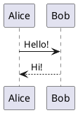

This example creates a simple interaction between two participants.

The important idea is that PlantUML translates text instructions into visual diagrams.

---

## 4. MindMaps

### 4.1. What is a MindMap?

A MindMap is a visual representation of information organized around a central concept.

It is useful for:

- Brainstorming ideas.
- Organizing project requirements.
- Breaking down complex systems.
- Planning application features.
- Representing the structure of a video game.

In PlantUML, MindMaps are created using `@startmindmap` and `@endmindmap`.

### 4.2. Basic syntax

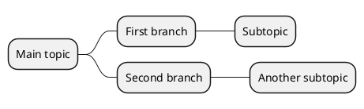

The number of asterisks determines the hierarchy:

- `*` represents the central topic.
- `**` represents a main branch.
- `***` represents a secondary branch.
- Additional asterisks create deeper levels.

### 4.3. Controlling the diagram layout

PlantUML supports different ways of organizing MindMaps.

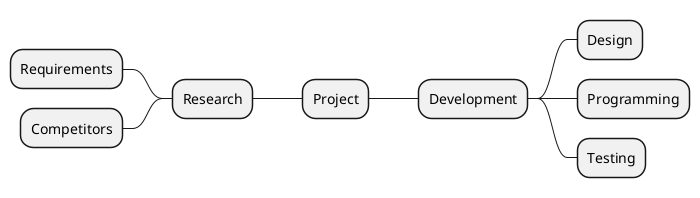

This allows information to be distributed across both sides of the central concept.

### 4.4. Example: Minecraft

Let's represent the main systems of a game inspired by Minecraft.

<text>**Diagram 1. Main systems of a sandbox survival game**</text>

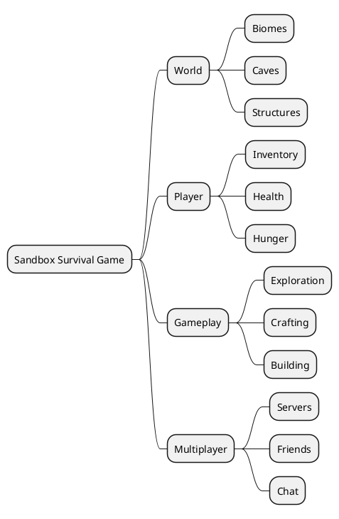

This diagram provides a high-level overview of the game's main systems.

### 4.5. Example: Spotify

A MindMap can also be used to organize the main features of a music streaming application.

<text>**Diagram 2. Main features of a music streaming application**</text>

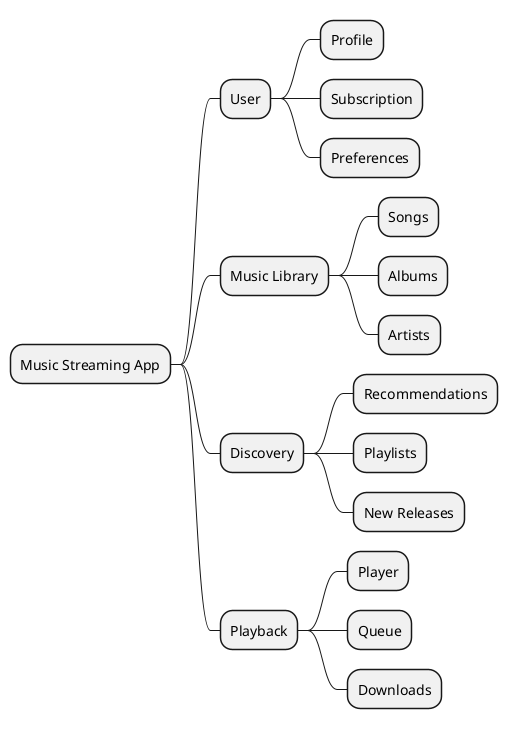

### 4.6. Exercise

Create a MindMap for a mobile game or application of your choice.

Your diagram must include:

- One central concept.
- At least four main branches.
- At least two subtopics for each main branch.
- A logical hierarchy of information.

---

## 5. JSON Visualization

### 5.1. What is JSON?

JSON (JavaScript Object Notation) is a lightweight data format commonly used to exchange information between applications and servers.

It is widely used in:

- REST APIs.
- Web applications.
- Mobile applications.
- Configuration files.
- User profiles and application settings.

JSON organizes information through key-value pairs, objects, and arrays.

PlantUML can visualize JSON structures, making it easier to understand complex data.

### 5.2. Basic JSON structure

A JSON object is defined using curly brackets `{}`.

```json
{
  "name": "Alex",
  "level": 10,
  "active": true
}
```

The main data types are:

| Data type | Description | Example |
|---|---|---|
| String | Text | `"Alex"` |
| Number | Numeric value | `10` |
| Boolean | True or false | `true` |
| Array | List of values | `["A", "B"]` |
| Object | Collection of properties | `{"level": 10}` |
| Null | Empty or unknown value | `null` |

### 5.3. Visualizing JSON with PlantUML

PlantUML uses specific delimiters to render JSON structures.

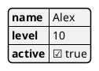

The resulting diagram displays the JSON structure visually, allowing us to inspect its properties and hierarchy.

### 5.4. Example: Music streaming user profile

Consider a user profile in an application similar to Spotify.

<text>**Diagram 3. Music streaming user profile**</text>

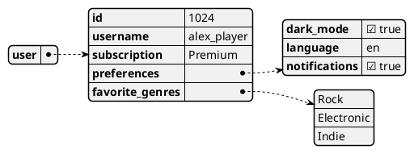

This example shows how a user profile can contain nested objects and arrays.

### 5.5. Example: Video game configuration

JSON is also frequently used to store game settings and player preferences.

<text>**Diagram 4. Video game configuration**</text>

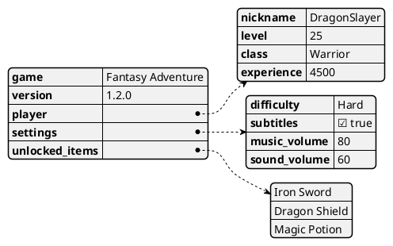

This representation makes it easier to understand how the game's configuration and player information are organized.

### 5.6. Exercise

Create a JSON structure for a video game or application.

Your structure must include:

- At least five properties.
- At least one nested object.
- At least one array.
- At least three different data types.

Then use PlantUML to generate its visual representation.

---

## 6. Gantt Charts

### 6.1. What is a Gantt chart?

A Gantt chart is a project management tool used to represent activities over time.

It allows teams to visualize:

- Project phases.
- Tasks and their duration.
- Start and end dates.
- Dependencies between tasks.
- Milestones.
- Project progress.

Gantt charts are especially useful when planning software development projects because they provide an overview of the work and its schedule.

### 6.2. Basic syntax

PlantUML uses `@startgantt` and `@endgantt` to create Gantt charts.

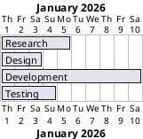

The `lasts` keyword defines the duration of a task.

### 6.3. Task dependencies

Tasks can depend on the completion of other tasks.

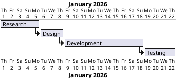

This example represents a sequential workflow in which each phase starts after the previous one has finished.

### 6.4. Milestones and sections

A project can be divided into sections to make its schedule easier to understand.

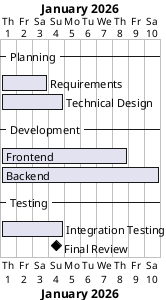

Sections group related tasks, while milestones represent important project events.

### 6.5. Example: Developing a 2D video game

Let's plan the development of a small 2D platform game.

<text>**Diagram 5. Development schedule for a 2D platform game**</text>

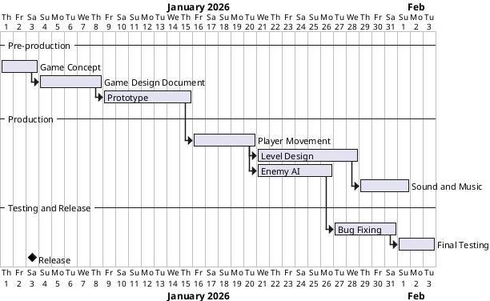

This example illustrates how different development activities can be organized into phases.

Some activities can also overlap, depending on the project's requirements.

### 6.6. Example: Developing a music application

A Gantt chart can also represent the development of a mobile music application.

<text>**Diagram 6. Development schedule for a music application**</text>

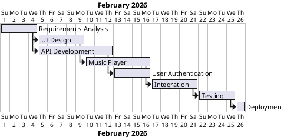

### 6.7. Exercise

Create a Gantt chart for a software development project.

Your chart must include:

- At least three project phases.
- At least six tasks.
- Task durations.
- At least three dependencies.
- At least one milestone.

---

## 7. Wireframes and Mockups with Salt

### 7.1. What are wireframes and mockups?

Wireframes and mockups are visual tools used during the design of user interfaces.

Although they are related, they serve different purposes:

| Concept | Description |
|---|---|
| Wireframe | A basic representation of the structure and layout of an interface. |
| Mockup | A more detailed visual representation that includes colors, typography, and visual elements. |
| Prototype | An interactive representation used to simulate user interactions and navigation. |

PlantUML includes a feature called **Salt**, which allows users to create simple interface layouts directly from text.

Salt is useful for quickly documenting interface ideas without having to use a dedicated design application.

### 7.2. Basic syntax

Salt diagrams use `@startsalt` and `@endsalt`.

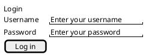

Salt supports several interface elements, including:

- Text fields.
- Buttons.
- Checkboxes.
- Radio buttons.
- Dropdown lists.
- Tables.
- Separators.
- Text labels.

### 7.3. Example: Login screen inspired by Netflix

<text>**Diagram 7. Streaming application login screen**</text>

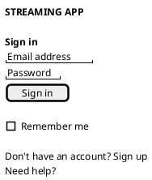

This example represents the basic structure of a streaming application's login screen.

### 7.4. Example: Application dashboard

<text>**Diagram 8. Application dashboard**</text>

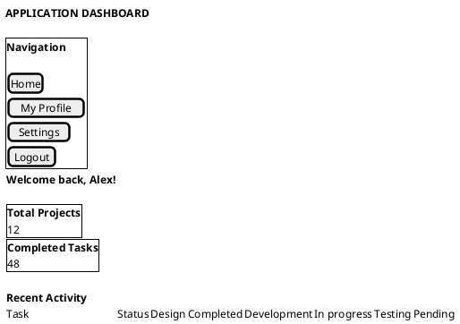

This example shows how a dashboard can be divided into navigation and content areas.

### 7.5. Example: To-Do application

<text>**Diagram 9. Task management interface**</text>

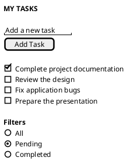

### 7.6. Example: Music player

<text>**Diagram 10. Music streaming player**</text>

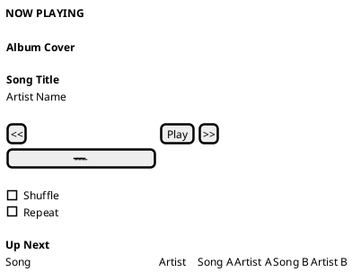

This example represents the main elements of a music player, including playback controls, progress, and the upcoming queue.

### 7.7. Exercise

Design a wireframe for a video game menu or a mobile application.

Your interface must include:

- A title or logo.
- At least three interactive elements.
- A navigation area or menu.
- A main content area.
- A clear and logical layout.

---

## 8. Integrative Exercise: Video Game Companion App

In this exercise, you will combine the different PlantUML features covered in this lesson to document a single project.

### 8.1. Project description

Imagine that you are developing a companion application for a multiplayer video game.

The application allows players to:

- View their player profile.
- Check their level and experience points.
- Review unlocked achievements.
- Browse available missions.
- Configure their preferences.

You must create four diagrams to document the project.

### 8.2. MindMap: Application structure

Represent the main features and sections of the application.

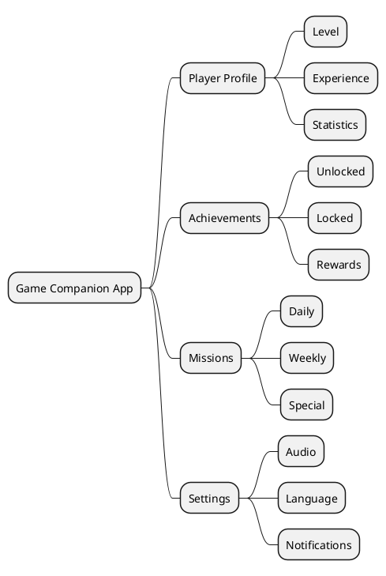

### 8.3. JSON: Player data

Define the data structure used to represent a player.

```plantuml
@startjson

{
  "player": {
    "id": 1001,
    "nickname": "ShadowKnight",
    "level": 25,
    "experience": 4500,
    "achievements": [
      "First Victory",
      "Explorer",
      "Master Builder"
    ],
    "settings": {
      "language": "en",
      "notifications": true
    }
  }
}

@endjson
```

### 8.4. Gantt: Development schedule

Create a development schedule for the application.

```plantuml
@startgantt

Project starts 2026-03-01

-- Planning --
[Requirements] lasts 4 days
[Interface Design] lasts 5 days

-- Development --
[Backend Development] lasts 8 days
[Frontend Development] lasts 10 days
[Player Profile] lasts 4 days
[Achievements] lasts 4 days

-- Testing --
[Integration Testing] lasts 5 days
[Final Release] happens at [Integration Testing]'s end

[Interface Design] starts at [Requirements]'s end
[Backend Development] starts at [Requirements]'s end
[Frontend Development] starts at [Interface Design]'s end
[Player Profile] starts at [Frontend Development]'s end
[Achievements] starts at [Player Profile]'s end
[Integration Testing] starts at [Achievements]'s end

@endgantt
```

### 8.5. Salt: Application interface

Create a basic player profile screen.

```plantuml
@startsalt

{
  <b>GAME COMPANION APP</b>
  .
  <b>Player Profile</b>
  .
  Nickname | ShadowKnight
  Level | 25
  Experience | 4500 XP
  .
  <b>Achievements</b>
  [ First Victory ]
  [ Explorer ]
  [ Master Builder ]
  .
  <b>Navigation</b>
  [Profile] | [Missions] | [Settings]
}

@endsalt
```

### 8.6. Deliverables

Submit the following files:

1. `mindmap.puml`
2. `player-data.puml`
3. `development-plan.puml`
4. `player-profile.puml`

Each file must contain valid PlantUML code and generate the expected diagram.

---

## 9. Good Practices When Working with PlantUML

To keep diagrams clear and maintainable, follow these recommendations:

- Use descriptive names for elements and sections.
- Avoid including too much information in a single diagram.
- Organize complex diagrams into logical groups.
- Use comments when additional explanations are necessary.
- Keep source files organized within the project structure.
- Use version control to track changes.
- Update diagrams whenever the documented system changes.
- Use consistent naming conventions across the project.

Remember that diagrams should make information easier to understand. A diagram that is too complex can be just as difficult to interpret as poorly organized source code.

---

## 10. Quick Syntax Reference

| Diagram type | Opening tag | Closing tag |
|---|---|---|
| UML | `@startuml` | `@enduml` |
| MindMap | `@startmindmap` | `@endmindmap` |
| JSON | `@startjson` | `@endjson` |
| Gantt | `@startgantt` | `@endgantt` |
| Salt | `@startsalt` | `@endsalt` |

---

## 11. Official Resources and Documentation

The following resources provide additional information and practical examples:

- **PlantUML official website:** https://plantuml.com/
- **PlantUML Language Reference Guide:** https://plantuml.com/guide
- **MindMap diagrams:** https://plantuml.com/mindmap-diagram
- **JSON diagrams:** https://plantuml.com/json
- **Gantt diagrams:** https://plantuml.com/gantt-diagram
- **Salt diagrams:** https://plantuml.com/salt
