# PlantUML – Beyond UML: Advanced Modeling (Part 2)

## 1. Introduction

In the first part of this course, we explored how PlantUML can be used to create MindMaps, visualize JSON structures, plan projects using Gantt charts, and design basic wireframes with Salt.

In this second part, we will explore more advanced features and apply them to larger, more realistic scenarios.

The goal is to move beyond simple diagrams and learn how to create detailed visual documentation for complex software projects.

Throughout this lesson, we will use examples inspired by well-known video games and applications, such as Minecraft, Spotify, Netflix, and online gaming platforms.

### Learning objectives

By the end of this lesson, students should be able to:

- Customize MindMaps using colors, styles, icons, and symbols.
- Represent complex software architectures and organizational structures.
- Create Gantt charts for enterprise projects involving multiple teams and dependencies.
- Visualize complex JSON structures containing entities, relationships, and operations.
- Design advanced wireframes using Salt, including multi-column layouts and complex interface components.
- Apply these techniques to document a complete software project.

---

## 2. Advanced MindMaps

MindMaps are useful for organizing information, but their potential goes much further than creating simple hierarchical structures.

With PlantUML, we can customize their appearance, highlight important elements, organize information across both sides of the diagram, and represent complex systems.

### 2.1. Advanced styling and customization

A well-designed MindMap should make information easier to understand.

When working with large diagrams, colors, styles, and symbols can help distinguish different categories and levels of importance.

The following techniques are particularly useful:

- **Custom colors:** assign colors to different branches or categories.
- **Individual node colors:** highlight specific elements without changing the entire diagram.
- **Icons and symbols:** use visual references to identify different types of information.
- **Consistent styling:** apply a common visual language across the diagram.

#### Custom colors and styles

PlantUML allows us to customize MindMaps through colors and styling rules.

For example, a software architecture diagram can use different colors to distinguish the frontend, backend, database, and infrastructure layers.

**Example: Software development architecture**

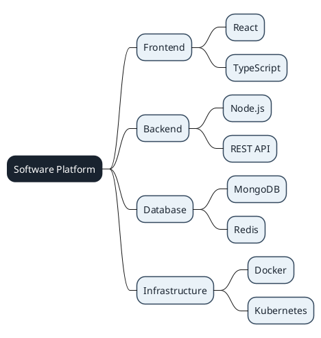

The example applies a consistent visual style to the diagram, making the main concept stand out from its branches.

**Reference example:** [Custom colors and styles](../../documentos/modelosUML/mindmap/mm-estilos.puml "Open custom colors and styles example")

#### Individual node colors

Sometimes, we need to highlight specific elements without applying the same style to every node.

This is particularly useful when representing priorities, risks, development stages, or different types of components.

**Example: Video game development priorities**

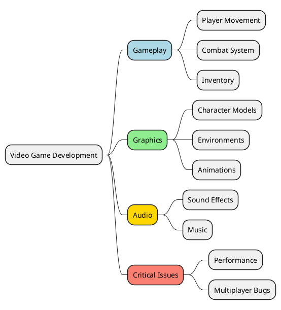

The colors help distinguish the different development areas and make critical issues easier to identify.

**Reference example:** [Individual node colors](../../documentos/modelosUML/mindmap/mm-colores-nodo.puml "Open individual node colors example")

#### Icons and special symbols

Icons and symbols provide additional visual information.

They are especially useful when creating diagrams for teams that need to identify different types of resources or components quickly.

For example:

- 🎮 Video game features.
- 👤 Users and player profiles.
- 🗄️ Databases.
- 🔒 Security components.
- ☁️ Cloud infrastructure.
- ⚙️ Configuration and processes.
- 🚀 Releases and milestones.

**Example: Online gaming platform**

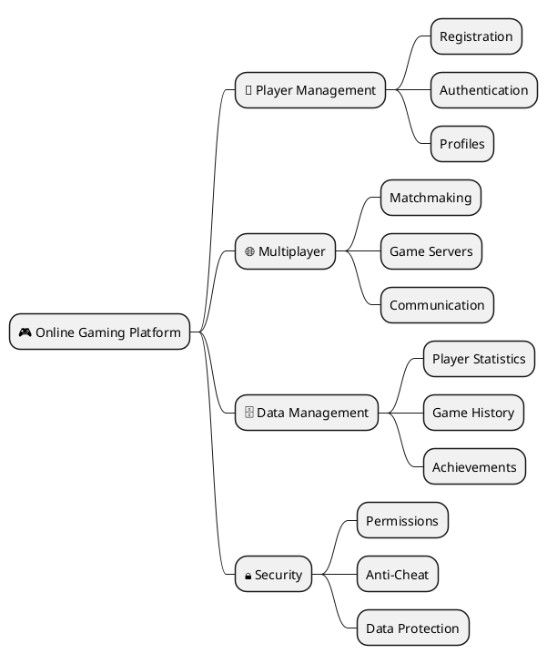

**Reference example:** [Icons and special symbols](../../documentos/modelosUML/mindmap/mm-iconos.puml "Open icons and special symbols example")

A list of Unicode symbols and icons is available in the bibliography at the end of this document.

### 2.2. Complex organizational MindMaps

Advanced MindMaps are particularly useful for representing systems with multiple layers, departments, or interconnected components.

Let's look at two practical examples.

#### Example 1: Complete software architecture

Imagine that we are documenting a platform similar to Spotify.

The system includes a frontend, backend services, databases, external integrations, and infrastructure.

**Diagram 1. Music streaming platform architecture**

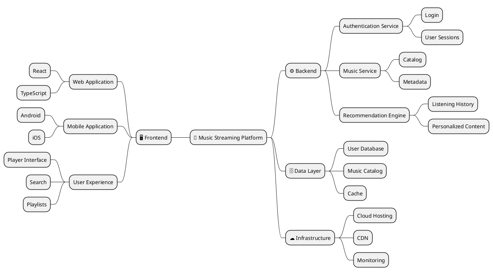

This diagram provides a high-level view of the architecture and helps identify the main responsibilities of each system component.

It is a conceptual representation, not a reproduction of Spotify's actual internal architecture.

**Reference example:** [Complete software architecture](../../documentos/modelosUML/mindmap/mm-arquitectura.puml "Open software architecture example")

#### Example 2: Technical roadmap

A technical roadmap represents the evolution of a project over time.

It helps teams identify planned improvements, technical priorities, and future development stages.

**Diagram 2. Technical roadmap for a multiplayer video game**

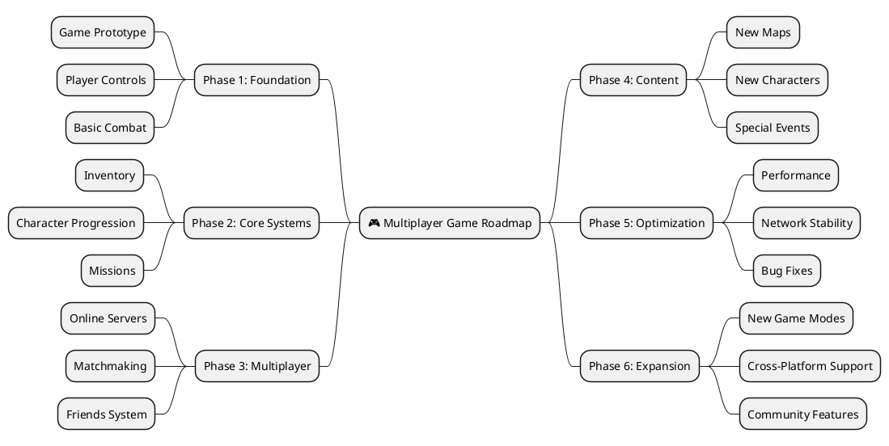

This roadmap organizes the development process into logical phases, from the initial prototype to future expansions.

**Reference example:** [Technical roadmap](../../documentos/modelosUML/mindmap/mm-roadmap-tecnico.puml "Open technical roadmap example")

### 2.3. Practical Exercise 1 – Advanced MindMap

<badge color="info">Individual assignment</badge>

Create an advanced MindMap for one of the following scenarios:

1. **Software architecture:** document the architecture of your most complex project, including at least four levels or layers.
2. **Certification study plan:** organize a study plan for a professional certification, including topics, a timeline, and learning resources.
3. **Company or startup strategy:** represent the structure and strategy of a company, including its different departments and responsibilities.

**Requirements:**

- [ ] Use custom styles.
- [ ] Include at least five different colors.
- [ ] Include a minimum of four levels of depth.
- [ ] Include emojis or special symbols.
- [ ] Distribute information across both sides of the MindMap.
- [ ] Use a logical and consistent hierarchy.
- [ ] Include enough detail to make the diagram useful as technical or organizational documentation.

---

## 3. Enterprise Gantt Charts

Gantt charts are useful for planning individual projects, but they become even more valuable when applied to larger organizations and development teams.

In this section, we will explore how to represent multiple projects, Agile sprints, and infrastructure initiatives.

### 3.1. Advanced project planning

When managing complex projects, a Gantt chart should provide more information than just task names and durations.

A more complete project plan may include:

- Multiple project phases.
- Different teams and responsibilities.
- Task dependencies.
- Important milestones.
- Resource allocation.
- Progress percentages.
- Parallel activities.
- Delivery dates.

These elements help project managers understand the overall development process and identify potential bottlenecks.

### 3.2. Multi-project planning and resource allocation

In an enterprise environment, several projects may run simultaneously and share resources.

For example, a company developing several applications may have a single infrastructure team supporting all of them.

**Diagram 3. Enterprise multi-project development plan**

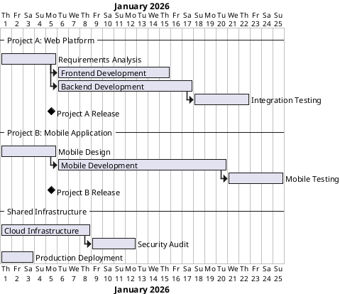

This example shows how two projects can be planned alongside shared infrastructure activities.

In a real project, the schedule should also identify resource conflicts and team availability.

**Reference example:** [Multi-project Gantt chart](../../documentos/modelosUML/gantt/gt-multiproyecto.puml "Open multi-project Gantt chart example")

### 3.3. Agile development and sprint planning

Agile development divides work into short iterations called sprints.

Each sprint includes a set of tasks that the team aims to complete within a defined period.

A Gantt chart can provide a visual overview of sprint planning, deliverables, and release milestones.

**Diagram 4. Agile development roadmap for a video game**

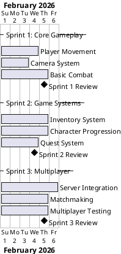

This example illustrates how a video game development team can organize work into successive sprints.

**Reference example:** [Agile sprint Gantt chart](../../documentos/modelosUML/gantt/gt-sprints.puml "Open sprint Gantt chart example")

### 3.4. Infrastructure and DevOps planning

Infrastructure projects require careful coordination between development, operations, and security teams.

A DevOps Gantt chart can represent activities such as:

- Infrastructure provisioning.
- Containerization.
- CI/CD configuration.
- Monitoring and logging.
- Security audits.
- Production deployment.

**Diagram 5. DevOps infrastructure migration**

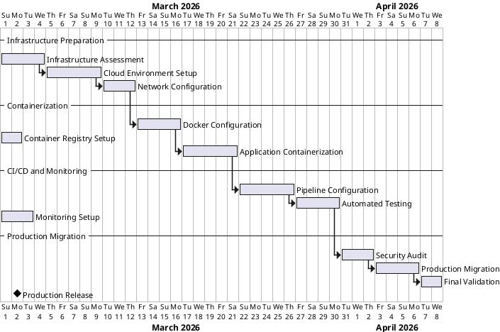

This diagram provides a simplified overview of an infrastructure migration project.

**Reference example:** [DevOps Gantt chart](../../documentos/modelosUML/gantt/gt-devops.puml "Open DevOps Gantt chart example")

### 3.5. Practical Exercise 2 – Enterprise Gantt Chart

<badge color="info">Individual assignment</badge>

Create an enterprise Gantt chart for one of the following scenarios:

1. **Product launch:** plan a product launch involving marketing, development, design, and legal teams.
2. **Digital transformation:** plan the digital transformation of a department or company.
3. **Research project:** organize a research project involving different phases, deliverables, publications, and dissemination activities.

**Requirements:**

- [ ] Include at least four phases or sections.
- [ ] Include at least 15 tasks.
- [ ] Include at least three important milestones.
- [ ] Use colors to distinguish task categories or teams.
- [ ] Include task dependencies.
- [ ] Add notes describing the required resources or teams.
- [ ] Include task completion percentages.
- [ ] Make the schedule consistent and realistic.

---

## 4. Advanced JSON Visualization

JSON is widely used to exchange data between applications and services.

In the first part, we explored basic JSON structures and how to visualize them using PlantUML.

Now we will work with more complex structures that represent complete application models, including entities, relationships, operations, and system metadata.

### 4.1. Modeling complex application data

A real application usually contains several related entities.

For example, an online store may include:

- Customers.
- Products.
- Orders.
- Payments.
- Shipping information.

These entities contain attributes and may reference other entities.

A well-structured JSON document should represent these relationships clearly.

### 4.2. Example: E-commerce platform

**Diagram 6. Online store data structure**

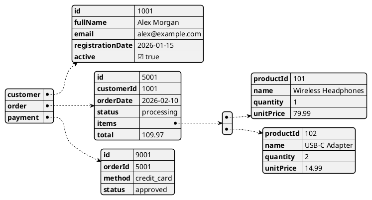

This example represents several related entities within an online store.

Notice how the customer, order, products, and payment information are organized into separate objects.

### 4.3. Example: API response with metadata

Modern applications frequently use APIs to exchange information.

An API response may contain not only the requested data but also metadata describing the response, pagination, status, and available operations.

**Diagram 7. API response for a video game platform**

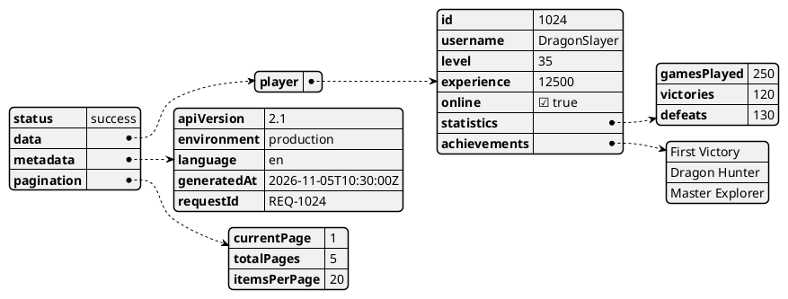

This example demonstrates how an API response can separate business data from technical metadata.

It also includes nested objects, arrays, numeric values, strings, and booleans.

**Reference example:** [API response with complete metadata](../../documentos/modelosUML/json-visualizer/jv-api-response-metadata.puml "Open advanced JSON API example")

### 4.4. Representing operations and methods in JSON

JSON is a data format, not a programming language.

It does not define executable methods or classes in the same way as an object-oriented programming language.

However, we can document the operations supported by a system by including an `actions` or `methods` object.

For example, an educational platform might define operations such as:

- `createUser`
- `enrollStudent`
- `submitAssignment`
- `calculateGrade`

Each operation can describe the entity it affects and the parameters it requires.

This is useful when documenting an API or designing a system before implementation.

### 4.5. Practical Exercise 3 – Design Your Own Data Model

<badge color="info">Individual assignment</badge>

Create a JSON structure for an object-oriented system.

You can choose one of the following scenarios or propose your own:

- Social network.
- Video game.
- Educational platform.
- Banking system.
- Online store.
- Library management system.

Your JSON structure must model the main entities, their relationships, and the operations supported by the system.

**Requirements:**

- [ ] Include at least four main classes or objects.
- [ ] Each object must have basic attributes such as `id`, `name`, `date`, and `status`, where appropriate.
- [ ] At least one object must contain other objects.
- [ ] Use colors in the PlantUML visualization.
- [ ] Include different data types: strings, numbers, booleans, arrays, and objects.
- [ ] Use ISO date formats (`YYYY-MM-DD` or `YYYY-MM-DDTHH:mm:ssZ`).
- [ ] Add an `actions` or `methods` object describing the operations supported by the system.
- [ ] Each action must specify which entity or class it affects and which parameters it requires.
- [ ] Add a `metadata` or `config` field containing system information, such as version, language, environment, and author.
- [ ] Use clear and consistent naming conventions, following either camelCase or PascalCase.
- [ ] Generate the corresponding diagram using PlantUML.

---

## 5. Advanced Wireframes with Salt

Salt allows us to create interface layouts using text-based descriptions.

In the first part, we created simple wireframes for login screens, dashboards, and media players.

In this section, we will work with more complex layouts and reusable interface components.

### 5.1. Advanced grid systems

A grid system divides an interface into logical areas.

It is useful for designing dashboards, administration panels, and applications with multiple sections.

A typical administration interface may contain:

- A navigation sidebar.
- A main content area.
- A secondary information panel.
- Data tables and filters.
- Action buttons.

**Diagram 8. Administration dashboard**

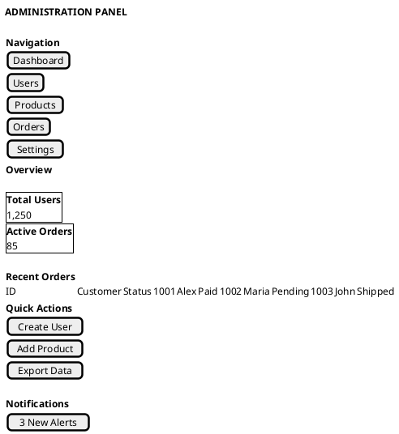

This example represents a three-column layout with navigation, main content, and quick actions.

**Reference example:** [Advanced grid system](../../documentos/modelosUML/mockups/wf-grid-adv.puml "Open advanced grid example")

### 5.2. Complex multi-step forms

Multi-step forms divide long forms into smaller sections.

They are useful when collecting large amounts of information, such as:

- User registration.
- Online purchases.
- Course enrollment.
- Account configuration.
- Project creation.

A typical multi-step form includes:

1. Personal information.
2. Additional details.
3. Preferences or configuration.
4. Review and confirmation.

**Diagram 9. Multi-step registration form**

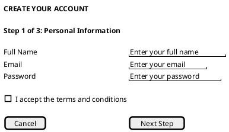

This example represents the first step of a registration process.

A complete design should also document the remaining steps and the information required at each stage.

**Reference example:** [Multi-step form](../../documentos/modelosUML/mockups/wf-form-multistep.puml "Open multi-step form example")

### 5.3. Advanced UI components and design systems

A design system defines reusable visual and functional components.

It helps development teams maintain consistency across different screens and applications.

Common components include:

- Buttons.
- Input fields.
- Navigation menus.
- Cards.
- Tables.
- Dialogs.
- Alerts.
- Tabs.
- Dropdown menus.

**Diagram 10. Reusable component library**

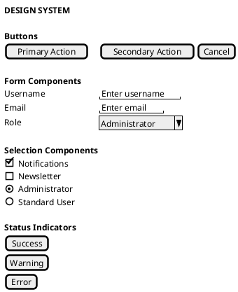

This example illustrates how different interface components can be documented within a single design system.

**Reference example:** [Component library](../../documentos/modelosUML/mockups/wf-component-library.puml "Open component library example")

### 5.4. Example: Messaging and chat application

Messaging applications combine several interface components into a single screen.

A typical chat interface includes:

- A list of conversations.
- Contact information.
- Message history.
- A message input field.
- Attachment and sending controls.

**Diagram 11. Messaging application interface**

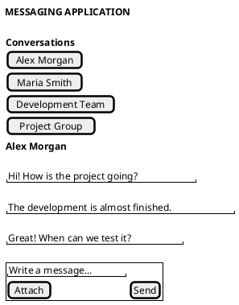

This example shows a simplified messaging interface with a conversation list and an active chat.

**Reference example:** [Messaging application](../../documentos/modelosUML/mockups/wf-chat-app.puml "Open messaging application example")

### 5.5. Practical Exercise 4 – Advanced Wireframe Design

<badge color="info">Individual assignment</badge>

Design a complex wireframe for one of the following scenarios:

1. **Administration dashboard:** create a management interface with data tables, filters, and bulk actions.
2. **Streaming application:** design an interface containing a media player, playlists, and playback controls.
3. **E-learning platform:** create an interface with video content, learning progress, and educational resources.

**Requirements:**

- [ ] Include a three-column layout.
- [ ] Include at least one data table.
- [ ] Include a navigation section.
- [ ] Include at least 10 interactive elements.
- [ ] Use symbols or emojis where appropriate.
- [ ] Organize the interface into clearly defined sections.
- [ ] Ensure that the layout is easy to understand and navigate.

---

## 6. Integrative Exercise – Document a Complete Application

The final exercise combines the techniques covered in both parts of this course.

### 6.1. Project description

Imagine that you are part of a development team creating a video game companion application.

The application allows players to:

- Manage their player profiles.
- Check their experience points and levels.
- Review achievements.
- Browse missions and challenges.
- Configure their preferences.
- Receive notifications about game events.

Your task is to create a set of diagrams documenting the application's structure, data, development schedule, and interface.

### 6.2. Required deliverables

**1. Advanced MindMap**

Represent the application's architecture and main features.

Include at least four levels of depth, custom styles, and different colors.

**2. Advanced JSON visualization**

Define the application's data model.

Include players, achievements, missions, and settings, as well as an `actions` object and system metadata.

**3. Enterprise Gantt chart**

Plan the application's development.

Include at least four phases, 15 tasks, dependencies, milestones, and progress percentages.

**4. Advanced Salt wireframe**

Design the player dashboard.

Include navigation, player information, achievements, missions, and interactive controls.

### 6.3. Submission structure

Organize your files as follows:

```text
game-companion-app/
└── diagrams/
    ├── architecture.puml
    ├── data-model.puml
    ├── development-plan.puml
    └── player-dashboard.puml
```

All diagrams must contain valid PlantUML code and generate the expected visual representations.

---

## 7. Good Practices for Advanced PlantUML Diagrams

When creating complex diagrams, keep the following recommendations in mind:

- **Prioritize readability:** avoid including too much information in a single diagram.
- **Use consistent colors:** assign colors to categories and maintain their meaning throughout the project.
- **Organize information logically:** group related elements and use clear hierarchies.
- **Use descriptive names:** avoid ambiguous labels and abbreviations.
- **Add context when necessary:** use comments or notes to explain important decisions.
- **Keep diagrams updated:** documentation should reflect the current state of the project.
- **Separate responsibilities:** create different diagrams when a single diagram becomes too complex.
- **Use version control:** store `.puml` files alongside the project's source code.

Remember that advanced diagrams should improve communication, not simply add visual complexity.

---

## 8. Quick Reference

| Feature | Main purpose |
|---|---|
| MindMap styling | Customize the appearance of hierarchical diagrams. |
| Node colors | Highlight specific categories or elements. |
| Icons and symbols | Add visual references and improve readability. |
| Organizational MindMaps | Represent complex structures and architectures. |
| Multi-project Gantt | Plan multiple projects and shared resources. |
| Agile Gantt | Organize development into sprints. |
| DevOps Gantt | Plan infrastructure and deployment activities. |
| Advanced JSON | Visualize complex data structures and API responses. |
| Salt grids | Design multi-column interfaces. |
| Multi-step forms | Represent complex user input processes. |
| Component libraries | Document reusable interface elements. |

---

## 9. Bibliography and Additional Resources

The following resources provide additional information and examples:

1. [PlantUML – Creole and Unicode Icons](https://plantuml.com/es/creole) – documentation on text formatting, symbols, and icons.
2. [Compart – Unicode Character Search](https://www.compart.com/en/unicode) – searchable database of Unicode characters and symbols.
3. [PlantUML – MindMap Diagrams](https://plantuml.com/mindmap-diagram) – official MindMap documentation.
4. [PlantUML – Gantt Diagrams](https://plantuml.com/gantt-diagram) – official Gantt chart documentation.
5. [PlantUML – JSON Diagrams](https://plantuml.com/json) – official JSON visualization documentation.
6. [PlantUML – Salt Diagrams](https://plantuml.com/salt) – official wireframe and interface documentation.

By combining these techniques, developers can create a consistent set of technical documents that support the entire software development lifecycle.

The most important takeaway is that PlantUML is not just a tool for drawing diagrams: it allows us to maintain technical documentation as text, making it easier to update, share, and manage alongside the source code.
